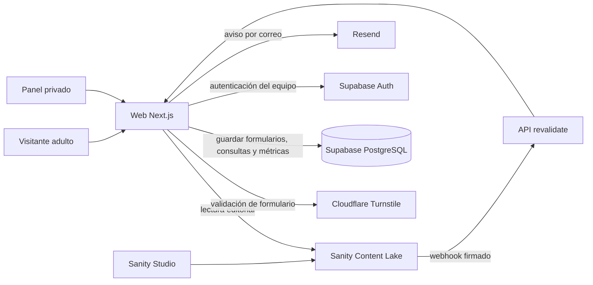

# Referencia funcional y técnica del backend

**Proyecto:** Las Aventuras de Curileta
**Actualizado:** 12 de octubre de 2026
**Alcance:** arquitectura, funciones, almacenamiento, seguridad, configuración y operación del backend que existe en el repositorio.

> Esta es la referencia viva del backend. Distingue el código local, el estado remoto comprobado y lo que aún falta publicar. No se guardan valores de secretos en este documento. La versión de Production solo se considera actualizada cuando se comprueba su despliegue, aunque el código ya esté en `main`.

> **Estado DNS más reciente:** las menciones históricas a `NXDOMAIN` en las comprobaciones iniciales de `.es` describen el estado anterior a la propagación. La verificación posterior del 11 de octubre, registrada en la sección 37, confirma delegación DNS y redirección HTTPS operativas.

## 1. Resumen ejecutivo

La plataforma tiene dos aplicaciones principales: la web pública en Next.js y el CMS editorial Sanity Studio. Supabase proporciona autenticación para el equipo, la base de datos de formularios y consultas, el seguimiento de leads y los contadores estadísticos agregados. Sanity proporciona contenido editorial. Resend envía avisos de los formularios y Cloudflare Turnstile ayuda a filtrar automatizaciones.

El backend ya está implementado en el código para:

- iniciar sesión en el panel mediante Supabase Auth y perfiles con roles;
- obtener y editar formularios de contacto desde Supabase;
- validar, guardar y administrar mensajes enviados por visitantes;
- enviar notificaciones por correo y dejar el envío guardado si falla el correo;
- convertir manualmente mensajes en oportunidades y registrar su fase y notas;
- eliminar consultas cerradas sin seguimiento de lead a los 30 días;
- revisar leads tras 12 meses sin actividad, avisar al equipo sin incluir datos personales y eliminarlos 30 días después del aviso si no se reanuda el seguimiento;
- agregar estadísticas por fecha, ruta, idioma y evento, sin crear perfiles de visitantes;
- compartir o recomendar libros, personajes, canciones, vídeos, eventos, lugares y fondos por el menú del dispositivo, WhatsApp, Telegram, Facebook, LinkedIn, X, correo, SMS o copiando el enlace;
- contar inicios de acciones de compartir por canal y contenido, y votos agregados en vídeos;
- leer contenido editorial de Sanity, invalidar su caché con un webhook firmado y exponer datos mediante rutas de contenido.

El código incorpora módulos administrativos para favoritos de personajes, selección manual de personajes del próximo episodio, identidad del canal, catálogo de libros y encuadres. Los favoritos se recuerdan por navegador y se sincronizan con el servidor; los votos de vídeo usan un marcador local y Turnstile. El editor de encuadres cubre cuatro ubicaciones. Las migraciones 7–9 se aplicaron manualmente en Production el 10 de octubre de 2026; la migración 10 se aplicó manualmente el 11 de octubre y se verificaron tabla, RLS y permisos. El commit `4fa3618` está publicado como despliegue Ready de Vercel Production y la URL del despliegue sirve el nuevo podio y la sección de próximo episodio. La migración 14, que añade el desempate por antigüedad de puntuación, se aplicó manualmente en Supabase Production desde SQL Editor el 11 de octubre de 2026. Se comprobó que la función existe, que `anon` y `authenticated` no pueden ejecutarla y que `service_role` sí. En aquella verificación, el código posterior a `4fa3618` seguía local. Después, Vercel marcó `6484687` como `Ready` en Production y las rutas `/es/galeria` y `/es/autora` respondieron HTTP 200 en el alias `curileta-pink.vercel.app`. El 11 de octubre se conectaron los dominios `.com` a Vercel: `www.curileta.com` tiene configuración válida y responde HTTPS 200; el apex redirige por HTTPS con 308 y termina en `www.curileta.com/es` con 200. En la primera comprobación tras cambiar la delegación de `.es`, `curileta.es` y `www.curileta.es` devolvían `NXDOMAIN`; la verificación posterior de la sección 37 confirma que la delegación terminó y que ambos hosts redirigen por HTTPS a `www.curileta.com`. La configuración completa figura en la sección 28. El historial de migraciones sigue sin reconciliarse, por lo que `supabase db push` continúa bloqueado. Supabase CLI 2.120.0 está fijado como dependencia de desarrollo y el checkout conserva metadatos locales de enlace con el proyecto Curileta. En la comprobación de esta sesión del 12 de octubre, `supabase migration list --linked` no pudo ejecutarse porque el CLI no disponía de un token de acceso. El historial remoto sigue sin reconciliarse; el enlace local no modifica la base remota.

El 10 de octubre de 2026 se comprobó el estado remoto: Supabase está saludable, contiene las cuatro tablas originales y un perfil `owner`; sus cinco migraciones originales se aplicaron manualmente, las cinco columnas nuevas de privacidad/retención existen y el job `contact-submission-retention` está activo a las 03:00 UTC. `image_frame_settings` y las tablas de favoritos, tripulación, canal y catálogo existen en Production. Confirmé RLS y permisos restringidos al servidor para las cinco tablas de las migraciones 7–9. Sanity tiene 114 documentos y el webhook de revalidación está habilitado, pero no tiene Studio público desplegado. Vercel Production contiene variables de Supabase, Sanity, Turnstile y revalidación; faltan `RESEND_API_KEY`, `CONTACT_FROM_EMAIL`, `CONTACT_TO_EMAIL`, `PRIVACY_NOTICE_VERSION`, `CRON_SECRET` y la URL pública de Studio. Cloudflare tiene un widget para el dominio de producción. El detalle y sus límites figuran en la sección 13.

## 2. Arquitectura y responsabilidades

| Componente | Responsabilidad | Código y configuración |
|---|---|---|
| Web pública y API | Páginas, formularios, panel y rutas HTTP | `apps/web`, Next.js App Router |
| CMS editorial | Edición de documentos, imágenes, traducciones y ajustes | `apps/studio`, Sanity Studio |
| Contratos de contenido | Tipos y proveedor de contenido local | `packages/cms` |
| Base de datos y autenticación | Perfiles internos, formularios, consultas, analítica y sesiones | Supabase PostgreSQL y Supabase Auth |
| Correo transaccional | Avisos de nuevos envíos | Resend, llamado por `/api/contact` |
| Protección del formulario | Verificación antispam en servidor | Cloudflare Turnstile |
| Publicación web | Variables y despliegue del sitio | Vercel Free/Hobby sigue en Production; el commit `6010290` está `Ready` y CI pasó el 12 de octubre de 2026. `www.curileta.com` responde HTTPS 200; `curileta.com`, `curileta.es` y `www.curileta.es` redirigen a la URL canónica; ver secciones 28 y 44 |



## 3. Contenido editorial dinámico

### 3.1 Selección del proveedor

`apps/web/src/lib/cms/index.ts` selecciona `SanityCMSProvider` si `SANITY_STUDIO_PROJECT_ID` existe y no es el valor de demostración `curileta-demo`. Si no se configura un proyecto real, usa `DatabaseCMSProvider`, el contenido local de respaldo. El Studio, en cambio, se niega a iniciar si falta el identificador real del proyecto.

El proveedor Sanity consulta documentos publicados de tipo `contentEntry` y el documento `siteSettings`. Las consultas se almacenan en caché durante cinco minutos con `unstable_cache`; el webhook firmado invalida etiquetas de contenido y revalida la página raíz.

**Comportamiento que conviene conocer:** si una consulta a Sanity falla, el proveedor registra el error y vuelve a los datos locales. Si Sanity responde correctamente con una lista vacía, devuelve esa lista vacía; en ese caso no usa el contenido local como sustituto. Esto evita ocultar un dataset vacío, pero puede dejar una sección sin contenido hasta que se publiquen documentos.

### 3.2 Tipos de contenido disponibles

El esquema unificado `apps/studio/schemas/documents/contentEntry.ts` permite crear:

1. Personajes (`character`)
2. Libros (`book`)
3. Aventuras (`adventure`)
4. Vídeos (`video`)
5. Canciones (`song`)
6. Lugares (`location`)
7. Puntos de ruta (`trailWaypoint`)
8. Hitos narrativos (`narrativeMilestone`)
9. Curiosidades (`mentionedCuriosity`)
10. Fondos de pantalla (`wallpaper`)
11. Eventos estacionales (`seasonalEvent`)
12. Cartas (`letter`)
13. Próximo contenido (`universeRoadmapItem`)
14. Oportunidades de colaboración (`collaboration`)

`siteSettings` contiene ajustes del sitio, incluidos datos que controlan si las secciones de portada se muestran y en qué orden. Los objetos `localizedString` y `localizedText` guardan traducciones en español e inglés. El español es obligatorio y actúa como idioma de respaldo en varios campos.

`siteSettings` también define título, descripción, URL, etiquetas, avatar y cabecera del canal de YouTube. La web muestra esos datos en la sección de vídeos y actualiza el enlace de suscripción del pie de página. Sanity conserva los recursos editoriales originales y el CMS resuelve sus direcciones públicas. `/admin/youtube` permite editar el texto y la identidad del canal; sus imágenes subidas se guardan en el bucket público `curileta-site-media` de Supabase Storage y prevalecen sobre los valores del CMS. El 11 de octubre de 2026 se aplicó manualmente la configuración del bucket en Production y se verificaron su acceso público, límite de 8 MB y tipo permitido `image/webp`. La ejecución manual no añadió un registro al historial de migraciones.

Cada vídeo puede guardar tipo (episodio, Short, canción o tráiler), fecha, miniatura, duración, número de episodio, descripción, etiqueta destacada, etiquetas y nombre e identificador de lista de YouTube. También admite activar una pregunta y votación para ese vídeo. Las canciones admiten descripción, portada, duración, letra, etiquetas y datos de YouTube. `/admin/youtube` administra ambos tipos mediante una capa de ajustes en Supabase: permite importar un enlace, revisar los metadatos, crear, editar, ocultar, publicar y retirar fichas. Los documentos originales de Sanity se conservan; al retirar uno existente, la capa guarda una marca de retirada para excluirlo del sitio.

La importación usa YouTube Data API v3 cuando existe `YOUTUBE_API_KEY` y obtiene título, descripción, miniatura, fecha, duración, etiquetas, lista, canal y estadísticas que la API exponga. Sin esa variable usa el endpoint público oEmbed para importar título, autor y miniatura; fecha, descripción, duración, etiquetas, lista y estadísticas deben completarse manualmente. Las estadísticas se guardan como una captura del momento de importación, no se actualizan solas. La clave solo se lee en el servidor.

### 3.3 Qué partes de la web son dinámicas hoy

La portada y páginas de libros, personajes, canciones, colaboraciones, Curileta, eventos, fondos, mundo, novedades y vídeos consumen el proveedor CMS en el código. El contenido editorial y la visibilidad y orden de secciones de portada pueden venir de Sanity. La página `/[locale]/eventos` muestra el bloque de capítulo especial solo cuando el CMS lo incluye; la cuenta atrás de Halloween acepta una fecha opcional y usa el valor predeterminado del código cuando falta. El formulario, las consultas, los leads y las estadísticas dependen de Supabase.

`/admin/contenidos` resume los módulos editoriales y enlaza al proyecto Sanity. Si `NEXT_PUBLIC_SANITY_STUDIO_URL` apunta a un Studio desplegado, muestra el acceso directo al editor. Mientras falte, avisa de que el enlace al proyecto no edita documentos. El acceso corresponde a `owner`, `admin` y `editor`.

No todo el sitio es editable desde un panel. En esta revisión, las páginas de accesibilidad, cookies, aviso legal, privacidad y prensa contienen textos y metadatos definidos en código. También hay elementos de navegación, interfaz y estructura que son parte de la aplicación, no documentos editables. Por ello, "backend conectado" no significa que cada texto, página, estilo o función se pueda modificar desde el CMS.

Para ampliar la cobertura dinámica hay que diseñar esquemas de edición para los contenidos estáticos que de verdad deban administrar editores y migrar esos textos de forma gradual. Los textos legales requieren que el responsable complete y apruebe la información antes de que el equipo los publique desde el CMS. No conviene convertir estructura o lógica de interfaz en campos CMS sin una necesidad editorial concreta.

### 3.4 Publicación, identificadores y webhook

- La web lee documentos publicados; los documentos de borrador se excluyen de las consultas públicas.
- El dataset `production` debe ser legible por la web si no se proporciona `SANITY_READ_TOKEN`. Para el contenido público del sitio, la guía de instalación recomienda un dataset público.
- Los identificadores públicos importados no deben contener puntos, según la configuración y guía de importación del proyecto.
- El webhook llama `POST /api/revalidate` con la cabecera de firma de Sanity y `SANITY_REVALIDATE_SECRET`. El endpoint limita el cuerpo a 32 KB, valida la firma y solo acepta `contentEntry` con `contentType` o `siteSettings`.
- La caché normal tiene una ventana de hasta cinco minutos. Un webhook válido busca reducir esa demora al publicar.
- `SANITY_WRITE_TOKEN` solo se utiliza temporalmente en importaciones locales. No se debe desplegar. `SANITY_READ_TOKEN` se necesita solo si el dataset requiere autenticación.

### 3.5 Importación del contenido existente

Los scripts del monorepo son:

```sh
npm run sanity:import:dry-run
npm run sanity:import
npm run sanity:migrate-public-ids:dry-run
npm run sanity:migrate-public-ids
```

El orden y las condiciones previas están en [BACKEND_SETUP.md](./BACKEND_SETUP.md). Ejecuta primero el modo de simulación, revisa los recuentos y confirma que el proyecto y dataset seleccionados son los esperados. Después de importar, revoca y elimina el token temporal de escritura.

## 4. Formularios de contacto configurables

### 4.1 Configuración

La tabla `contact_forms` almacena título y descripción localizados, activación, definición de campos y preferencias de notificación. El formulario público solicita `GET /api/forms/{slug}?locale=es|en` y la web usa esa respuesta para construir los campos.

Los tipos de campo aceptados por el panel son `text`, `email`, `textarea`, `select` y `checkbox`. Cada campo puede tener clave, etiqueta localizada, obligatoriedad, longitud máxima, opciones para listas y una función de sistema. El servidor exige que cada formulario mantenga exactamente un campo de sistema `name`, uno `email` y uno `message`. Las opciones de listas tienen valores únicos y límites de cantidad y longitud.

La interfaz administrativa vive en `/admin/forms`. Solo `owner` y `admin` pueden consultarla o editarla. Desde ahí se modifican textos, campos, estado activo y configuración de destinatarios por defecto o por categoría. La notificación finalmente usa `CONTACT_TO_EMAIL` como destino de reserva.

### 4.2 Envío y validación

`POST /api/contact` aplica este flujo:

1. Limita el cuerpo a 24 KB y exige JSON válido.
2. Responde con éxito genérico a un honeypot rellenado, sin guardar el envío.
3. En producción falla de forma cerrada con HTTP 503 si falta una de las dos claves de Turnstile o `PRIVACY_NOTICE_VERSION`. En desarrollo se usa `contact-form-privacy-v1` si no se definió la variable.
4. Si Turnstile tiene secreto configurado, valida el token mediante el endpoint `siteverify` de Cloudflare con un límite de espera de cinco segundos.
5. Comprueba el `formSlug`, idioma, campos, formato de correo, opciones permitidas, obligatoriedad y longitud.
6. Exige nombre, correo y mensaje; si el esquema configura confirmación de persona adulta o de privacidad, también exige ambas confirmaciones.
7. Guarda los datos y respuestas en `contact_submissions` antes de solicitar el correo.
8. Registra el evento agregado `contact_submit`.
9. Envía por Resend un aviso genérico con un enlace al panel; no incluye nombre, correo ni contenido del mensaje. Si no hay configuración de correo o el envío falla, conserva la consulta en Supabase, marca el estado de correo como fallido y responde HTTP 202 con `notificationPending: true`. `/admin/consultas` muestra ese estado y, si Resend devuelve un error HTTP, su código para facilitar el diagnóstico.

Los textos del mensaje y las respuestas se escapan antes de incluirse en HTML para el correo. Si el correo llega a enviarse, el panel marca `email_status` como `sent`.

### 4.3 Dependencias operativas

- La migración inicial y el registro `contact` deben existir en Supabase.
- Para producción, `TURNSTILE_SECRET_KEY`, `NEXT_PUBLIC_TURNSTILE_SITE_KEY` y `PRIVACY_NOTICE_VERSION` son obligatorios para mostrar y enviar el formulario. La versión debe identificar el aviso aprobado y actualizarse cuando cambie la primera capa de privacidad.
- Para recibir el aviso por correo, hacen falta `RESEND_API_KEY`, `CONTACT_FROM_EMAIL` con dominio validado y `CONTACT_TO_EMAIL` o un destinatario configurado en el formulario.
- La entrega de correo es una notificación, no el almacenamiento principal. La fila de Supabase queda como registro del mensaje incluso si Resend falla.

El cambio de `apps/web/src/lib/forms/privacy-version.ts` centraliza la versión del aviso y usa `contact-form-privacy-v1` solo como alternativa de desarrollo. En la inspección de solo lectura de Vercel Production del 12 de octubre estaban configuradas `PRIVACY_NOTICE_VERSION`, `TURNSTILE_SECRET_KEY`, `NEXT_PUBLIC_TURNSTILE_SITE_KEY`, `RESEND_API_KEY`, `CONTACT_FROM_EMAIL` y `CONTACT_TO_EMAIL`; no se abrió ni cambió ningún valor. El PR #9 (`21b5194`) ya está desplegado en Production como `Ready`. Después del despliegue se envió una prueba controlada: el formulario confirmó la recepción y el guardado en Admin, donde el estado del correo figuró como `enviado`; Resend confirmó `Delivered`. Esta prueba manual fue posterior a los checks del PR #9, que no incluyen pruebas de entrega externa en Production. No se conserva aquí información personal del envío.

## 5. Consultas y gestión de leads

### 5.1 Bandeja de consultas

`/admin/consultas` muestra mensajes almacenados en Supabase. Los roles `owner` y `admin` pueden cambiar su estado y eliminar registros. Los estados de consulta son `new`, `in_progress`, `resolved` y `archived`. La tabla también registra `email_status` (`pending`, `sent`, `failed`) y un error técnico de entrega, sin incluirlo en la respuesta al visitante.

### 5.2 Seguimiento de leads

La conversión a lead es manual desde la bandeja, para que el equipo decida qué consultas requieren seguimiento comercial. `/admin/leads` permite buscar, cambiar fase y guardar notas internas de hasta 4.000 caracteres. Las fases son `new`, `contacted`, `qualified`, `won` y `lost`.

Quitar un lead de la lista pone `lead_stage` a `null`; no elimina el mensaje ni las notas. Esto devuelve el registro a la política normal de retención. `owner` y `admin` tienen acceso a la lista y a su actualización.

### 5.3 Conservación automática

La migración `20261010020000_lead_management_and_retention.sql` añade `resolved_at`, `lead_stage` y `lead_notes`. `20261010040000_privacy_and_lead_retention.sql` añade el registro del acuse de privacidad y las marcas de actividad, aviso y eliminación de leads, y actualiza la función diaria de limpieza. `20261010050000_contact_privacy_compatibility.sql` conserva temporalmente la clave de sistema que conoce la versión de la web actualmente publicada.

- Al cerrar una consulta (`resolved` o `archived`), el disparador registra la fecha de cierre. Si se vuelve a abrir, borra `resolved_at`; un cierre posterior inicia un nuevo plazo.
- La limpieza solo borra registros cuyo estado sea cerrado, cuyo `lead_stage` sea nulo y cuya fecha de cierre tenga más de 30 días.
- Las consultas abiertas no entran en esa regla.
- Cada envío inicializa `lead_last_activity_at`. Cambiar estado, fase o notas actualiza esa marca y reinicia cualquier aviso o eliminación programados.
- Un lead sin actividad durante 12 meses queda pendiente de revisión. La función web `/api/cron/lead-retention` envía al equipo un aviso agregado que no incluye datos personales. Tras enviar el aviso correctamente, programa la eliminación para 30 días después.
- Si el correo de aviso no está configurado o falla, el lead permanece guardado y no se programa su eliminación. La ruta responde `503` si faltan las variables de Resend para que la ejecución fallida aparezca en los registros del cron. La ruta exige `CRON_SECRET`; Resend requiere `RESEND_API_KEY`, `CONTACT_FROM_EMAIL` y `CONTACT_TO_EMAIL`.
- Los leads con una fase asignada ya no se conservan indefinidamente por defecto: tras aviso y plazo de gracia se eliminan si no se actualiza su actividad. El equipo puede reabrir o actualizar el seguimiento para reiniciar el plazo.
- Al instalar esta política, se reinicia `resolved_at` para consultas cerradas sin lead que ya existan, tal como se confirmó. La verificación en Production encontró 0 consultas cerradas sin lead, así que no hubo registros existentes cuyo reloj hubiera que reiniciar ni filas eliminadas. Las nuevas consultas cerradas empiezan el plazo al cerrarse.
- `pg_cron` ejecuta `public.purge_expired_contact_submissions()` todos los días a las 03:00 UTC. El webhook de la aplicación está configurado en `apps/web/vercel.json` para 03:30 UTC y necesita estar desplegado junto con `CRON_SECRET` para enviar avisos de leads.
- La limpieza solo afecta a Supabase. No borra avisos ya entregados al buzón de Resend ni copias guardadas allí.

La retención aplicada debe coincidir con el aviso de privacidad y con la política de conservación del buzón receptor.

## 6. Panel, autenticación y permisos

El panel usa Supabase Auth para validar identidad y cookies de sesión. Después busca un perfil en `admin_profiles`; sin perfil válido, el usuario no entra al panel. `getAdminIdentity()` consulta `auth.getUser()` mediante el cliente de sesión y lee el perfil con el cliente de servidor.

| Rol | Resumen | Acceso implementado |
|---|---|---|
| `owner` | Control total del panel | Resumen, formularios, consultas, leads y estadísticas |
| `admin` | Administración operativa | Resumen, formularios, consultas, leads y estadísticas |
| `editor` | Acceso interno limitado | Resumen, contenidos y encuadres visuales; no consulta mensajes personales |
| `analyst` | Análisis | Resumen y estadísticas agregadas; no ve mensajes personales ni formularios |

El panel oculta navegación según el rol y las rutas de API vuelven a exigir autorización en servidor. No se debe confiar solo en que una sección esté oculta en el navegador. `owner` y `admin` son los únicos roles que pueden revisar y eliminar consultas. `analyst` puede ver estadísticas agregadas. El primer usuario necesita un registro en `admin_profiles`; el SQL de ejemplo está en [BACKEND_SETUP.md](./BACKEND_SETUP.md).

### Vistas del panel

- **Resumen:** consultas de los últimos siete días, consultas nuevas, formularios activos y vistas de página de hoy. Solo administración ve las cinco consultas más recientes con datos de contacto.
- **Formularios:** configuración bilingüe y de destinatarios para roles `owner` y `admin`.
- **Consultas:** bandeja con estado de tratamiento y estado de aviso por correo.
- **Oportunidades:** consultas seleccionadas, notas y fase. La URL interna sigue siendo `/admin/leads`; la interfaz se muestra en español.
- **Contenidos:** acceso editorial a Sanity y estado de módulos operativos o pendientes. El editor de documentos requiere publicar Sanity Studio.
- **Encuadres:** `/admin/encuadres` permite previsualizar, arrastrar, posicionar y ampliar imágenes dentro de cuatro marcos registrados. `owner`, `admin` y `editor` pueden guardar. Los valores están limitados a posiciones entre 0 y 100 y ampliación de 1 a 2. Se guardan en Supabase y se aplican en la página de inicio, el catálogo y el detalle del libro mediante `revalidatePath`. Si la tabla no existe, la web pública usa valores por defecto y la API del panel responde 503.
- **Canal y contenido de YouTube:** `/admin/youtube` tiene secciones para editar identidad del canal y administrar vídeos, Shorts, videoclips y fichas musicales. `owner`, `admin` y `editor` pueden listar, importar, crear, editar, publicar u ocultar y retirar fichas. La API valida el enlace de YouTube, rechaza URLs con credenciales embebidas y comprueba los campos antes de guardar. `youtube_content_overrides` conserva cambios sobre el CMS; la web combina esas fichas con Sanity o el contenido local y excluye fichas ocultas o retiradas. La retirada de una ficha ya existente en el CMS es una marca de retirada; una ficha creada en el panel se elimina de la tabla.
- **Identidad del canal:** el editor mantiene el nombre y la descripción del canal en español e inglés, URL, etiquetas, avatar y cabecera. Los dos campos de imagen usan el componente compartido de carga desde el ordenador; no muestran campos para pegar una URL. La API `/api/admin/youtube-channel` valida longitudes y enlaces HTTPS sin credenciales embebidas, restringe el host del canal a dominios de YouTube, exige `owner`, `admin` o `editor`, y persiste un único documento JSON en `youtube_channel_settings`. La API `/api/admin/media/upload` exige esos mismos roles y emite un permiso de subida de un solo objeto para una carpeta permitida del bucket `curileta-site-media`. El navegador procesa la imagen como WebP y la sube directamente a Storage. Las páginas públicas combinan el ajuste con los datos existentes del CMS; si la tabla de canal aún no existe, mantienen los valores del CMS.
- **Catálogo de libros:** `/admin/libros` ordena los tres libros que se muestran en portada y permite crear, editar, eliminar, publicar u ocultar próximas aventuras con título localizado, descripción opcional y fecha opcional. Los anuncios ocultos no se incluyen en la web ni se pueden elegir como destacados. La API `/api/admin/book-catalog` restringe la gestión a `owner`, `admin` y `editor`, valida los datos y guarda ajustes en `book_catalog_settings`. Los libros editoriales publicados y su contenido completo siguen en Sanity.
- **Próximo episodio:** `/admin/proximo-episodio` permite activar o desactivar personajes publicados en el CMS. La selección manual alimenta las tarjetas horizontales de la portada; el equipo la actualiza al publicar cada episodio. La API acepta `owner`, `admin` y `editor`.
- **Favoritos de personajes:** la web mantiene un voto por navegador y personaje, expone el ranking y la posición en las fichas y tarjetas, y agrega altas y bajas por día para `/admin/estadisticas`. La API pública usa un hash derivado de un secreto de servidor y la base no expone filas individuales a `anon` ni `authenticated`.
- **Estadísticas:** recuentos de páginas, formularios, acciones para compartir, canales y votos para administración y analistas. Admite rangos de 7, 30 y 90 días, 12 meses, 5 años y todo el histórico, con evolución de visitas agrupada por día, semana, mes o año. El total de visitas suma vistas de página agregadas desde el inicio del registro; no representa personas únicas.
- **Libros:** `/admin/libros` gestiona hasta tres destacados de portada y hasta doce próximas aventuras con título ES/EN, descripción opcional, fecha opcional y cubierta genérica sin texto. Cada anuncio se puede editar, eliminar, publicar u ocultar. La ficha editorial completa de un libro publicado permanece en Sanity Studio.
- **Personajes del próximo episodio:** `/admin/proximo-episodio` mantiene una lista manual de personajes de portada, independiente de las relaciones editoriales del episodio.
- **Favoritos:** `/admin/estadisticas` muestra totales agregados y evolución diaria; ranking y medallas se muestran en páginas públicas. Un voto por personaje y UUID de navegador; quitarlo borra la fila actual, no los agregados diarios.

## 7. Estadísticas y minimización de datos

`packages/analytics/src/index.ts` envía un subconjunto permitido de eventos cuando existe `window` y el navegador no activa `Do Not Track`. El cliente no manda propiedades del evento al endpoint; deriva la ruta y el idioma de la URL. Para compartir, envía el canal, tipo y slug del contenido. El servidor valida el cuerpo, idioma, evento y que el slug exista en el CMS publicado; después usa una ruta canónica de la forma `/{idioma}/contenido/{tipo}/{slug}`. Para eventos normales valida las rutas públicas admitidas. Al final llama a `record_public_analytics`.

`/api/admin/analytics` conserva la autorización `owner`, `admin` o `analyst`. La consulta admite ventanas de 7, 30, 90, 365 y 1825 días o todo el histórico. Lee filas agregadas por páginas de mil registros para evitar el límite predeterminado del API REST de Supabase, suma el total histórico de `page_view` y devuelve series diarias y totales agrupados por evento y ruta. La interfaz permite agrupar la serie por día, semana, mes o año y muestra tanto el total desde el inicio del registro como el subtotal del periodo seleccionado. Estos valores son vistas de página, no visitantes únicos.

La base conserva agregados en `analytics_daily`, con clave por fecha, evento, ruta e idioma. No se crea una fila individual por visitante ni una tabla de comparticiones. La función de base de datos admite los eventos de navegación y contenido (`page_view`, `contact_submit`, `book_view`, `book_purchase_click`, `video_play`, `character_view`, `map_destination_open`, `song_play`, `wallpaper_download`), las acciones `content_share_{native,copy,whatsapp,telegram,email,sms,facebook,linkedin,x}` y `video_vote`.

El componente `ShareActions` ofrece compartir del dispositivo, WhatsApp, Telegram, Facebook, LinkedIn, X, correo, SMS y copiar el enlace. Está integrado en vídeos, canciones, libros, personajes, eventos estacionales, lugares y fondos de pantalla. En la hoja nativa registra cuando la API del dispositivo resuelve la acción sin cancelación. En opciones externas registra el clic que inicia la acción; Curileta no recibe confirmación de que la aplicación se haya abierto ni de que la persona haya terminado el envío. La copia se cuenta solo cuando el navegador confirma que copió el enlace. En navegadores sin permisos de portapapeles se muestra una dirección seleccionable para copiar manualmente, sin contabilizar una copia confirmada. El panel separa los canales y el contenido, y no presenta estos datos como envíos externos confirmados.

Los controles aparecen en vídeos, canciones, libros, personajes, eventos estacionales, lugares y fondos de pantalla. En vídeos y canciones el enlace puede dirigir a YouTube; en otras fichas se comparte la URL de la página actual. La hoja nativa puede mostrar otras aplicaciones instaladas en el dispositivo. La analítica respeta `Do Not Track` y no crea identificadores persistentes; esta limitación aplica a analítica, no a favoritos de personajes, que usan un token aleatorio por navegador para sostener el ranking.

El CMS puede activar la votación por vídeo y editar su pregunta. `VideoVote` exige que Turnstile valide el reto antes de registrar `video_vote`. La base conserva solo el contador agregado diario. Después de un voto válido, el endpoint revalida la portada y la página de vídeos para actualizar el total mostrado. `localStorage` marca el voto en ese navegador para evitar repetir por accidente; no es una identidad ni impide que alguien borre el almacenamiento o vote desde otro navegador. Las estadísticas muestran el total y los vídeos con más votos durante el periodo seleccionado.

La analítica agregada no crea identificadores persistentes ni perfiles, y no ofrece sesiones, embudos individuales ni atribución de campañas. La función de favoritos sí usa un UUID aleatorio guardado en `localStorage`; el servidor guarda su SHA-256 para recordar los votos por navegador. Quitar un favorito elimina la fila individual, mientras el contador agregado diario permanece. Las filas de favoritos no tienen vencimiento automático todavía; el responsable debe definir un periodo de retención y aplicarlo en una migración futura.

## 8. Base de datos

Las migraciones versionadas incluyen `supabase/migrations/20261010010000_backend.sql`, `20261010020000_lead_management_and_retention.sql`, `20261010030000_content_share_analytics.sql`, `supabase/migrations/20261010040000_privacy_and_lead_retention.sql`, `supabase/migrations/20261010050000_contact_privacy_compatibility.sql` y `supabase/migrations/20261010060000_image_frame_settings.sql`, además de `20261010070000_character_favorites_and_story_crew.sql`, `20261010080000_youtube_channel_settings.sql`, `20261010090000_book_catalog_settings.sql`, `20261011010000_upcoming_episode_characters.sql`, `20261011020000_site_media_storage.sql`, `20261011030000_youtube_content_management.sql`, `20261011040000_author_gallery_management.sql` y `20261011050000_character_favorite_ranking_tiebreak.sql`. Las nueve primeras se aplicaron manualmente en Supabase Production; la migración 10 también se aplicó y verificó. La migración 11 está presente localmente y su configuración de bucket se aplicó manualmente; Production confirma `curileta-site-media` público, límite de 8 MB y tipo `image/webp`. En esta sesión se aplicaron directamente con `supabase db query --linked --file` las migraciones 12 y 13 autorizadas. Production confirma las cuatro tablas nuevas, RLS activo, lectura directa denegada a `anon` y `authenticated`, permisos de tabla completos para `service_role`, ejecución de analítica reservada a `service_role` y soporte de `gallery_download`. El índice público de galería usa `updated_at`, columna usada por la consulta y definida en la tabla. La última consulta registrada de `supabase migration list --linked`, anterior a la incorporación del script 14, mostraba 13 migraciones locales y ninguna versión remota; las consultas SQL directas no registraron las versiones 12 y 13, y la migración 14 aplicada desde SQL Editor tampoco reconcilia su versión en ese historial. El historial completo sigue sin reconciliarse: no ejecutar `supabase db push` ni reparar el historial hasta auditar las ejecuciones manuales de las versiones anteriores. Supabase CLI 2.120.0 está fijado como dependencia de desarrollo; el checkout enlazado apunta al proyecto Curileta. La migración 14 se aplicó manualmente desde SQL Editor en esta misma base Production; se verificó la función y sus permisos. La ejecución SQL no reconcilia esa versión en el historial de migraciones. No se imprimieron ni añadieron credenciales al repositorio.

La migración 15 (`20261011060000_managed_seasonal_events.sql`) se aplicó manualmente desde SQL Editor en Supabase Production el 12 de octubre de 2026 y se verificó: tablas, RLS, privilegios, función protegida, filas base y bucket. La migración 16 (`20261011070000_destination_management.sql`) se aplicó y verificó en Production el 11 de octubre de 2026. Las verificaciones de las secciones 21, 24, 25, 40 y 43 documentan los estados de las migraciones 11–16. La base remota no registra el historial de esas ejecuciones manuales; no ejecutar `supabase db push` ni reparar el historial sin auditar la secuencia completa, porque podría repetir migraciones ya aplicadas.

| Tabla | Uso | Campos relevantes |
|---|---|---|
| `admin_profiles` | Asociación de usuario Auth a rol interno | `user_id`, `display_name`, `role`, marcas de tiempo |
| `contact_forms` | Definición de formularios configurables | `slug`, título y descripción JSON por idioma, `enabled`, `fields`, `notification_settings` |
| `contact_submissions` | Mensajes personales recibidos | `form_id`, `form_slug`, idioma, nombre, email, compañía, categoría, mensaje, respuestas JSON, acuse de privacidad, versión de aviso, estado/email y marcas de actividad, aviso y eliminación de leads |
| `analytics_daily` | Contadores diarios agregados | fecha, evento, ruta, idioma y `event_count` |
| `image_frame_settings` | Encuadre de imágenes de la web | `target_key`, `position_x`, `position_y`, `zoom`, `updated_by`, `updated_at` |
| `character_favorites` | Favoritos globales anónimos por personaje | `visitor_hash`, `character_slug`, `created_at`, `updated_at` |
| `character_favorite_daily` | Cambios agregados diarios de favoritos | `day`, `character_slug`, `action`, `event_count` |
| `home_character_crew_settings` | Selección histórica de participantes del capítulo; la portada nueva ya no la consulta | `chapter_slug`, `character_slugs`, `updated_by`, `updated_at` |
| `home_upcoming_episode_characters` | Selección manual para las tarjetas del próximo episodio | `setting_key`, `character_slugs`, `updated_by`, `updated_at` |
| `youtube_channel_settings` | Configuración localizada del canal y su identidad visual | `setting_key`, `config`, `updated_by`, `updated_at` |
| `youtube_content_overrides` | Contenido de YouTube añadido o ajustado desde `/admin`; marcas de retirada para documentos del CMS | `item_key`, `content_type`, `payload`, `is_deleted`, `updated_by`, `updated_at` |
| `author_pages` | Perfiles bilingües publicados de autoras | `slug`, `author_name`, `name`, `biography`, `portrait_path`, `sort_order`, `is_published` |
| `gallery_categories` | Categorías bilingües ordenadas para la galería | `slug`, `name`, `sort_order` |
| `gallery_items` | Imágenes bilingües publicadas en la galería | `slug`, `category_slug`, `title`, `alt`, `image_url`, `storage_path`, `sort_order`, `is_published` |
| `book_catalog_settings` | Selección de portada y publicaciones próximas | `setting_key`, `featured_book_slugs`, `upcoming_books`, `updated_by`, `updated_at` |
| `managed_destinations` | Destinos administrados como superposición del proveedor editorial | `slug`, `content`, `media`, `segments`, `sort_order`, `is_published`, `show_on_home`, `is_deleted`, `updated_by`, `updated_at` |
| `destination_settings` | Activación de la selección explícita de tarjetas de portada | `setting_key`, `home_selection_enabled`, `updated_by`, `updated_at` |

La migración inicial crea el formulario `contact` bilingüe con campos de nombre, correo, organización, país, categoría, mensaje y confirmaciones de persona adulta y privacidad.

### Row Level Security

Las tablas con datos protegidos usan RLS. Las migraciones revocan permisos directos de `anon` y `authenticated` en formularios, consultas, analítica y ajustes privados, y conceden al cliente `service_role` los permisos de servidor. Un usuario autenticado solo puede leer su propio perfil mediante la política de `admin_profiles`. La función de analítica limita la lista de eventos, valida rutas e idiomas, y su ejecución directa queda revocada para los roles públicos y autenticados. En Production se verificó RLS y la matriz de permisos en `image_frame_settings` y en las cinco tablas creadas por las migraciones 7–9.

La clave secreta de Supabase omite RLS. Por eso el cliente que la utiliza está marcado `server-only` y solo debe vivir en handlers o código de servidor. Cada endpoint administrativo debe autorizar el rol antes de usar ese cliente. `image_frame_settings` no concede acceso a `anon` ni `authenticated`; la lectura pública de la web y las escrituras administrativas pasan por el cliente de servidor. La API valida la clave objetivo frente al registro de marcos admitidos.

## 9. Inventario de API

| Ruta | Método | Función y acceso |
|---|---|---|
| `/api/forms/[slug]` | `GET` | Devuelve configuración activa y pública del formulario; sin datos de consultas; falla en producción si falta Turnstile |
| `/api/contact` | `POST` | Valida Turnstile y campos, persiste mensaje, cuenta evento y manda aviso por correo |
| `/api/revalidate` | `POST` | Verifica firma de webhook Sanity e invalida caché de tipos admitidos |
| `/api/admin/auth/login` | `POST` | Valida credenciales de Supabase Auth y que haya perfil administrativo |
| `/api/admin/auth/logout` | `POST` | Cierra sesión de Supabase Auth |
| `/api/admin/overview` | `GET` | Indicadores del panel; datos personales recientes solo para `owner` y `admin` |
| `/api/admin/analytics` | `GET` | Estadísticas para `owner`, `admin` y `analyst`, rangos de 7 a 1825 días o todo el histórico; paginación y series de visitas agregadas |
| `/api/admin/analytics` | `POST` | Ingesta pública validada de vistas, compartir y votos; los votos verifican Turnstile y las acciones de contenido validan el slug publicado |
| `/api/admin/forms` | `GET` | Lista formularios para `owner` y `admin` |
| `/api/admin/forms/[id]` | `PATCH` | Valida y actualiza configuración de formulario para `owner` y `admin` |
| `/api/admin/submissions` | `GET` | Lista hasta 100 consultas para `owner` y `admin` |
| `/api/admin/submissions/[id]` | `PATCH` | Cambia estado, fase de lead o notas para `owner` y `admin` |
| `/api/admin/submissions/[id]` | `DELETE` | Elimina un mensaje de Supabase para `owner` y `admin` |
| `/api/admin/leads` | `GET` | Lista hasta 500 leads para `owner` y `admin` |
| `/api/admin/image-frames` | `GET` | Lista encuadres guardados para `owner`, `admin` y `editor` |
| `/api/admin/image-frames` | `PUT` | Valida y guarda posición y ampliación de un marco registrado; invalida inicio y catálogo |
| `/api/admin/media/upload` | `POST` | Para `owner`, `admin` y `editor`, valida el campo de imagen y emite un permiso temporal para subir un WebP al directorio admitido de Supabase Storage |
| `/api/admin/media/discard` | `DELETE` | Limpia cargas recientes sin referencias cuando se reemplazan o quitan del editor; vuelve a comprobar referencias antes de eliminar el objeto |
| `/api/admin/character-favorites` | `GET` | Estadísticas agregadas de favoritos para `owner`, `admin` y `analyst` |
| `/api/admin/upcoming-episode-characters` | `GET`, `PUT` | Lista personajes publicados del CMS y guarda la selección manual del próximo episodio para `owner`, `admin` y `editor` |
| `/api/admin/youtube-channel` | `GET`, `PUT` | Lee y guarda configuración visual y localizada del canal para `owner`, `admin` y `editor`; limpia las imágenes anteriores de la biblioteca cuando dejan de estar referenciadas |
| `/api/admin/youtube-content` | `GET`, `POST` | Lista fichas combinadas del CMS y Supabase o crea una ficha nueva; exige `owner`, `admin` o `editor` |
| `/api/admin/youtube-content/[itemKey]` | `PUT`, `DELETE` | Actualiza o retira una ficha; la retirada deja una marca para contenido heredado del CMS y borra las fichas creadas en el panel |
| `/api/admin/youtube-content/import` | `POST` | Extrae metadatos de un enlace admitido de YouTube; usa YouTube Data API con `YOUTUBE_API_KEY` o oEmbed como alternativa |
| `/api/cron/site-media-cleanup` | `GET` | Protegida con `CRON_SECRET`; elimina hasta 100 imágenes administradas sin referencias y con más de 30 días; falla de forma cerrada si no puede comprobar Supabase o el CMS |
| `/api/admin/author-pages` | `GET`, `POST`, `PATCH`, `DELETE` | Administra perfiles bilingües de autoras, publicación y orden; exige `owner`, `admin` o `editor` |
| `/api/admin/gallery` | `GET` | Lee categorías e imágenes para `owner`, `admin` y `editor` |
| `/api/admin/gallery/categories`, `/api/admin/gallery/categories/[slug]` | `POST`, `PUT`, `DELETE` | Crea, edita, renombra y retira categorías; no permite retirar categorías con imágenes asociadas |
| `/api/admin/gallery/items`, `/api/admin/gallery/items/[id]`, `/api/admin/gallery/order` | `POST`, `PUT`, `PATCH`, `DELETE` | Crea, publica, edita, ordena y retira imágenes; valida la carpeta permitida y exige `owner`, `admin` o `editor` |
| `/api/admin/book-catalog` | `GET`, `PUT` | Lee y guarda orden de portada y próximas aventuras, incluido estado visible u oculto, para `owner`, `admin` y `editor` |
| `/api/admin/destinations` | `GET`, `POST` | Lista destinos de Sanity y de la capa administrada o crea una ficha; exige `owner`, `admin` o `editor` |
| `/api/admin/destinations/[slug]` | `PUT`, `DELETE` | Edita o elimina una ficha; la eliminación deja una marca para suprimir la entrada heredada del CMS |
| `/api/admin/destinations/selection` | `PATCH` | Guarda la selección de destinos publicados para las tarjetas de portada |
| `/api/admin/destinations/media` | `POST`, `DELETE` | Emite permisos temporales para fotos WebP o vídeo MP4/WebM y limpia cargas sin referencias |
| `/api/character-favorites` | `GET`, `POST` | Lee el ranking y alterna un favorito por personaje; registra agregados en servidor |
| `/api/cron/lead-retention` | `GET` | Protegida con `CRON_SECRET`; envía aviso agregado de revisión y programa 30 días de gracia tras confirmación de Resend |
| `/api/v1/books`, `/api/v1/books/[slug]` | `GET` | Libros y detalle desde el proveedor CMS |
| `/api/v1/characters`, `/api/v1/characters/[slug]` | `GET` | Personajes y detalle desde el proveedor CMS |
| `/api/v1/content/[section]` | `GET` | Secciones agregadas, ajustes, contenido editorial y datos de universo |
| `/api/v1/events/active` | `GET` | Evento estacional activo |
| `/api/v1/letters`, `/api/v1/letters/[id]` | `GET` | Cartas y detalle |
| `/api/v1/locations` | `GET` | Lugares, hitos y puntos de ruta |
| `/api/v1/settings` | `GET` | Ajustes del sitio |
| `/api/v1/wallpapers` | `GET` | Fondos de pantalla |

Las rutas administrativas que consultan datos personales son privadas y responden con `Cache-Control: private, no-store` cuando devuelven datos sensibles.

Las rutas de login, formulario administrativo, consultas, analítica y contenido validan que el cuerpo sea un objeto JSON con el tamaño admitido por su contrato. Los cuerpos nulos, de tipo array, malformados o demasiado grandes se rechazan con `400` o `413` antes de acceder a sus propiedades.

## 10. Variables de entorno

Los archivos de plantilla son `apps/web/.env.example` y `apps/studio/.env.example`. El archivo local `apps/web/.env.local` está excluido de Git. Los nombres siguientes describen la configuración, nunca se deben copiar valores secretos a documentación o commits.

El dominio canónico indicado por el titular es `www.curileta.com`; `curileta.com` debe llevar a la misma web y `.es` es secundario. El código local usa `https://www.curileta.com` como valor predeterminado de `NEXT_PUBLIC_SITE_URL` para metadatos, sitemap, `robots.txt`, enlaces para compartir y portadas absolutas; las plantillas de entorno reflejan esa URL. En Vercel, `www.curileta.com` está asignado a Production con configuración válida; `curileta.com`, `curileta.es` y `www.curileta.es` tienen redirección permanente 308 a `www.curileta.com`. `NEXT_PUBLIC_SITE_URL` está definido en Production con la URL canónica nueva. El despliegue `6PHqxx2DaPMaC3ebeHmK8tpWnvcS`, desde `main` (`9a4a551`), figura `Ready`. PiensaSolutions ya tiene para `.com` el A `@` → `216.198.79.1` y el CNAME `www` → `d951f96d4294a3e6.vercel-dns-017.com`; ambos registros resuelven desde DNS público. La petición directa a Vercel confirma HTTPS válido en `curileta.com`, redirección 308 a `www`, redirección 307 a `/es` y respuesta 200 de la página. Safari de esta sesión mostró una página genérica de error y tampoco pudo resolver `example.com`; las primeras peticiones normales devolvieron errores de ruta, mientras que la conexión directa a las IP públicas de Vercel completó con éxito. En `.es`, Piensa rechazó la eliminación de los A de parking. Con autorización expresa del titular, se cambiaron sus servidores DNS a `ns1.vercel-dns.com` y `ns2.vercel-dns.com`; Piensa advertía que la propagación podía tardar entre 12 y 24 horas. Los resolvers públicos devolvieron `NXDOMAIN` y Vercel mostró `Invalid Configuration` durante la propagación; la verificación posterior de la sección 37 confirma delegación, resolución y redirección HTTPS operativas. La zona anterior no tenía registros MX. Queda pendiente verificar o actualizar los hosts permitidos de Turnstile y la URL pública del webhook de Sanity.

| Variable | Dónde | Uso |
|---|---|---|
| `NEXT_PUBLIC_SITE_URL` | Web | URL canónica para metadatos y sitemap |
| `SUPABASE_URL` | Servidor web | URL primaria del proyecto Supabase |
| `NEXT_PUBLIC_SUPABASE_URL` | Compatibilidad | Alias antiguo aceptado si falta `SUPABASE_URL` |
| `SUPABASE_PUBLISHABLE_KEY` | Servidor web | Cliente con cookie de sesión para Auth |
| `NEXT_PUBLIC_SUPABASE_PUBLISHABLE_KEY` | Compatibilidad | Alias antiguo aceptado si falta la clave publicable actual |
| `SUPABASE_SECRET_KEY` | Solo servidor | Operaciones administrativas con privilegios elevados |
| `SUPABASE_SERVICE_ROLE_KEY` | Compatibilidad | Clave heredada aceptada como alternativa a la clave secreta |
| `SUPABASE_JWKS_URL` | Configuración | URL JWKS del proyecto, documentada para integración futura; la sesión actual se valida con `auth.getUser()` |
| `SANITY_STUDIO_PROJECT_ID` | Web y Studio | ID del proyecto Sanity real |
| `SANITY_STUDIO_DATASET` | Web y Studio | Dataset, normalmente `production` |
| `NEXT_PUBLIC_SANITY_STUDIO_URL` | Web | Dirección HTTPS del Studio publicado que enlaza `/admin/contenidos` |
| `SANITY_READ_TOKEN` | Solo servidor web, opcional | Lectura si el dataset es privado |
| `YOUTUBE_API_KEY` | Solo servidor web, opcional | Lee metadatos públicos de YouTube Data API v3 al importar contenido; configurada como secreto en Vercel Production y no presente en `apps/web/.env.local` a 11 oct 2026 |
| `SANITY_WRITE_TOKEN` | Solo importación local, temporal | Escritura para importar o migrar documentos; revocar y retirar al terminar |
| `SANITY_REVALIDATE_SECRET` | Web y webhook Sanity | Firma compartida para invalidar caché |
| `RESEND_API_KEY` | Solo servidor web | Autenticación de la API de correo |
| `CONTACT_FROM_EMAIL` | Web | Remitente verificado en Resend |
| `CONTACT_TO_EMAIL` | Web | Destino de reserva del formulario |
| `CRON_SECRET` | Solo servidor web | Autoriza las llamadas programadas a `/api/cron/lead-retention` y `/api/cron/site-media-cleanup` |
| `PRIVACY_NOTICE_VERSION` | Web, obligatorio en Production | Versión del aviso aprobado que se guarda con cada consulta; en desarrollo se usa `contact-form-privacy-v1` si falta |
| `NEXT_PUBLIC_TURNSTILE_SITE_KEY` | Cliente y servidor web | Identificador público del widget de Cloudflare |
| `TURNSTILE_SECRET_KEY` | Solo servidor web | Verificación del token con Cloudflare |
| `NODE_ENV` | Plataforma | Distingue las condiciones de producción y desarrollo |

`CURILETA_DB_PATH` pertenece al almacenamiento SQLite local de respaldo. No configura la base de datos Supabase.

### Estado local revisado

En la inspección actual de `apps/web/.env.local` están definidas `SUPABASE_URL`, `SUPABASE_PUBLISHABLE_KEY` y `SUPABASE_SECRET_KEY`. `PRIVACY_NOTICE_VERSION`, `RESEND_API_KEY`, `CONTACT_FROM_EMAIL`, `CONTACT_TO_EMAIL`, `NEXT_PUBLIC_TURNSTILE_SITE_KEY` y `TURNSTILE_SECRET_KEY` están ausentes o vacías localmente. En desarrollo no se aplica el bloqueo de Production por Turnstile; esta configuración local no reproduce ni valida la protección antispam de Production.

El 10 de octubre de 2026 también se revisó el estado remoto: Vercel Production contiene las variables de Supabase, Sanity, Turnstile y revalidación; faltan `RESEND_API_KEY`, `CONTACT_FROM_EMAIL`, `CONTACT_TO_EMAIL`, `PRIVACY_NOTICE_VERSION`, `CRON_SECRET` y `NEXT_PUBLIC_SANITY_STUDIO_URL`. El proyecto Sanity `Curileta CMS` usa el dataset `production`, tiene 114 documentos y su webhook de revalidación está activo. Aún no tiene Studio publicado. En Cloudflare existe el widget de producción para `curileta-pink.vercel.app`. Las claves no se imprimen ni se copian aquí.

Supabase responde y tiene las cuatro tablas originales, `image_frame_settings` y un perfil `owner`; también se comprobó activa la tarea de retención diaria a las 03:00 UTC. El ajuste del proyecto muestra región West EU (Irlanda), código `eu-west-1`. Las seis migraciones del repositorio se ejecutaron manualmente en SQL Editor; se verificaron las columnas nuevas, la programación diaria y los permisos de la tabla de encuadres. La comprobación de `image_frame_settings` devolvió RLS activado, lectura denegada a `anon` y `authenticated` y lectura permitida a `service_role`. La consulta de compatibilidad devolvió `privacy_consent_exists = true` y `acknowledgement_exists = false`. La comprobación de consultas cerradas sin lead devolvió 0 registros; no se eliminó ninguna fila durante la migración. El historial de migraciones sigue vacío y no existe la tabla `supabase_migrations.schema_migrations`; las ejecuciones no quedaron reconciliadas. Antes de usar `supabase db push`, hay que reconciliar ese historial para evitar que intente aplicar de nuevo el esquema inicial o las migraciones manuales.

## 11. Avisos legales y activación de formularios

Las páginas localizadas viven en `apps/web/src/app/[locale]/legal/page.tsx` y `privacidad/page.tsx`. El código local incluye la identidad, el domicilio, el correo y el NIF facilitados por el titular. La capa informativa del formulario muestra responsable, finalidad/base jurídica propuesta, proveedores, conservación y derechos. El campo obligatorio “He leído la información de privacidad” registra un acuse (`privacy_notice_acknowledged`), no un consentimiento para marketing. El texto local continúa siendo un borrador; no constituye aprobación legal ni verificación de cumplimiento.

### Decisiones registradas y revisión pendiente

La normativa de servicios de la sociedad de la información incluye la identificación y el NIF entre la información general del prestador; ese dato ya está incorporado al borrador local ([LSSI, artículo 10](https://www.boe.es/buscar/act.php?id=BOE-A-2002-13758)). El RGPD y la guía de información de la AEPD cubren finalidades, bases jurídicas, conservación, destinatarios, transferencias y derechos ([RGPD, artículo 13](https://eur-lex.europa.eu/eli/reg/2016/679/oj/eng/), [AEPD, derecho de información](https://www.aepd.es/derechos-y-deberes/conoce-tus-derechos/derecho-de-informacion)). Antes de publicar, confirmar:

1. **Uso del formulario:** se usa para responder consultas de personas adultas y tramitar propuestas solicitadas. El boletín y los mensajes promocionales no están activados; si se habilitan, requieren un flujo y una base jurídica revisados aparte. La casilla registra que se ha leído la información, no es consentimiento de marketing.
2. **Bases jurídicas:** la primera capa propone interés legítimo para consultas generales y medidas precontractuales para ofertas solicitadas. Un asesor debe confirmar que esas bases encajan con las finalidades y circunstancias reales antes de publicar una política definitiva.
3. **Conservación:** consultas cerradas sin seguimiento de lead se eliminan a los 30 días. Los leads se revisan tras 12 meses sin actividad; se notifica al equipo y se programa eliminación 30 días después si no se reanuda la actividad. La regla está implementada en Supabase y la ruta que envía el aviso requiere `CRON_SECRET` y Resend configurados y desplegados.
4. **Información en primera capa:** ya está en el formulario e incluye responsable, finalidad/base jurídica propuesta, destinatarios, conservación, derechos y enlace a la política completa. Revisar su redacción final y la coherencia con los acuerdos de los proveedores.
5. **Proveedores y transferencias:** Supabase está en Irlanda (`eu-west-1`); Vercel, Resend, Cloudflare y Sanity deben revisarse según las cuentas y regiones efectivamente usadas. La opción de alojamiento elegida puede cambiar los proveedores y la información que hay que comunicar. Confirmar términos, DPA, subencargados, transferencias y garantías aplicables ([Supabase](https://supabase.com/legal/privacy-resources/data-residency-and-transfers-faq), [Resend](https://resend.com/security/gdpr), [Sanity DPA](https://www.sanity.io/legal/dpa), [Vercel DPA](https://vercel.com/legal/dpa)).
6. **Cookies y almacenamiento local:** `localStorage` se usa para tema, cierre del aviso estacional, mercado de Amazon, favoritos y marca local de voto; Supabase Auth usa cookies de sesión para `/admin`. No hay una plataforma de preferencias. Revisar el tratamiento con la guía vigente de la AEPD ([Guía de cookies](https://www.aepd.es/guias/guia-cookies.pdf)). Turnstile se carga al activar el formulario y YouTube al abrir un vídeo. Documentar también los registros técnicos del alojamiento.
7. **Público menor de edad:** el formulario se reserva a personas adultas y pide no incluir datos de menores. Confirmar que no habrá cuentas, boletines ni formularios dirigidos a menores y que el texto sea adecuado para una web familiar.

Estos puntos son una revisión de hechos y decisiones del responsable, no una validación jurídica. `contact-form-privacy-v1` es una marca técnica predeterminada en cualquier entorno y no aprueba el texto legal ni sustituye la revisión pendiente de la política.

El endpoint del formulario en Production requiere las dos claves de Turnstile y una versión explícita de aviso. Si falta cualquiera, el formulario falla de forma cerrada con HTTP 503. `contact-form-privacy-v1` solo se usa como alternativa en desarrollo; antes de activar el formulario, el responsable debe revisar el aviso y definir en Production la versión aprobada correspondiente.

## 12. Configuración y despliegue

El procedimiento detallado para crear servicios y configurar variables está en [BACKEND_SETUP.md](./BACKEND_SETUP.md). Este es el orden funcional recomendado:

1. Crear Supabase en la región adecuada y guardar credenciales en un gestor de contraseñas.
2. Para el proyecto actual, usar el CLI fijado en el repositorio (`npm exec -- supabase`); el checkout ya está enlazado con Curileta. Una revisión anterior no pudo autenticar el CLI; en la auditoría del 11 de octubre de 2026, `supabase migration list --linked` conectó y devolvió trece versiones locales sin entradas remotas. Las migraciones 12 y 13 se aplicaron con consultas SQL específicas y se verificaron en Production. El historial previo continúa sin reconciliarse; no ejecutar `supabase migration repair` ni `supabase db push` hasta auditar las ejecuciones manuales. En un proyecto nuevo, ejecutar las migraciones en orden.
3. Confirmar que existen las tablas, políticas RLS, extensión `pg_cron` y el job `contact-submission-retention`.
4. Crear el usuario Auth del equipo e insertar su perfil `owner` en `admin_profiles`.
5. El proyecto actual `Curileta CMS` y su dataset `production` ya existen; configurar sus identificadores en web y Studio. Solo crear otro proyecto si se prepara un entorno separado.
6. Importar contenido con modo dry run, validar los recuentos y migrar identificadores cuando corresponda.
7. Crear el webhook firmado de Sanity a `https://<dominio>/api/revalidate` y revisar su filtro y proyección según la guía.
8. Verificar el dominio de Resend y configurar remitente y destino.
9. Configurar el widget Turnstile con los dominios reales y añadir sus variables al entorno de cada despliegue.
10. Completar y revisar los avisos legales antes de activar formularios públicos; definir `PRIVACY_NOTICE_VERSION` para identificar la versión aprobada del aviso.
11. Añadir variables al entorno correcto de Vercel, desplegar y comprobar formulario, panel, CMS, correo, webhook y tarea de retención.

### Instalación local

Requisitos declarados en el README: Node.js 22.18 o posterior y npm 10 o posterior. Comandos del monorepo:

```sh
npm install
npm run dev
npm run dev:studio
npm run dev:all
npm run build
npm run lint
npm run typecheck
npm test
```

La referencia de configuración y despliegue es la guía enlazada arriba. Los comandos de lint, build, typecheck y tests aparecen aquí como operaciones disponibles; su presencia no significa que se hayan ejecutado ni que hayan pasado en esta revisión.

## 13. Riesgos conocidos y trabajo pendiente

1. **Ajustes de catálogo:** el despliegue `58dc21b` activó las cards nuevas del catálogo. La captura del 10 de octubre mostró tarjetas comprimidas en la portada y acciones desalineadas en el catálogo. La corrección separa las portadas de los textos, ancla las acciones al pie y da una composición ancha y centrada cuando hay un solo libro destacado. Verifiqué visualmente en Production que la card única usa el panel ancho, con la portada y el texto en columnas equilibradas; el grid de varias cards conserva sus pies de acciones alineados.
2. **Aviso legal pendiente de revisión:** el identificador fiscal ya está incluido localmente; falta confirmar la base jurídica por finalidad, la revisión periódica de oportunidades y los datos contractuales, las regiones y las garantías de transferencia de los proveedores.
3. **Lint de web:** el workspace usa ESLint 9.39.5, `eslint-config-next` 16.4.0 y configuración Flat Config en `apps/web/eslint.config.mjs`; el comando usa `eslint .`. La revisión local del 11 de octubre terminó sin errores y dejó 54 avisos: 33 de `` y 21 de reglas React sobre fechas y estado en efectos. Se mantienen visibles para una revisión gradual; no hay avisos actuales de código no usado.
4. **Resend y copias de correo:** el borrado de la base de datos no borra emails recibidos ni copias del proveedor o del buzón.
5. **Cron de limpieza y retención:** la inspección de Vercel Production del 12 de octubre confirmó que `CRON_SECRET` no está configurada; por eso `/api/cron/site-media-cleanup` y `/api/cron/lead-retention` no se pueden autenticar y la limpieza periódica ni los avisos de retención web no se consideran activos. `RESEND_API_KEY`, `CONTACT_FROM_EMAIL` y `CONTACT_TO_EMAIL` sí aparecen configuradas. Supabase `pg_cron` sigue cerrando consultas y marcando leads inactivos; el borrado web con aviso conserva su protección y no se habilita hasta configurar `CRON_SECRET` y confirmar la política de retención. No se añadieron credenciales ni se ejecutó un borrado.
6. **Reintento de correo:** el fallo queda registrado para gestión manual. No se ha identificado una cola automática de reintentos en esta implementación.
7. **Dataset sin contenido:** una respuesta válida de Sanity vacía no activa el respaldo local; confirmar contenido publicado después de conectar el proyecto.
8. **Cobertura de administración parcial:** libros publicados, personajes, destinos, episodios, cartas y contenido narrativo están modelados en Sanity; el panel cubre más módulos y la portada administra la visibilidad de secciones. `siteSettings.homepageSections` completa valores omitidos con los predeterminados, ignora claves desconocidas y duplicados y conserva orden estable. El PR #9 (`21b5194`) desplegó en Production la gestión de medios, cartas y eventos; las rutas de eventos, cartas, destinos e identidad de YouTube cargaron en una sesión `owner` autenticada de solo lectura. La escritura de cartas y el Studio siguen bloqueados por credenciales ausentes, y no se hicieron cargas ni cambios de datos en esta verificación.
9. **Límites de analítica:** las consultas previas confirmaron que la función SQL remota admite los eventos aceptados por el servidor. El consentimiento GA4, sitemap y cambios de eventos se desplegaron en Production con `21b5194` (`Ready`); no se tomó una decisión de consentimiento ni se comprobó recepción de eventos en GA4. El endpoint público agrega eventos sin deduplicar por persona ni cuota durable; tráfico automatizado podría inflar los recuentos.
10. **Studio no publicado:** el workflow de Sanity Studio se ejecutó con el merge del PR #9 (`21b5194`) y volvió a fallar en la comprobación de credenciales. Falta `SANITY_AUTH_TOKEN` en GitHub Actions; la publicación se detuvo y el Studio no está publicado. `NEXT_PUBLIC_SANITY_STUDIO_URL` tampoco aparece entre las variables de Vercel Production. El propietario debe guardar el secreto en GitHub Actions, ejecutar de nuevo el workflow y, tras publicar el Studio, configurar su URL pública en Vercel. No se creó ni transfirió un token.
11. **Analítica externa:** redes sociales, SMS y correo cuentan el clic para iniciar la opción; la web no confirma el envío. El compartir nativo y la copia se cuentan solo cuando el navegador confirma la acción. El endpoint de analítica es público y valida eventos y fichas publicadas, pero no deduplica por persona ni aplica una cuota durable; tráfico automatizado podría inflar los agregados. Los votos se pueden repetir desde otro navegador o después de borrar los datos locales.
12. **Verificación parcial:** el PR #9 (`21b5194`) pasó CI y Vercel Production quedó `Ready`. Las páginas públicas `/es` y `/es/eventos` cargaron; con una sesión `owner` se consultaron `/admin/eventos` (sin eventos), `/admin/cartas` (11 fichas en solo lectura), `/admin/destinos` (12 fichas y selector de archivos) e identidad de `/admin/youtube` (selectores de avatar y cabecera). No se probaron escrituras, importaciones, subidas reales ni cambios destructivos. Falta una comprobación administrativa de autores, galería y estadísticas.

## 14. Registro de cambios documentados

| Fecha | Cambio reflejado | Referencias |
|---|---|---|
| 10 oct 2026 | Añadido seguimiento manual de leads, fases y notas; retención programada de consultas cerradas no marcadas como lead durante 30 días; documentado el estado local y las dependencias operativas | `supabase/migrations/20261010020000_lead_management_and_retention.sql`, `apps/web/src/app/admin/(panel)/leads`, APIs administrativas, `Docs/BACKEND_SETUP.md` |
| 10 oct 2026 | Establecida obligación de mantener esta referencia en cada cambio funcional o técnico | `AGENTS.md`, `README.md` |
| 10 oct 2026 | Auditada la cobertura CMS: contenido editorial y secciones de portada dinámicos; páginas legales, privacidad, cookies, accesibilidad y prensa siguen con texto mantenido en código | `apps/web/src/app/[locale]`, `apps/studio/schemas` |
| 10 oct 2026 | Añadidas opciones para recomendar y compartir por redes, correo, SMS, hoja nativa o enlace; registro agregado por canal y ficha; estadísticas de acciones y votos; administración del canal de YouTube y avisos de módulos pendientes; interfaz del panel traducida a español. La ampliación de analítica se aplicó manualmente en Supabase Production y su código quedó publicado en Vercel Production | `apps/web/src/components/ShareActions.tsx`, `VideoVote.tsx`, `api/admin/analytics`, `estadisticas`, esquemas Sanity y `supabase/migrations/20261010030000_content_share_analytics.sql` |
| 10 oct 2026 | Aplicadas manualmente en Supabase Production las migraciones de privacidad/retención y compatibilidad del formulario; confirmados el acuse de privacidad, el plazo de 12 meses más notificación y 30 días de gracia para leads y la clave compatible `privacyConsent`. Código y cron web todavía no desplegados | `supabase/migrations/20261010040000_privacy_and_lead_retention.sql`, `supabase/migrations/20261010050000_contact_privacy_compatibility.sql`, `apps/web/src/app/api/cron/lead-retention/route.ts` |
| 10 oct 2026 | Añadido editor de encuadres con arrastre, controles de posición y ampliación para cuatro ubicaciones de portada. Añadida rosa náutica animada como marca y favicon. Código desplegado en Vercel Production y favicon verificado; tabla y permisos verificados en Supabase Production | `apps/web/src/app/admin/(panel)/encuadres`, `apps/web/src/app/api/admin/image-frames`, `apps/web/src/lib/image-frames.ts`, `apps/web/public/favicon.svg`, `supabase/migrations/20261010060000_image_frame_settings.sql` |
| 10 oct 2026 | Añadidos edición administrativa de catálogo próximo y orden de portada, selección de participantes de la historia más reciente, estadísticas de favoritos, ajustes de identidad del canal, mejoras de interfaz y animación de recorrido del mapa. Migraciones 7–9 aplicadas y permisos verificados en Supabase Production; código publicado en Vercel Production. Se corrigieron las portadas estrechas y los pies desalineados; la card única destacada aparece centrada en un panel ancho. El último cambio de código es `5a521e1` y se comprobó en la URL pública | `apps/web/src/app/admin/(panel)/libros`, `personajes-destacados`, `youtube`, `apps/web/src/features/home/BooksScene.tsx`, `apps/web/src/app/[locale]/libros/page.tsx`, APIs administrativas y migraciones `20261010070000`–`20261010090000` |
| 11 oct 2026 | Al abrir un pasaporte en el directorio de personajes, la página desplaza el panel seleccionado hacia la zona visible y respeta la preferencia de movimiento reducido. Código incluido en `4fa3618`, despliegue de Production Ready; la interacción no se ha comprobado manualmente en un dispositivo | `apps/web/src/features/home/CharacterHubScene.tsx` |
| 11 oct 2026 | Cambiado el ranking de favoritos a un podio con avatares redondos y puestos vacíos animados. Añadida la selección manual de personajes del próximo episodio en `/admin/proximo-episodio` y la lista horizontal en portada. La migración se aplicó y verificó en Supabase Production. Vercel confirmó Ready para `4fa3618`; la URL de ese despliegue muestra el podio, los puestos vacíos y el estado vacío del próximo episodio. La ruta administrativa redirige a inicio de sesión; no se probaron operaciones autenticadas. Supabase CLI 2.120.0 quedó fijado en las dependencias de desarrollo | `apps/web/src/components/CharacterFavoritesProvider.tsx`, `apps/web/src/features/home/StoryLanding.tsx`, `/api/admin/upcoming-episode-characters`, `supabase/migrations/20261011010000_upcoming_episode_characters.sql`, `package.json` |
| 11 oct 2026 | Sustituidos los campos URL de avatar y cabecera de YouTube por cargas desde el ordenador con vista previa; añadidos permiso firmado de subida y limpieza comprobada de cargas recientes sin referencias. El código está en `main` (`6484687`) y el bucket se aplicó y verificó en Supabase Production; el despliegue Production del commit `6484687` quedó `Ready` en Vercel el 11 de octubre de 2026 | `apps/web/src/components/admin/ImageUploadField.tsx`, `/api/admin/media/upload`, `/api/admin/media/discard`, `/api/admin/youtube-channel`, `supabase/migrations/20261011020000_site_media_storage.sql` |
| 11 oct 2026 | Ampliadas las estadísticas con total histórico y evolución agrupable por día, semana, mes y año; añadidas edición, retirada y publicación de anuncios de próximas aventuras. Código incluido en el despliegue Production `Ready` del commit `6484687`; no requiere migración ni variables nuevas | `apps/web/src/app/admin/(panel)/estadisticas`, `/api/admin/analytics`, `apps/web/src/app/admin/(panel)/libros`, `/api/admin/book-catalog`, `apps/web/src/lib/book-catalog.ts` |
| 11 oct 2026 | Añadida gestión en `/admin/youtube` de vídeos, Shorts y música con importación por enlace, publicación, retirada y cargas de miniaturas y portadas; añadidas páginas públicas y gestión administrativa de autoras y galería con cargas locales de imágenes. La edición de autoras admite cambiar el identificador sin duplicar el perfil; la creación no sobrescribe un identificador existente y las API nuevas responden 400 ante JSON nulo o no objeto. Los endpoints verifican conflictos y eliminan imágenes recién subidas solo si siguen sin referencias tras fallar el guardado. Las migraciones de YouTube y galería se aplicaron manualmente y se verificaron en Supabase Production; el historial remoto sigue sin reconciliar. El despliegue Production del commit `6484687` figura `Ready`; no se comprobó el CRUD con una cuenta autenticada | `apps/web/src/app/admin/(panel)/youtube`, `autoras`, `galeria`, `/api/admin/youtube-content`, `/api/admin/author-pages`, `/api/admin/gallery`, `supabase/migrations/20261011030000_youtube_content_management.sql`, `supabase/migrations/20261011040000_author_gallery_management.sql` |
| 11 oct 2026 | Los empates del podio de favoritos se ordenan por quién alcanzó primero la puntuación; la posición ahora es consecutiva. La consulta agregada se aplicó manualmente en Supabase Production y se verificaron la función y sus permisos. Las tarjetas del próximo episodio muestran avatares circulares. El cambio de interfaz y ranking está incluido en el despliegue Production `Ready` del commit `6484687` | `apps/web/src/lib/character-favorites.server.ts`, `apps/web/src/features/home/StoryLanding.tsx`, `supabase/migrations/20261011050000_character_favorite_ranking_tiebreak.sql` |
| 11 oct 2026 | Endurecida la validación de cuerpos JSON en rutas administrativas de login, formularios, consultas, analítica, catálogo y próximo episodio; los cuerpos vacíos, nulos, array o demasiado grandes reciben una respuesta controlada en lugar de un error 500 | `/api/admin/auth/login`, `/api/admin/forms/[id]`, `/api/admin/submissions/[id]`, `/api/admin/analytics`, `/api/admin/book-catalog`, `/api/admin/upcoming-episode-characters` |
| 11 oct 2026 | Actualizada la web a Next.js 16.4.0 y ESLint 9 con Flat Config; el middleware se sustituyó por `src/proxy.ts`, la revalidación usa el perfil `max` y Geist se sirve localmente. Build y typecheck de todos los workspaces comprobados; 54 avisos de lint visibles y sin errores. Auditoría npm: 35 avisos, incluido uno crítico en la cadena de herramientas Sanity 3. Vercel confirmó `Ready` para `6484687`; no se probó el CRUD autenticado | `apps/web/package.json`, `apps/web/src/proxy.ts`, `apps/web/src/app/api/revalidate/route.ts`, `apps/web/eslint.config.mjs`, `apps/web/src/app/layout.tsx`, `@fontsource-variable/geist` |
| 11 oct 2026 | Mejorada la entrega de imágenes, migrados 33 usos de `` a `next/image`, sincronizadas preferencias entre pestañas, corregidos efectos de React y listeners de Turnstile. Verificación local: cero avisos de ESLint, typecheck, 16 pruebas y build webpack de 133 rutas. El commit `17c0069` quedó desplegado en Vercel Production; la portada y galería responden 200 y el navegador renderizó la portada con JavaScript | `apps/web/src/components/ContentImage.tsx`, `apps/web/src/lib/browser-storage.ts`, `apps/web/src/components/VideoVote.tsx`, `apps/web/src/providers/ThemeProvider.tsx` |
| 11 oct 2026 | Automatizadas revisiones de dependencias con Dependabot; CI desactiva credenciales persistidas, limita el tiempo del despliegue del Studio y fija acciones oficiales por SHA completo. Los workflows usan Node.js 22.23.3 LTS. Para `17c0069`, CI y las dos revisiones dinámicas terminaron correctamente. El build del Studio pasó; su publicación se bloqueó porque falta el secreto `SANITY_AUTH_TOKEN` en GitHub Actions | `.github/dependabot.yml`, `.github/workflows/ci.yml`, `.github/workflows/deploy-studio.yml` |
| 11 oct 2026 | Auditado el lockfile contra el registro npm: 21 avisos (10 moderados, 11 altos, ninguno crítico). Override compatible de `smol-toml` 1.9.1 en `@vercel/frameworks` retira un aviso. En copia APFS limpia pasaron typecheck, lint sin avisos, las 16 pruebas, build webpack de 133 rutas y build del Studio; el build Turbopack sigue limitado por permisos de puerto del entorno. Cambios publicados en `main` como parte de `17c0069` | `package.json`, `package-lock.json`, sección 29 |
| 11 oct 2026 | Separada la persistencia SQLite del entrypoint compartido de CMS: el acceso queda expuesto por `@curileta/cms/server` con la marca `server-only`; el entrypoint general conserva tipos y proveedor local. Typecheck, lint, pruebas, builds y ausencia de marcadores SQLite en los chunks cliente se verificaron en copia APFS limpia. La refactorización está incluida en el despliegue Production del commit `17c0069` | `packages/cms/package.json`, `packages/cms/src/index.ts`, `packages/cms/src/server.ts`, `apps/web/src/lib/cms`, `tooling/tests/database.test.mjs` |
| 11 oct 2026 | Ampliada la CI para ejecutar lint, typecheck de todos los workspaces, 16 pruebas y builds de web y Studio con Node 22.18.0 y permisos `contents: read`. La ejecución del commit `9a4a551` pasó y Vercel reportó `Deployment has completed`; el alias público devuelve 200 en las rutas de portada, galería y autoras, y el panel redirige al login. El destino específico de Vercel pide SSO; los dominios propios siguen con fallos de TLS/DNS | `.github/workflows/ci.yml`, [ejecución CI](https://github.com/lbernardo-dev/curileta/actions/runs/38159348922) |

## 15. Regla de mantenimiento para cambios futuros

`AGENTS.md` obliga a actualizar este documento en el mismo cambio de código cuando haya modificaciones funcionales o técnicas. La actualización debe explicar el propósito, comportamiento, configuración, datos, permisos, impacto operativo y estado verificado; registrar limitaciones relevantes y mantener las instrucciones de `README.md` y `BACKEND_SETUP.md` coherentes. Los valores secretos nunca se documentan. Los despliegues y cambios remotos se marcan como no verificados hasta confirmarlos expresamente en el proveedor correspondiente.

## 16. Editor visual de encuadres

El panel `/admin/encuadres` permite a los roles `owner`, `admin` y `editor` ajustar la posición horizontal, posición vertical y ampliación de cuatro encuadres: la portada editorial del inicio, la tarjeta de libros del inicio, la tarjeta de la página `/libros` y la cubierta frontal de `/libros/las-aventuras-de-curileta`. La vista previa admite arrastre y los controles permiten afinar valores; `Guardar encuadre` persiste los cambios y `Restaurar valores iniciales` vuelve a los valores definidos en el código. El editor cubre marcos registrados, no cargas de imágenes ni un editor libre de toda la página.

El flujo usa `apps/web/src/app/admin/(panel)/encuadres/ImageFrameEditor.tsx`, el registro tipado `apps/web/src/lib/image-frames.ts`, la lectura de servidor `apps/web/src/lib/image-frame-settings.server.ts` y `apps/web/src/app/api/admin/image-frames/route.ts`. La API vuelve a comprobar el rol en cada petición, solo admite claves registradas, restringe posiciones a 0–100 y zoom a 1–2, guarda `updated_by` y `updated_at`, y revalida inicio, catálogo y detalle del libro. La página usa el cliente administrativo de Supabase únicamente en servidor.

La migración `supabase/migrations/20261010060000_image_frame_settings.sql` crea `public.image_frame_settings`, activa RLS y revoca permisos directos de `public`, `anon` y `authenticated`; concede al servidor `service_role`. Esta migración se aplicó manualmente en Supabase Production el 10 de octubre de 2026. La verificación devolvió RLS activo, lectura denegada a `anon` y `authenticated` y lectura permitida a `service_role`. El historial de migraciones sigue sin reconciliarse, por lo que no se debe ejecutar `supabase db push` hasta reconciliarlo.

No se añade una variable de entorno nueva; el editor usa la configuración existente del cliente de servidor Supabase. La ejecución local de `npm run typecheck --workspace=apps/web` y `npm run build --workspace=apps/web` terminó correctamente. Durante el build local, este entorno no resolvió el CDN de Sanity (`ENOTFOUND`) y el proveedor de esa compilación usó el contenido local de respaldo. Esto no indica que la integración de Sanity en producción esté rota: el estado operativo del 10 de octubre confirma variables de Sanity en Vercel, proyecto `Curileta CMS`, dataset `production`, 114 documentos y webhook activo. La web publicada respondió y sirvió el nuevo favicon tras el despliegue del commit `5f00f25`. El editor de encuadres persiste ajustes en Supabase y no altera el proveedor editorial de Sanity.

## 17. Gestión dinámica del sitio

La fuente editorial de verdad es Sanity: allí se mantienen libros publicados, personajes, lugares, cartas, episodios y relaciones narrativas. `/admin` administra operaciones que deben cambiar sin publicar código: encuadres registrados, canal de YouTube (incluidos avatar y cabecera que se cargan desde el ordenador), libros próximos, selección manual de personajes del próximo episodio, estadísticas y favoritos. Los componentes públicos leen estos datos en servidor y, cuando corresponde, revalidan las páginas afectadas. Las traducciones visibles se mantienen como contenido bilingüe; las imágenes con texto no se usan como interfaz localizada.

No existe todavía un editor libre de composición visual ni un panel para cambiar todos los colores, la estructura o las políticas. Los titulares y módulos disponibles en `siteSettings` sí se administran en Sanity; la portada combina una lista parcial con sus secciones predeterminadas para conservar las que no se mencionaron. Las migraciones 7–10 se aplicaron en Production; el bucket de medios de la migración 11 también se aplicó y verificó manualmente. El historial de versiones sigue sin reconciliarse, por lo que `supabase db push` no debe usarse hasta completar esa revisión. Supabase CLI 2.120.0 está instalado como dependencia de desarrollo. Una revisión anterior no pudo consultar el historial por falta de autenticación. En la auditoría del 11 de octubre de 2026, el CLI sí accedió a Production y mostró el historial remoto vacío; las migraciones 12 y 13 se aplicaron y verificaron sin reparar las versiones anteriores. La prioridad operativa inmediata es guardar un token de despliegue de Sanity como secreto de GitHub Actions, desplegar el Studio y registrar su URL en Vercel. Después se puede ampliar el esquema editorial con vista previa y límites sin ofrecer controles de diseño que puedan romper el diseño adaptable.

En la verificación del 10 de octubre de 2026, las migraciones 7–9 estaban aplicadas manualmente en Supabase Production. Se verificaron cinco tablas con RLS activo, acceso directo denegado a `anon` y `authenticated` y acceso de `service_role`; la API de favoritos devolvió HTTP 200. En esa verificación, el último cambio de código era `5a521e1`, publicado en Vercel Production. TypeScript y build local terminaron correctamente; el build local no pudo resolver los hosts de Sanity y Supabase por DNS y usó el respaldo local de contenido. Se comprobó entonces en la URL pública que la única card destacada se presentaba centrada en un panel ancho, con acciones en su pie.

## 18. Apertura del pasaporte en el directorio de personajes

En `/[locale]/personajes`, al seleccionar una tarjeta o su control «Abrir pasaporte», `CharacterHubScene` actualiza el personaje activo y desplaza la página al panel de pasaporte situado después de la cuadrícula. El margen de desplazamiento reserva espacio para la cabecera fija. El movimiento es suave salvo que el dispositivo solicite movimiento reducido, en cuyo caso se desplaza sin animación. Esto permite llegar al contenido seleccionado incluso desde tarjetas situadas al principio de la lista.

El comportamiento se implementa en `apps/web/src/features/home/CharacterHubScene.tsx`, mediante una referencia al panel y `scrollIntoView`. No modifica API, tablas, permisos, variables de entorno ni datos persistidos: la selección sigue siendo estado local del componente. El código está incluido en el commit `4fa3618`, que Vercel muestra como Ready en Production. Se verificó la existencia del panel de personajes en la URL de ese despliegue; no se simuló el toque de una tarjeta en móvil.

## 19. Ranking y personajes del próximo episodio

`FavoriteLeaderboard` muestra los tres primeros puestos del ranking actual de favoritos en un podio. Cada ganador usa el avatar redondo resuelto por `getCharacterAvatarUrl`; si no existe un recurso de avatar para un slug publicado, muestra el retrato principal recortado en círculo. Si dos personajes tienen la misma cantidad de favoritos, queda delante el que alcanzó antes esa puntuación: la función `get_character_favorite_ranking_data()` devuelve el recuento y la fecha de creación más reciente entre sus favoritos activos, que representa la llegada al recuento actual. Si las fechas coinciden o faltan, el nombre localizado mantiene un orden estable. Los puestos se numeran consecutivamente para reflejar ese desempate. La nueva función SQL solo se puede ejecutar con `service_role`; no altera las tablas ni el contrato JSON público. Los puestos todavía sin votos muestran un signo de interrogación flotante con movimiento. Las animaciones se reducen mediante el ajuste global `prefers-reduced-motion`. La migración se aplicó y verificó en Supabase Production el 11 de octubre de 2026. El código de esta función se incluyó en `6484687`, commit que Vercel registró como `Ready` en la verificación del 11 de octubre; no se probó el flujo de ranking con una sesión administrativa. El historial de migraciones remoto sigue sin reconciliarse, así que no se debe usar `supabase db push`.

Debajo del podio, la portada usa una lista horizontal desplazable de tarjetas compactas en «Personajes del próximo episodio»: cada tarjeta muestra el avatar circular de `CharacterAvatarImage`, con retrato principal circular como alternativa si el personaje no tiene un recurso de avatar. `/admin/proximo-episodio` permite a los roles `owner`, `admin` y `editor` activar o desactivar cualquier personaje publicado en Sanity. El orden de activación se conserva en la portada. Al publicar un episodio, el equipo actualiza manualmente la selección para preparar la siguiente aparición; no hay sincronización automática con las relaciones del episodio. La ruta histórica `/admin/personajes-destacados` redirige a esta herramienta.

El flujo de administración usa `apps/web/src/app/admin/(panel)/proximo-episodio/UpcomingEpisodeEditor.tsx` y `/api/admin/upcoming-episode-characters`. El servidor valida que los slugs correspondan a personajes publicados, elimina duplicados y admite una lista vacía para retirar todas las tarjetas. La portada lee los slugs mediante `apps/web/src/lib/upcoming-episode-characters.server.ts`, en servidor y con el cliente Supabase `service_role`; los visitantes no reciben acceso directo a la tabla. No hay variables de entorno nuevas.

La migración `supabase/migrations/20261011010000_upcoming_episode_characters.sql` crea `home_upcoming_episode_characters`, activa RLS, revoca acceso directo a `public`, `anon` y `authenticated`, y concede acceso al servidor `service_role`. Se aplicó en Supabase Production desde SQL Editor el 11 de octubre de 2026. La consulta posterior devolvió tabla existente, RLS activo, lectura denegada a `anon` y `authenticated`, gestión permitida a `service_role` y cuatro columnas. La ejecución SQL manual no registró la versión en el historial de Supabase; el historial remoto continúa sin reconciliarse.

Supabase CLI 2.120.0 está fijado como dependencia de desarrollo de la raíz. En esta auditoría, el CLI accedió a Production mediante la configuración local existente y `supabase migration list --linked` devolvió trece versiones locales sin versiones remotas. La consulta del catálogo confirmó que antes de aplicar las migraciones faltaban las cuatro tablas de YouTube, autoras y galería, y que existían el bucket, `analytics_daily`, `record_public_analytics` y `auth.users`. Se aplicaron con `supabase db query --linked --file` los dos archivos autorizados, después de corregir el índice de galería que refería una columna inexistente. Las comprobaciones posteriores confirmaron RLS, permisos y evento analítico. La ejecución directa no añadió entradas al historial; no se ejecutaron `supabase migration repair` ni `supabase db push`. El historial remoto permanece sin reconciliar y `db push` debe seguir bloqueado hasta comparar las trece migraciones con los objetos aplicados manualmente. Vercel confirmó Ready para `4fa3618`, y la URL de ese despliegue sirve el podio y la sección del próximo episodio. El 11 de octubre, desde una sesión autenticada del equipo en `/admin/proximo-episodio`, se activaron Curileta y Pompón; una recarga confirmó que ambos siguen seleccionados y que la portada tiene dos personajes activos. La tabla anterior `home_character_crew_settings` permanece en Production; no se borraron sus datos ni se cambiaron permisos remotos.

## 20. Auditoría de dependencias

La auditoría completa de `package-lock.json`, ejecutada el 11 de octubre de 2026 con acceso de solo lectura al registro npm, informa 21 avisos: 10 moderados, 11 altos y ninguno crítico. Un intento dentro del sandbox no resolvió `registry.npmjs.org`; la consulta autorizada posterior sí completó la auditoría. La migración a Sanity 6.18.0 retiró `decompress` del árbol. Además, el lockfile local fija `smol-toml` en 1.9.1 mediante un override limitado a `@vercel/frameworks`, retirando un aviso; la lista y los límites de las vulnerabilidades restantes se detallan en la sección 29. El commit `afe5cd7` pasó el [CI completo](https://github.com/lbernardo-dev/curileta/actions/runs/38161071437) y Vercel informó que terminó el despliegue. El flujo separado de publicación del Studio compiló correctamente, pero se detuvo porque falta el secreto `SANITY_AUTH_TOKEN` de GitHub Actions; el Studio aún no está publicado en Sanity. `www.curileta.com/es`, `/es/galeria` y `/es/autora` responden HTTP 200; el panel redirige al login. No se validó una sesión administrativa autenticada.

Plan pendiente: revisar los avisos que requieren una actualización mayor o un cambio upstream y volver a auditar después de modificar dependencias. Sanity ya está en la línea 6.18.0; no queda pendiente migrar desde Sanity 3. Evaluar Tailwind 4 por separado, revisando utilidades y estilos. Mantener bloqueado `supabase db push` hasta reconciliar el historial remoto. No usar un alias ESM para `decompress` con el CLI CommonJS sin una prueba de compatibilidad.

## 21. Biblioteca de imágenes del panel

Los campos de imagen editables del panel usan `apps/web/src/components/admin/ImageUploadField.tsx`: identidad del canal de YouTube, miniaturas y portadas, retratos de autoras, galería, fotos de cartas y portadas de destinos. El equipo elige un archivo local, obtiene vista previa y puede cambiarlo o quitarlo; no introduce URLs para esos campos. El navegador decodifica y convierte fotos a WebP, limita el lado mayor a 3840 píxeles, omite metadatos que no copia el canvas y admite originales de hasta 24 MB con resultado de hasta 8 MB. `DestinationMediaEditor` también acepta vídeos; `EventMediaUploadField` administra vídeo y audio. Los encuadres ajustan imágenes registradas y el catálogo de próximos libros usa una cubierta genérica; no son campos de carga.

La carga se guarda en Supabase Storage, no en el sistema de archivos del despliegue web. El bucket público `curileta-site-media` organiza `youtube/avatar/`, `youtube/header/`, `youtube/content/video-thumbnails/`, `youtube/content/song-covers/`, `authors/portraits/`, `gallery/`, `letters/photos/`, `destinations/` y `events/`. `apps/web/src/app/api/admin/media/upload/route.ts` vuelve a comprobar `owner`, `admin` o `editor`, valida destino, tipo WebP y tamaño de 1 byte a 8 MB y emite una URL firmada para un nombre aleatorio. El navegador sube con el cliente publicable directamente al objeto reservado. El bucket Production es público, limita el tamaño general a 100 MB y permite WebP, MP4, WebM, MPEG, MP4 audio, OGG y WebM audio; las rutas específicas validan sus límites más bajos. La lectura es pública para renderizar el sitio; no existe un endpoint público de listado ni escritura libre.

`apps/web/src/app/api/admin/youtube-channel/route.ts` conserva la URL pública y los demás datos del canal en `youtube_channel_settings.config`. Al guardar, el servidor borra medios reemplazados solo cuando ya no hay referencias. Una ficha de vídeo o canción puede conservar una miniatura externa HTTPS solo si procede de YouTube y corresponde al vídeo; las imágenes propias deben estar en las carpetas WebP autorizadas. Al reemplazar, quitar o abandonar cargas recientes, `/api/admin/media/discard` vuelve a comprobar referencias antes de borrar; la limpieza es de mejor esfuerzo y un objeto puede quedar huérfano si el navegador se cierra durante una interrupción de red. El PR #9 (`21b5194`) está integrado en `main` y Vercel Production figura `Ready`; la sesión `owner` confirmó en `/admin/youtube` los selectores locales para el avatar y la cabecera. No se guardaron cambios ni se subió una imagen. `CRON_SECRET` no está configurada, así que la limpieza periódica no está activa. Las URL externas heredadas se siguen mostrando.

`/api/cron/site-media-cleanup` recorre las carpetas `youtube/avatar/`, `youtube/header/`, `youtube/content/video-thumbnails/`, `youtube/content/song-covers/`, `authors/portraits/`, `gallery/`, `letters/photos/`, `events/` y `destinations/` cada domingo a las 04:00 UTC. Comprueba referencias, pagina en lotes de 100 y elimina como máximo 100 objetos de más de 30 días por carpeta y ejecución; cancela si alguna consulta de referencias falla. El código se publicó con el PR #9 (`21b5194`), y las tablas usadas para cartas, eventos y destinos existen en Production. Vercel Production no tiene `CRON_SECRET`, por lo que el endpoint no se autentica y la programación no está activa. Una limpieza de mejor esfuerzo al cerrar el formulario reduce residuos, pero no reemplaza el cron.

El componente compartido cubre todos los campos de imagen editables revisados en el panel. Para añadir otro, hay que usar `ImageUploadField`, registrar destino y carpeta en la API y actualizar el contrato. No hay variables nuevas para la carga; se reutilizan `SUPABASE_URL` o `NEXT_PUBLIC_SUPABASE_URL`, la clave publicable y `SUPABASE_SECRET_KEY` o `SUPABASE_SERVICE_ROLE_KEY`. La migración `20261011020000_site_media_storage.sql` creó/configuró el bucket. Las migraciones de gestión de YouTube, galería/autoras, eventos y destinos fueron aplicadas manualmente y sus tablas, RLS y permisos se verificaron en Production; ninguna de estas ejecuciones quedó en el historial remoto. El PR #9 (`21b5194`) desplegó el código web y Vercel Production está `Ready`. Se verificó de forma autenticada la presentación de selectores de archivos en YouTube y destinos, pero no se completó una subida real ni un CRUD de autoras o galería. No ejecutar `supabase db push` hasta auditar el historial manual.

En la verificación histórica de las 19:08 del 11 de octubre de 2026, el código de canal, contenido, autoras y galería estaba en `main` y `origin/main` en `6484687`; las migraciones 12 y 13 estaban aplicadas y verificadas en Supabase Production, y Vercel marcaba ese commit como `Ready`. Las rutas `/es/galeria` y `/es/autora` respondían HTTP 200 en `curileta-pink.vercel.app`; `/admin/autoras` y `/admin/estadisticas` redirigían a `/admin/login` sin sesión. No había sesión autenticada para comprobar una subida o un CRUD real. El build web local con Next 16.4.0 terminó correctamente el 11 de octubre de 2026 y generó 133 rutas prerenderizadas/estáticas; `npm run typecheck --workspace=apps/web` también terminó correctamente. ESLint terminó sin errores y con 54 avisos (33 de imágenes nativas y 21 de reglas nuevas de React que se mantienen como avisos durante la migración). El build de Next 16 requiere acceso a procesos locales para Turbopack y fuentes instaladas localmente; la fuente Geist ahora se empaqueta desde npm y no se descarga de Google durante el build. No se probó una subida con una cuenta autenticada. Este párrafo es un registro de aquella verificación y no describe el estado actual de `origin/main` ni el despliegue de los commits posteriores.

## 22. Evolución de visitas y gestión de próximas aventuras

En `/admin/estadisticas`, administración y analistas pueden consultar el total histórico de vistas de página, el subtotal del periodo y una gráfica agrupada por día, semana, mes o año. Los periodos son 7, 30, 90, 365 y 1825 días o el histórico completo. La etiqueta «visitas» corresponde al evento agregado `page_view`; no equivale a personas únicas ni a sesiones. La lectura usa `analytics_daily`, conserva la minimización de datos y pagina en bloques de mil filas. El endpoint protegido `/api/admin/analytics` no cambia los roles existentes. No hay migración, tabla ni variable de entorno nueva.

En `/admin/libros`, `owner`, `admin` y `editor` pueden editar o eliminar cada próxima aventura y cambiar su visibilidad pública. El estado `isPublished` se persiste dentro de `upcoming_books` en `book_catalog_settings` y la web filtra los anuncios ocultos al construir el catálogo. Los registros antiguos que no contienen este campo se interpretan como publicados para no retirar anuncios existentes. Los destacados de portada solo admiten libros editoriales existentes o anuncios visibles. La API `/api/admin/book-catalog` valida el estado y mantiene la revalidación de inicio, catálogo, detalle y novedades. No se cambia el esquema SQL ni RLS.

La edición se encuentra en `apps/web/src/app/admin/(panel)/estadisticas/page.tsx`, `VisitsTrendChart.tsx`, `apps/web/src/app/admin/(panel)/libros/BookCatalogEditor.tsx`, `/api/admin/analytics`, `/api/admin/book-catalog` y `apps/web/src/lib/book-catalog.ts`; el código quedó consolidado y desplegado mediante el PR #9 (`21b5194`), con Production `Ready`. El panel de estadísticas no se comprobó en una sesión autenticada en esta verificación. No requiere migración ni variables nuevas. Editar documentos editoriales de Sanity todavía necesita el Studio publicado y `NEXT_PUBLIC_SANITY_STUDIO_URL` configurada.

## 23. Publicación del CMS y salud operativa

`apps/studio/sanity.cli.ts` fija el destino de publicación del Studio alojado en Sanity (`curileta-cms.sanity.studio`) y usa el proyecto y dataset de producción. El identificador de proyecto es público y se puede sobreescribir con `SANITY_STUDIO_PROJECT_ID`; `SANITY_STUDIO_DATASET` selecciona el dataset. `.github/workflows/deploy-studio.yml` construye el workspace al cambiar `apps/studio`, `packages/cms` o los manifiestos de npm. Solo permite despliegues desde `main`, no interrumpe una publicación en curso si llega otro push y exige `SANITY_AUTH_TOKEN` como secreto de GitHub Actions; si falta, el job termina con error visible en lugar de figurar como despliegue exitoso. El token no está presente localmente ni en el repositorio. El Studio exige que cada persona inicie sesión con una cuenta autorizada en Sanity; la URL pública solo entrega los archivos de la aplicación.

Tras publicar y registrar el Studio hay que definir `NEXT_PUBLIC_SANITY_STUDIO_URL` en el entorno Production de Vercel para que `/admin/contenidos` muestre el enlace al editor. La propiedad `siteSettings.homepageSections` ya ordena y oculta secciones de la portada. `apps/web/src/lib/homepage-sections.ts` completa los valores omitidos con la configuración predeterminada, ignora claves desconocidas y duplicados y conserva un orden estable. No añade tablas, API ni variables de servidor.

`/admin/contenidos` presenta el estado de configuración sin mostrar valores secretos. La inspección de nombres de variables en Vercel Production del 12 de octubre confirmó `PRIVACY_NOTICE_VERSION`, ambas claves de Turnstile, `RESEND_API_KEY`, `CONTACT_FROM_EMAIL` y `CONTACT_TO_EMAIL`; no se reveló ningún valor. `CRON_SECRET`, `SANITY_WRITE_TOKEN` y `NEXT_PUBLIC_SANITY_STUDIO_URL` no aparecen configuradas. La retención y limpieza vía cron no pueden autenticarse. `/admin/cartas` queda en solo lectura mientras falte `SANITY_WRITE_TOKEN`. El workflow #6 de Studio falló porque falta `SANITY_AUTH_TOKEN` en GitHub Actions; para publicar el Studio, el propietario debe añadir el token desde el gestor de secretos, volver a ejecutar el workflow y luego definir `NEXT_PUBLIC_SANITY_STUDIO_URL` en Vercel. No se añadieron ni copiaron secretos.

El usuario del panel con rol `owner`, `admin` o `editor` ve el estado editorial; las verificaciones de correo y conservación se muestran solo a `owner` y `admin`. La presencia de las variables de correo está comprobada por nombre, pero no se probó una entrega real. Los avisos y el borrado automático de retención siguen inactivos hasta configurar de forma segura `CRON_SECRET`; el borrado definitivo se conserva protegido y no se activó.

## 24. Gestión de contenido de YouTube

`/admin/youtube` ahora abre por defecto el gestor de contenido y mantiene una pestaña para la identidad del canal. `YouTubeContentManager.tsx` lista los documentos de vídeo y canción del CMS junto con los ajustes guardados por el panel. Se puede añadir un enlace de vídeo, Short, emisión o YouTube Music; revisar y editar los metadatos; guardar la ficha visible u oculta; cambiar el tipo, la descripción bilingüe, miniatura o portada, duración, fecha, etiquetas, lista y opciones de votación; y retirar una ficha. La importación procesa un vídeo por enlace. No importa en bloque todos los vídeos de un canal o una lista.

`/api/admin/youtube-content/import` valida el dominio y el identificador antes de consultar YouTube. Con `YOUTUBE_API_KEY` usa YouTube Data API v3 para título y descripción en español e inglés cuando YouTube publica esas localizaciones, miniaturas y sus variantes, duración, fecha, etiquetas, canal, categoría, estadísticas públicas, idioma, emisión, privacidad, licencia, inserción y datos de la lista cuando el enlace contiene su identificador. Sin la clave consulta oEmbed y obtiene título, autor y miniatura. La miniatura detectada se preselecciona como miniatura del vídeo o portada musical; la API solo permite guardar una URL `https` de las miniaturas de YouTube asociada al ID importado o una imagen WebP de la biblioteca propia. Las estadísticas se guardan como datos del momento de importación. La clave se creó en el proyecto Google Cloud `Curileta YouTube API` (`micro-cacao-511319-g8`), donde YouTube Data API v3 figura habilitada; la credencial `Curileta YouTube Data API` está limitada a esa API. No se configuró una restricción por IP o dominio de aplicación porque no se verificó una IP de salida fija para las funciones de Vercel. Vercel Production tiene `YOUTUBE_API_KEY` como variable secreta; no está presente en `apps/web/.env.local`. El redeployment de Production `8hoBxD7Xv` del commit `e30d8a8` terminó con estado `Ready` el 11 de octubre de 2026 y Vercel asignó los dominios de Production. No se realizó una importación con sesión autenticada, por lo que la llamada real al endpoint sigue sin verificarse.

Los cambios no escriben en Sanity ni requieren `SANITY_WRITE_TOKEN`. `youtube_content_overrides` usa `item_key`, tipo, payload JSON, marca de retirada, usuario que guardó y fecha. `/api/admin/youtube-content` lista y crea; `/api/admin/youtube-content/[itemKey]` actualiza y retira. Las tres rutas exigen `owner`, `admin` o `editor` en servidor. RLS está habilitado y la migración revoca los permisos de `public`, `anon` y `authenticated`, con acceso de escritura reservado a `service_role`. Si se retira una ficha procedente de Sanity, se escribe una marca para ocultarla y se conserva el documento original. Las fichas creadas en el panel se eliminan de la tabla.

`apps/web/src/lib/cms/index.ts` aplica los ajustes a las consultas públicas de vídeos y canciones en portada, vídeos y canciones. Los registros antiguos sin `isPublished` se tratan como publicados; los que se ocultan dejan de salir en la web. La página `/canciones` muestra la portada y descripción guardadas. El esquema de Sanity añade el estado visible y los campos de metadatos para mantener compatibilidad con el editor cuando se publique el Studio.

El código y `supabase/migrations/20261011030000_youtube_content_management.sql` están desplegados en Production desde el PR #9 (`21b5194`, Vercel `Ready`). Supabase ya tenía la tabla `youtube_content_overrides`; la comprobación previa confirmó RLS, sin permisos para `anon` o `authenticated` y CRUD reservado a `service_role`. La sesión autenticada verificó que `/admin/youtube` abre la identidad del canal y muestra selectores de archivo para avatar y cabecera. No se guardaron cambios, no se importó un vídeo y no se subió una imagen. El historial remoto de migraciones continúa sin reconciliarse; no usar `supabase db push`. El panel importa enlaces individuales, no sincroniza periódicamente el canal; `YOUTUBE_API_KEY` solo habilita lectura de datos públicos y se requiere OAuth del propietario para cambios en YouTube.

## 25. Perfiles públicos de autoras y galería

`/admin/autoras` permite a `owner`, `admin` y `editor` crear, editar, cambiar el identificador, publicar u ocultar, ordenar y retirar perfiles bilingües. El cambio de identificador actualiza la fila existente y revalida las rutas antiguas y nuevas. El nombre del perfil se compara con `author` de los libros después de quitar acentos y normalizar mayúsculas, y los detalles de libro enlazan al perfil cuando hay coincidencia. `/[locale]/libros` muestra una sección dedicada a las autoras publicadas, siguiendo el orden del panel, con acceso a cada perfil y un estado vacío cuando no hay perfiles publicados; la portada incluye el mismo módulo después de los libros destacados. `/es/autora`, `/en/autora` y sus páginas de detalle muestran solo perfiles publicados. La lista pública de libros asociados se construye desde el proveedor CMS. `apps/web/src/lib/author-pages.server.ts` lee en servidor mediante `service_role`; si falta la tabla o falla Supabase, la web conserva una página vacía y el panel indica que la migración no está disponible.

`/admin/galeria` permite crear, renombrar y reordenar categorías, además de crear, editar, publicar u ocultar, ordenar y retirar fichas. Los títulos, descripciones y textos alternativos se administran en español e inglés; las imágenes se suben desde el ordenador. Las API del panel limitan el cuerpo según su esquema, con respuestas `413` en categorías, fichas, ajustes y listas ordenadas. Los endpoints de edición y retirada comprueban que la ficha exista y reportan conflictos si otro cambio la eliminó mientras se editaba. Si falla la creación tras subir una imagen, se intenta retirar el archivo solo después de comprobar que no lo use otra ficha. Al cambiar el identificador de categoría, la clave nueva se propaga a sus fichas mediante la restricción `ON UPDATE CASCADE`. La retirada se rechaza mientras tenga imágenes asociadas; el panel indica que hay que moverlas o retirarlas primero. `/[locale]/galeria` muestra categorías e imágenes publicadas y usa los parámetros `imagen` y `categoria` para abrir contenido y compartirlo. Los parámetros publicados tienen metadatos localizados y canonical propios. `apps/web/src/app/sitemap.ts` incluye los perfiles, categorías e imágenes publicadas; la compilación local informa una revalidación efectiva cada cinco minutos por la caché CMS, y las API de autoras, galería y el webhook CMS invalidan `/sitemap.xml` al guardar cambios. `apps/web/src/app/api/gallery/[slug]/download/route.ts` comprueba que la ficha siga publicada y sirve el WebP original como descarga sin caché. La descarga registra `gallery_download`; el compartir usa los eventos existentes por canal. Se respeta `Do Not Track`. Esta actualización del sitemap, los metadatos y los límites de carga está en `main` (`6484687`) y en el despliegue Production `Ready`; las rutas públicas responden HTTP 200 en el alias de Vercel.

La migración `supabase/migrations/20261011040000_author_gallery_management.sql` define `author_pages`, `gallery_categories` y `gallery_items`, sus restricciones, índices y RLS, y amplía `record_public_analytics`. La aplicación previa en Supabase Production confirmó las tres tablas con RLS, ningún privilegio directo para `anon` ni `authenticated`, CRUD de `service_role`, el índice de orden de galería sobre columnas existentes y `gallery_download` en la función RPC. La migración fue ejecutada manualmente y no está en el historial remoto. El código de páginas, componentes, API, sitemap y metadatos está publicado en Production mediante el PR #9 (`21b5194`, Vercel `Ready`). Las rutas se protegieron por rol, pero no se comprobó el CRUD ni una descarga o carga de archivo en una sesión autenticada. El uploader valida HTTPS, idioma, identificadores y pertenencia al bucket/carpeta; no se hicieron cambios de contenido.

El typecheck, lint, las pruebas y el build web consolidados para el PR #9 terminaron correctamente; GitHub CI pasó sus tres checks y Vercel confirmó Production `Ready`. No se verificó en esta sesión el contenido de `/admin/autoras` o `/admin/galeria`, ni se probó CRUD o descarga con sesión. La migración y los permisos remotos se comprobaron en la aplicación anterior. No se añaden variables de entorno.

## 26. Cobertura de estadísticas del sitio

`analytics_daily` conserva contadores agregados por día, evento, ruta e idioma; no almacena identificadores de visitante ni las propiedades de contenido que se pasan al cliente de analítica. `/api/admin/analytics` acepta eventos públicos de una lista cerrada y los escribe mediante `record_public_analytics`; el `GET` solo permite `owner`, `admin` y `analyst`. La función remota ejecuta como `security definer`, limita eventos y rutas y el acceso de ejecución se reserva a `service_role`. `Do Not Track` desactiva el seguimiento de cliente. El formulario registra `contact_submit` después de guardar el mensaje y sin incluir su contenido en analítica.

El seguimiento de cliente cubre vistas de página, detalle de libros y personajes, clics de compra de Amazon y otras tiendas, reproducción de vídeos y canciones, selección de destinos, descargas de fondos y galería, votos de vídeo y acciones para compartir. `AnalyticsRouteTracker.tsx`, `TrackedAnalyticsLink.tsx`, `AmazonMarketplaceLink.tsx`, `WallpapersScene.tsx`, `CharacterHubScene.tsx`, `Globe3DScene.tsx`, `ShareActions.tsx` y `GalleryDownloadLink.tsx` envían los eventos de interacción sin mandar datos personales. La API normaliza las rutas de detalle para mantener estadísticas agregadas. El panel `/admin/estadisticas` permite elegir 7, 30, 90, 365, 1825 días o todo el histórico, filtrar por tipo de actividad, agrupar las gráficas por día, semana, mes o año y consultar los totales, rutas, canales de compartir, descargas, votos y actividad diaria.

El esquema observado en Production el 11 de octubre de 2026 contiene `analytics_daily` con `day`, `event_name`, `path`, `locale`, `event_count` y `updated_at`, RLS habilitado, sin privilegios directos para `anon` ni `authenticated` y con CRUD de `service_role`. La función RPC tiene `SECURITY DEFINER`, `search_path=public`, no concede ejecución a `anon` ni a `authenticated` y admite los eventos aceptados por el servidor. La compilación web local conectó las interacciones y el panel grafica agregados. El código de analítica propia, consentimiento externo, sitemap e interacciones está consolidado en el PR #9 (`21b5194`) y Vercel marcó Production `Ready`. No se comprobó GA4 en red ni la consulta administrativa de estadísticas. No se añadieron datos por visitante.

## 27. Actualización de Next.js y verificación local

El 11 de octubre de 2026 el workspace web se actualizó de Next.js 15 a Next.js `16.4.0`, con `eslint-config-next@16.4.0` y ESLint `9.39.5`. `apps/web/src/middleware.ts` se sustituyó por `apps/web/src/proxy.ts`, conforme al punto de entrada de Next 16; la sesión de Supabase mantiene la renovación de cookies y la protección de rutas desde ese proxy. `/api/revalidate` pasa ahora un perfil explícito (`max`) a `revalidateTag`, requerido por la API actual. `npm run lint` invoca ESLint directamente porque Next 16 ya no proporciona `next lint`; `apps/web/eslint.config.mjs` consume las configuraciones flat de Next.

Geist `5.3.0` se sirve desde la dependencia local `@fontsource-variable/geist`. El CSS incluye la fuente y define `--font-geist`, de modo que el build no solicita archivos a Google Fonts. Se requiere Node `>=22.18.0` para el workspace web. El workflow `.github/workflows/ci.yml` fija Node 22.18.0, limita el token a `contents: read` y valida lint web, typecheck de todos los workspaces, pruebas y builds de web y Studio; el build del Studio usa los identificadores públicos de proyecto y dataset. No hay migraciones de base de datos asociadas a esta actualización.

La verificación local del 11 de octubre de 2026 pasó `npm run typecheck` en todos los workspaces y `npm test` (16 pruebas en 4 suites, todas correctas). `npm run lint --workspace=apps/web` terminó sin errores y con 54 avisos. El build web terminó correctamente y generó 133 páginas; también pasaron el typecheck y build del Studio. De los avisos de lint, 33 corresponden a imágenes nativas `` todavía no convertidas a `next/image`; 21 provienen de reglas React recientes sobre fechas leídas durante render de servidor y actualizaciones de estado desde efectos. La revisión corrigió además un callback de voto declarado después de su uso y una escritura de `ref` durante render. El build usa Turbopack y necesitó permiso para enlazar un puerto local; se eliminó solo la caché generada que fallaba. La compilación del Studio se ejecutó con su configuración de usuario aislada bajo `/tmp`, porque el sandbox no permite escribir fuera del workspace. La suite no cubre operaciones autenticadas de autoras, galería ni sus API.

La última auditoría npm que terminó registró 35 avisos (15 moderados, 19 altos y uno crítico). El crítico afecta `decompress@4.2.1`, dependencia de `@sanity/cli@3.99.0` en Studio. Las advisories oficiales [GHSA-mp2f-45pm-3cg9](https://github.com/advisories/GHSA-mp2f-45pm-3cg9) y [GHSA-hrh2-vp3x-79xf](https://github.com/advisories/GHSA-hrh2-vp3x-79xf) indican que la línea original no tiene versión corregida; la dependencia mantenida necesita una migración compatible del CLI. La inspección local confirma que el riesgo llega por la herramienta de desarrollo de Sanity; no hay evidencia de que forme parte del runtime web. Una nueva consulta `npm audit` no pudo completarse en esta revisión porque `registry.npmjs.org` falló al resolver por DNS, así que 35 es el último recuento disponible, no una auditoría renovada. La migración de Sanity 3 y Tailwind 3 a líneas mayores requiere ciclos propios; no se forzó un alias de paquete sin verificar compatibilidad CommonJS/ESM. El aviso de ESLint procede de `@next/eslint-plugin-next`; no se aplicó el downgrade sugerido por npm porque no corresponde a Next 16. El commit `6484687` estaba verificado como `Ready` en Vercel Production y las rutas públicas respondieron HTTP 200 en el alias durante la comprobación registrada el 11 de octubre. El navegador no pudo abrir el destino de despliegue, que redirige a SSO; cURL confirmó HTTP 200 en `curileta-pink.vercel.app/es`, `/es/galeria` y `/es/autora`, y HTTP 307 de `/admin/youtube` a `/admin/login`. `curileta.com` falló TLS y `curileta.es` no resolvió por DNS. No se probó el CRUD autenticado.

## 28. Dominios propios, canonical y HTTPS

El destino canónico aprobado es `https://www.curileta.com`. El apex `curileta.com`, `curileta.es` y `www.curileta.es` están configurados en el proyecto Vercel `curileta` para responder con redirección permanente 308 a ese destino; `www.curileta.com` sirve Production. La variable de Vercel `NEXT_PUBLIC_SITE_URL` está guardada para Production con el URL canónico. La edición del entorno creó el despliegue `6PHqxx2DaPMaC3ebeHmK8tpWnvcS`, desde `main` (`9a4a551`), que la consola de Vercel muestra como `Ready`.

### Registro y delegación DNS

`curileta.com` sigue registrado en PiensaSolutions y conserva sus nameservers `ns97.piensasolutions.com` y `ns98.piensasolutions.com`. En esa zona se verificaron los registros públicos requeridos por Vercel:

| Nombre | Tipo | Destino | Estado observado |
|---|---|---|---|
| `@` | A | `216.198.79.1` | Guardado en Piensa; Vercel marca el apex como configuración válida |
| `www` | CNAME | `d951f96d4294a3e6.vercel-dns-017.com` | Guardado en Piensa; Vercel marca `www` como configuración válida |

La zona anterior de `curileta.es` tenía registros A y AAAA de parking de Piensa y no contenía MX. La eliminación de los A fue rechazada por el panel. El titular autorizó delegar la gestión DNS del `.es` a Vercel, y el 11 de octubre de 2026 se guardaron en Piensa los nameservers `ns1.vercel-dns.com` y `ns2.vercel-dns.com`. La comprobación inicial posterior todavía mostraba `Invalid Configuration` en Vercel y `NXDOMAIN` en DNS público, antes de completar la propagación. La comprobación más reciente, descrita en la sección 37, confirma que la delegación está activa, el host `www` resuelve a Vercel y ambos dominios `.es` redirigen por HTTPS a la web canónica. No se contrataron productos de redirección de pago.

### HTTPS, URLs canónicas y verificación

El A público de `curileta.com` responde `216.198.79.1` tanto desde 1.1.1.1 como desde 8.8.8.8. `www.curileta.com` tiene el CNAME requerido a `d951f96d4294a3e6.vercel-dns-017.com`. Una petición directa, con TLS validado, al A del apex devolvió `308` a `https://www.curileta.com/`; la ruta siguió con `307` a `/es` y terminó en `200`. Una petición directa a `www.curileta.com/es` también devolvió `200`. Por tanto, la configuración pública de `.com`, el certificado del apex y la ruta hasta la página responden correctamente fuera de la ruta de proxy usada por las primeras pruebas. Esas pruebas a través de la ruta normal devolvieron un error TLS o un `404` de nginx; Safari tampoco pudo resolver `example.com`, lo que apunta a un problema en esa ruta local de prueba, no en los dominios `.com`. Los logs de Vercel para `www.curileta.com` mostraron `GET /` con respuesta `307`, `GET /es` con `200` y las imágenes de portada con `200`; los contadores de warnings, errors y fatals estaban a cero. Tras desplegar `e369daf`, `GET /favicon.ico` devuelve `308` hacia `/favicon.svg` y el recurso de destino devuelve `200` con tipo `image/svg+xml`. Vercel emite certificados tras verificar y propagar DNS; consultar [configuración de dominios personalizados](https://vercel.com/docs/domains/set-up-custom-domain) y [certificados SSL](https://vercel.com/docs/domains/working-with-ssl).

El commit `afe5cd7` actualiza el fallback de `NEXT_PUBLIC_SITE_URL` a `https://www.curileta.com` en `apps/web/src/app/layout.tsx`, `apps/web/src/app/sitemap.ts`, `apps/web/src/app/robots.ts`, portada, galería, detalle de libro y perfil de autora. También actualiza `.env.example` y `apps/web/.env.example`. Tras el despliegue, Vercel sirve `www.curileta.com/es` con canonical y `og:url` en `https://www.curileta.com/es`, y las páginas públicas de portada, galería y autoras responden HTTP 200. La comprobación directa más reciente también confirma que el apex completa TLS y redirige permanentemente a `www.curileta.com`; el error anterior se produjo en la ruta de red del entorno de prueba. No hay cambios de tablas, migraciones ni permisos.

La comprobación más reciente confirma que `.es` ya propagó: consulta los NS públicos y conserva la verificación HTTPS de ambos hosts registrada en la sección 37; no hace falta esperar a que se publique la delegación. El recorrido de `.com` está comprobado: apex `308`, redirección de idioma `307` y página final `200`; si un navegador concreto falla, comprobar desde otra red y revisar su proxy o caché DNS. El favicon está verificado en Production: `/favicon.ico` devuelve `308` a `/favicon.svg` y el destino `200`. Quedan por comprobar en los proveedores el dominio `www.curileta.com` en Turnstile y la URL `https://www.curileta.com/api/revalidate` en el webhook de Sanity; esos dos ajustes externos no se verificaron. Vercel crea automáticamente los registros DNS requeridos al delegar el `.es`; cualquier futura configuración de correo o subdominios deberá añadirse en Vercel DNS.

## 29. Actualización del Studio y dependencias

`apps/studio/package.json` y `package-lock.json` actualizan el Studio desde Sanity 3 a `sanity@^6.18.0`; el lockfile resuelve `sanity@6.18.0` y `@sanity/cli@8.16.0`. También se fija React y React DOM en `^19.3.0`. El root declara TypeScript `^6.0.3`, que satisface la herramienta de workflows del CLI, y `@types/node@^22.20.5`. `packages/config/tsconfig.base.json` declara `types: ["node"]` de forma explícita para mantener disponibles `process`, `require` y otros globals usados por los workspaces.

El Studio necesita Node.js `>=22.12`; CI fija Node 22.18.0. La configuración no personaliza `auth.providers` ni Vite y sus esquemas no definen Portable Text, así que no requieren ajustes de código para los cambios de configuración descritos por Sanity. El buscador del Studio v6 adopta la estrategia `groq2024`, cuyos resultados y orden pueden diferir de la estrategia anterior. La actualización no cambia tablas, APIs, variables de entorno, permisos ni contenido almacenado. La autenticación editorial sigue a cargo de Sanity.

La migración se comprobó mediante `npm ci` desde el lockfile en una copia local limpia: pasaron `npm run typecheck` para todos los workspaces, `npm test` (16 pruebas) y `npm run build --workspace=apps/studio`. El CI remoto del commit `afe5cd7` pasó lint, typecheck, pruebas y los builds web y Studio. El volumen externo del workspace devolvió errores de lectura/escritura durante su propio `npm ci`; no se completó esa instalación allí. `npm run lint --workspace=apps/web` termina con cero errores y 54 avisos: 33 de ``, 15 de `setState` sincrónico en efectos y 6 de lecturas de fecha durante render. El build web local no pudo verificarse porque Turbopack terminó con `Operation not permitted` al intentar enlazar un puerto; el build equivalente sí pasó en CI.

La auditoría npm completa del 11 de octubre de 2026 cuenta 21 avisos: 10 moderados y 11 altos, sin críticos. El override local de `smol-toml` actualiza la dependencia transitiva de `@vercel/frameworks` desde 1.5.2 a 1.9.1; el lockfile resultante resuelve esa versión y npm deja de informar el aviso correspondiente. El override no cambia la declaración publicada del paquete. `decompress` tampoco aparece ya en el árbol.

Persisten avisos altos en Tailwind CSS 3.4.19 y sus ramas de `braces`, `chokidar`, `fast-glob` y `micromatch`, y en `eslint-config-next`/su plugin. GitHub no declara una versión corregida para `braces` 3.x; la corrección que npm propone para Tailwind es Tailwind 4.3.3, un cambio mayor. npm propone `eslint-config-next` 14.2.35, también un downgrade mayor incompatible con Next 16, así que no se aplicó.

También persisten avisos de la cadena de herramientas de Sanity: `@vercel/frameworks` fija `js-yaml` 3.13.1, y las versiones 3.x publicadas llegan hasta 3.15.2, aún dentro del rango vulnerable que informa la auditoría actual. La cadena incluye `argparse` 1.0.10 y `sprintf-js` 1.1.3, sin versiones 1.x corregidas disponibles en npm. `typeid-js` 1.2.0 mantiene `uuid` 10, afectado por un aviso que se corrige desde uuid 11.1.1. npm ofrece como reparación automática bajar Sanity a 5.14.1, un cambio mayor; no se aplicó ni se forzaron overrides de majors que puedan romper el CLI. La auditoría también señala `postcss-selector-parser` y `postcss-nested`, cuya reparación sugerida llega por Tailwind 4. Para Sanity, consultar las guías oficiales [v3 a v4](https://www.sanity.io/docs/help/v3-to-v4), [v4 a v5](https://www.sanity.io/docs/help/v4-to-v5), [v5 a v6](https://www.sanity.io/docs/help/v5-to-v6) y [actualización del Studio](https://www.sanity.io/docs/studio/upgrade).

## 30. Imágenes optimizadas, preferencias del navegador y renderizado por petición

`apps/web/src/components/ContentImage.tsx` unifica las imágenes de páginas públicas, tarjetas, panel administrativo y vistas previas con `next/image`. Define tamaños responsivos predeterminados, garantiza el atributo `alt` y omite fuentes vacías. `apps/web/next.config.ts` conserva los orígenes ya usados de Sanity, YouTube y Unsplash, y añade el host HTTPS de `SUPABASE_URL` o `NEXT_PUBLIC_SUPABASE_URL` únicamente para objetos públicos de Storage. Next expone el nombre de host resultante como `NEXT_PUBLIC_SUPABASE_IMAGE_HOST`; se deriva en build y no requiere una variable nueva ni contiene credenciales. No se abre una regla del optimizador para cualquier host ni para transporte HTTP. Los HTTPS externos previamente guardados y los hosts locales que no coinciden con la lista configurada se muestran directamente sin pasar por el optimizador, para mantener compatibilidad con contenido editorial heredado. Las rutas existentes del bucket siguen siendo públicas y no cambia su acceso.

`apps/web/src/lib/browser-storage.ts` ofrece lecturas y suscripciones a `localStorage` y `sessionStorage` mediante `useSyncExternalStore`. Cubre excepciones de almacenamiento, cambios de otras pestañas y cambios de la pestaña actual. `AmazonMarketplaceLink`, `VideoVote`, `YouTubeScene`, `ThemeProvider` y `SeasonalThemeProvider` consumen ese estado compartido; el tema del sistema sigue las actualizaciones de `prefers-color-scheme`, y las preferencias estacionales continúan migrando la clave anterior al identificador de campaña. El marcador de voto se persiste después de aceptar el voto en el servidor; un fallo de almacenamiento local ya no presenta un envío aceptado como fallido. `VideoVote` mantiene actualizado el callback del widget Turnstile al cambiar el contenido o el idioma y aborta sus listeners si se cierra el desafío o se desmonta el componente; ya no necesita la excepción local de `react-hooks/exhaustive-deps`.

Las cargas iniciales de contacto, consultas, analítica, favoritos, páginas de autoras, galería y contenido de YouTube cancelan solicitudes al desmontar. Las interfaces derivan el estado ocupado de la clave solicitada (idioma, filtro o intervalo), evitando renders de reinicio y mostrando el error si la carga termina con fallo. En `HeroScene` y `Globe3DScene`, los cambios de soporte o selección que nacen de APIs del navegador se aplican desde callbacks de animación cancelables. `CharacterHubScene` deriva la imagen principal y el fallback de los datos actuales, sin un efecto de sincronización adicional.

`apps/web/src/lib/request-time.server.ts` comparte una única marca de tiempo por render de servidor mediante `React.cache`; la portada, catálogo, novedades y resumen administrativo usan la misma referencia temporal para decidir publicaciones y periodos. `/[locale]/novedades` espera `connection()` antes de calcular el catálogo dependiente del día, evitando congelar el estado editorial en un resultado de build.

No hay tablas, migraciones, políticas RLS ni cambios de rol asociados a esta sección. El commit `17c0069` se publicó en `main` y su despliegue de Vercel Production terminó correctamente. En `/private/tmp/curileta-validation-current`, copia APFS sin secretos, `npm ci` instaló 1.250 paquetes con el lockfile actual; npm 11 omitió los scripts locales de `fsevents` y `unrs-resolver` según su política `allowScripts`. `npm run typecheck`, `npm run lint` (cero avisos), `npm test` (16/16), `npm run build --workspace=apps/web -- --webpack` (133 rutas) y `npm run build --workspace=apps/studio` terminaron correctamente. El build por defecto con Turbopack falló tanto en sandbox como en un intento elevado: Turbopack no pudo crear un proceso enlazado a un puerto local (`Operation not permitted`); el build webpack sirve como comprobación de compilación alternativa, no sustituye ese resultado. La copia excluyó credenciales, por lo que Sanity y Supabase usaron sus fallbacks locales durante el build. `npm audit --json`, ejecutado con acceso de solo lectura al registro el 11 de octubre de 2026, informa 21 avisos (10 moderados, 11 altos, 0 críticos) tras el override de `smol-toml`. El intento sin acceso de red falló con `ENOTFOUND registry.npmjs.org`; no representa el resultado vigente de la auditoría. El árbol publicado resuelve Tailwind CSS `3.4.19`, Sanity `6.18.0`, CLI `8.16.0` y ya no incluye `decompress`. En una copia temporal separada se evaluó Tailwind CSS 4.3.3: pasaron typecheck, lint, las 16 pruebas y los builds web y Studio; una captura de portada a 1440 × 1100 cargó con estilos. La auditoría de esa copia bajó de 21 a 18 avisos (8 moderados, 10 altos), pero la revisión visual no cubrió todas las rutas, temas y tamaños ni la matriz de navegadores indicada por la [guía oficial de migración](https://tailwindcss.com/docs/upgrade-guide). No se trasladó esa migración al repositorio; `main` sigue en Tailwind 3.4.19.

## 31. Mantenimiento automatizado de dependencias y aislamiento de CI

`.github/dependabot.yml` programa revisiones semanales de npm los lunes a las 08:00 en `Europe/Madrid`, con grupos separados para actualizaciones minor y patch de producción y desarrollo. Los cambios mayores quedan como PRs separados. La lista limita a seis PRs de versiones abiertas. Las versiones de GitHub Actions se revisan mensualmente, con un máximo de cuatro PRs. Dependabot no combina ni integra cambios automáticamente; cada PR entra en `.github/workflows/ci.yml`, que ejecuta lint, typecheck, la suite existente y los builds web y Studio. Este flujo sigue el formato oficial de [actualizaciones de versión de Dependabot](https://docs.github.com/en/code-security/how-tos/secure-your-supply-chain/secure-your-dependencies/configure-version-updates). La generación de avisos y PRs de seguridad también depende de que las funciones correspondientes estén habilitadas en la configuración del repositorio; ese ajuste remoto no se verificó.

Los workflows fijan `actions/checkout` en `3d3c42e5aac5ba805825da76410c181273ba90b1` (v7.0.1) y `actions/setup-node` en `949feb2413d6458794dcd2491c4babbbce0c15c1` (v7.1.0). Los SHAs se contrastaron con commits firmados y releases oficiales de sus repositorios. El comentario de versión permite a Dependabot proponer el siguiente SHA publicado; las acciones no siguen una etiqueta mutable durante una ejecución. Esta fijación aplica la recomendación de [seguridad de GitHub Actions](https://docs.github.com/en/actions/reference/security/secure-use). Las versiones actuales requieren un runner actualizado compatible con Node 24; estos workflows usan `ubuntu-latest` de GitHub hospedado. La configuración de imágenes del runner y las políticas remotas del repositorio no se verificaron. Ambos jobs configuran Node.js 22.23.3, publicado como LTS el 23 de septiembre de 2026, en vez del parche 22.18.0 anterior. La aplicación mantiene `>=22.18.0` como mínimo de motor declarado; no se elevó ese mínimo.

El job CI conserva `permissions: contents: read` y ahora desactiva `persist-credentials` en `actions/checkout`, por lo que el token de lectura no queda escrito en `.git/config` mientras `npm ci` ejecuta scripts de dependencias. El despliegue del Studio conserva checkout sin credenciales persistidas, requiere `SANITY_AUTH_TOKEN`, verifica que se ejecute desde `main` y ahora tiene un límite de 20 minutos. No se añaden secretos ni variables de entorno. La configuración se publicó en `main` como parte de `17c0069`. El 11 de octubre, [CI](https://github.com/lbernardo-dev/curileta/actions/runs/38165556058) terminó correctamente y el build web/Studio pasó. [Deploy Sanity Studio](https://github.com/lbernardo-dev/curileta/actions/runs/38165556182) terminó con fallo en `Check deployment credential`; su paso `Deploy hosted Studio` se omitió. El workflow explica que debe existir el secreto de GitHub Actions `SANITY_AUTH_TOKEN`, por lo que Sanity Studio no quedó publicado. Las revisiones dinámicas de Actions y npm terminaron correctamente.

La primera ejecución dinámica de Dependabot abrió seis PRs mayores, todos abiertos y sin integrar en la última revisión. La CI pasó para [Sanity client 8.9.0](https://github.com/lbernardo-dev/curileta/pull/1) y [ESLint 10.12.0](https://github.com/lbernardo-dev/curileta/pull/3). [@types/node 26.6.4](https://github.com/lbernardo-dev/curileta/pull/5) también pasa CI, pero sus tipos apuntan a Node 26 mientras el runtime del proyecto y producción es Node 22; no debe integrarse sin revisar esa diferencia. La CI falló en [Tailwind 4.3.3](https://github.com/lbernardo-dev/curileta/pull/2), cuyo diff solo cambia el paquete y el lockfile y deja intactos el plugin PostCSS y las directivas CSS v3; el fallo fue en el build web. El [prototipo aislado con la migración completa de Tailwind](https://tailwindcss.com/docs/upgrade-guide) sí compila y su portada coincide visualmente con Production en escritorio, aunque no se revisaron todas las rutas ni el mínimo de Safari 16.4, Chrome 111 y Firefox 128 que exige v4. [TypeScript 7.0.2](https://github.com/lbernardo-dev/curileta/pull/4) falló en lint; la anotación pública solo da el código de salida 2, así que no se afirma una causa concreta. [Lucide React 1.53.0](https://github.com/lbernardo-dev/curileta/pull/6) falla el typecheck porque retiró el export `Youtube` que usa la aplicación. No se integró ninguna de estas PRs.

## 32. Estado de publicación de esta copia

El 11 de octubre de 2026 se publicaron los diez commits autorizados en `origin/main`, que avanzó de `591cc4d296685ce152d0fe26d021893fa9190643` a `17c00699f8a6e6ee76522c1486badd256c6f512f`. CI terminó correctamente y Vercel registró un despliegue de Production con estado `success` para ese SHA. El build del Studio pasó, pero su workflow terminó con fallo porque no encontró `SANITY_AUTH_TOKEN` en los secretos de GitHub Actions; el paso de publicación se omitió y el Studio no quedó desplegado. `https://www.curileta.com/es` y `/es/galeria` responden HTTP 200, y `/admin/youtube` redirige con 307 a `/admin/login`. El navegador cargó y renderizó la portada con JavaScript y su contenido principal; el destino individual de Vercel pide SSO a clientes sin sesión. Los workflows dinámicos de Actions y npm terminaron correctamente.

En la copia APFS limpia, con el lockfile actual, pasaron `npm ci`, el typecheck de todos los workspaces, ESLint sin avisos, las 16 pruebas, el build webpack de web con 133 rutas y el build del Studio. El build por defecto de Turbopack falló incluso en un intento elevado porque el sistema denegó crear el proceso que enlaza un puerto local (`Operation not permitted`); no se atribuye ese fallo al código CSS o a la aplicación, pues webpack compiló la misma web. La auditoría npm completa confirma 21 avisos (10 moderados, 11 altos, sin críticos). El navegador comprobó que la portada publicada renderiza con JavaScript; las rutas públicas de portada y galería responden 200, y `/admin/youtube` redirige a `/admin/login`. No había sesión autenticada para probar el CRUD o la carga de imágenes del panel. La consulta `dig` no pudo abrir un socket en el sandbox; el estado DNS de `.es` documentado en la sección de dominios es la última comprobación externa registrada.

## 33. Aislamiento server-only de la persistencia SQLite

`packages/cms/src/index.ts` ya no reexporta la base SQLite, el seeder, `DatabaseCMSProvider` ni una instancia que se inicialice al importar el paquete. El entrypoint general conserva modelos, contratos y `localProvider`. `packages/cms/package.json` declara rutas explícitas para `@curileta/cms` y `@curileta/cms/server`; esta última apunta a `packages/cms/src/server.ts`, que importa `server-only` antes de reexportar la base y sus módulos dependientes. `apps/web/src/lib/cms/index.ts` y `sanity-provider.ts` importan el proveedor persistente por esa ruta protegida. Así el fallback SQLite permanece disponible en ejecución de servidor y no se arrastra al grafo de módulos cliente por importar el paquete público del CMS.

Las pruebas y el importador local de contenido usan ahora imports explícitos de los archivos de base de datos, en vez de depender de los exports públicos del paquete. `packages/cms/src/db/seed.ts` conserva la ejecución directa ESM mediante `process.argv[1]` y elimina el chequeo CommonJS `require.main`. `CURILETA_DB_PATH`, la estructura SQLite y el comportamiento de seed no cambian. No hay tablas, migraciones, APIs HTTP, permisos, roles ni variables de entorno nuevas. `tooling/scripts/import-local-content-to-sanity.mjs` sigue siendo un script Node local y puede importar directamente el proveedor SQLite.

En la copia limpia sobre APFS con el árbol fuente actual, typecheck de todos los workspaces, ESLint, las 16 pruebas, build webpack de 133 rutas y build del Studio pasaron. La búsqueda de `better-sqlite3`, `DatabaseCMSProvider` y `CURILETA_DB_PATH` en los assets cliente generados no encontró coincidencias. El build predeterminado Turbopack continúa fallando por la denegación del puerto local descrita en la sección 32. La refactorización está incluida en el despliegue Production del commit `17c0069`.

## 34. Error de JavaScript en el dominio público

El 11 de octubre de 2026 se reprodujo en un navegador que `https://www.curileta.com/es` devuelve la página de error de la aplicación aunque las rutas HTTP respondan. La consola registra `ReferenceError: module is not defined` en un chunk JavaScript de Vercel. El cuerpo de ese chunk contiene el guardado de ejecución directa de `packages/cms/src/db/seed.ts`; su expresión CommonJS lee `module` aunque el paquete está declarado como ESM. También se comprobó que el barrel público `packages/cms/src/index.ts` reexportaba el proveedor SQLite, la base de datos y el script de seed. Una importación de valores compartidos por un componente cliente arrastraba ese código de servidor al bundle del navegador.

La corrección separa las entradas del paquete: `@curileta/cms` conserva modelos, contratos y contenido seguro para navegador; `@curileta/cms/server` exporta SQLite y CMS de servidor con la marca `server-only`. Los consumidores web de servidor y la prueba de base de datos apuntan a esa entrada. Además, se retiró la comprobación `require.main === module`, que no corresponde a este paquete ESM. El arreglo está en el commit `17c0069`, desplegado en Vercel Production. No hay nuevas variables de entorno, tablas ni migraciones.

El typecheck de `apps/web` y `packages/cms` y el build de producción con webpack pasaron en la copia local de validación; se generaron 133 rutas. La inspección de los chunks de navegador no encontró código del proveedor SQLite ni del script de seed. El servidor local no pudo arrancar porque el sandbox rechazó abrir el puerto (`listen EPERM`), así que no se hizo una comprobación HTTP local del build. En Production, Vercel registró `success` para el SHA `17c0069`; la portada pública se cargó en navegador con su árbol de contenido y JavaScript activo. La copia de validación no tenía credenciales privadas de Supabase; sus avisos de respaldo y encuadres predeterminados no validan esos flujos.

La corrección ya está desplegada en Production. El 11 de octubre, `www.curileta.com/es` y `/es/galeria` devolvieron HTTP 200; el navegador cargó la portada y mostró sus secciones con JavaScript activo. El destino individual de Vercel asociado al despliegue solicita SSO si la petición no incluye una sesión, por lo que la comprobación del navegador se hizo en el alias público. La comprobación visual no sustituyó los builds y análisis de chunks descritos arriba. En una comprobación en navegador posterior, `https://www.curileta.es/es` redirigió a `https://www.curileta.com/es` y cargó la portada; `https://curileta.com/es` también redirigió a `https://www.curileta.com/es`. Ambas páginas finales mostraron el contenido completo y no registraron errores de consola en esas cargas nuevas. Los errores `ReferenceError: module is not defined` conservados en la pestaña anterior correspondían a visitas previas y no se reprodujeron en las pestañas nuevas. La delegación DNS y HTTPS de los tres nombres queda operativa; no se comprobó desde una red móvil en esta sesión.

## 35. Limpieza segura de artefactos locales

`npm run clean` ejecuta `tooling/scripts/clean-generated-artifacts.mjs` y elimina solo directorios generados conocidos: `apps/web/.next`, `apps/studio/dist`, `apps/studio/.sanity`, `.turbo`, `coverage`, `playwright-report` y `test-results`. `npm run clean -- --dry-run` muestra la lista sin modificar archivos. El script usa únicamente módulos incorporados de Node.js, comprueba que cada directorio padre resuelva dentro de la raíz del repositorio, omite las rutas cuyo directorio padre no existe y rechaza enlaces simbólicos que resuelvan fuera. No recorre `.git` ni aplica borrados globales a sidecars `._*` o archivos de log; el contenido íntegro de las carpetas generadas incluidas sí se elimina. `tooling/tests/clean-generated-artifacts.test.mjs` verifica el modo simulación, las rutas eliminadas, la preservación de `.git`/sidecars/logs, el rechazo de enlaces simbólicos y la omisión de padres ausentes. El 11 de octubre de 2026, `node --check`, `npm run clean -- --dry-run` y `npm test` pasaron localmente; las 19 pruebas terminaron correctamente y la suite específica del limpiador pasó 3/3. El cambio se publicó como parte de `9f8f26c`; el CI de GitHub para ese commit pasó lint, typecheck, pruebas y build con Node.js 22. La eliminación real se comprobó en directorios temporales. No requiere variables, servicios ni cambios de despliegue.

## 36. Rate limiting del inicio de sesión administrativo

La revisión de `apps/web/src/app/api/admin` encontró que todas las rutas de datos exigen `requireAdmin` o un control de rol equivalente; las únicas rutas sin ese guard son `auth/login` y `auth/logout`, necesarias antes y después de iniciar sesión. `auth/login` llama `signInWithPassword` mediante `createSupabaseServerClient`, que usa la clave publicable y no configura `Sb-Forwarded-For`. La aplicación no añade un límite de intentos propio. El handler conserva la respuesta `429` de Supabase y muestra una indicación para esperar; los demás errores de credenciales mantienen una respuesta genérica `401`.

Supabase documenta límites de Auth basados en IP y permite reenviar la IP de usuario mediante `Sb-Forwarded-For` cuando la función está habilitada en Authentication > Rate Limits; el reenvío requiere una clave API secreta. Vercel ofrece `x-vercel-forwarded-for` con la IP pública de la solicitud. No se verificaron en Production los límites de Auth ni la habilitación del reenvío. Como la solicitud de contraseña la realiza una función del servidor, no se debe afirmar que el bucket de Auth esté aislado por visitante hasta inspeccionar esa configuración.

Plan para resolverlo: validar la IP que Vercel entrega, usar un cliente server-only con la clave secreta exclusivamente para el inicio de sesión, habilitar el reenvío en Supabase y comprobar que los límites distinguen clientes y preservan la sesión; añadir protección antiautomatización si la cuota configurada no es suficiente. La IP se compartiría con Supabase para seguridad de Auth, así que hay que revisar la redacción del aviso de privacidad antes de activar el flujo. Referencias: [límites de Supabase Auth](https://supabase.com/docs/guides/auth/rate-limits), [protección CAPTCHA de Supabase Auth](https://supabase.com/docs/guides/auth/auth-captcha) y [cabeceras de solicitud de Vercel](https://vercel.com/docs/headers/request-headers). El cambio requiere configuración de los proveedores; aún no está implementado ni verificado en Production.

## 37. Publicación de la limpieza y del manejo de `429`

El 11 de octubre de 2026, `origin/main` avanzó de `17c00699` a `9f8f26c7`; se publicaron los commits `98ca05a` y `9f8f26c`. El workflow [CI Pipeline](https://github.com/lbernardo-dev/curileta/actions/runs/38167611061) completó correctamente para `9f8f26c7`, incluido lint, typecheck, tests y build. Localmente también pasaron `node --check` para el script y su test, sus dos pruebas específicas, `npm test` (18/18) y la simulación `npm run clean -- --dry-run`, que enumeró siete rutas permitidas.

Una comprobación posterior consultó DNS público: `curileta.es` ya delega a `ns1.vercel-dns.com` y `ns2.vercel-dns.com`, y `www.curileta.es` resuelve a Vercel. Las peticiones HTTPS a ambos hosts completan la redirección hasta `https://www.curileta.com/es` con HTTP 200; la delegación del dominio `.es` ya está operativa.

El [workflow de Deploy Sanity Studio](https://github.com/lbernardo-dev/curileta/actions/runs/38167610973) instaló dependencias y construyó Studio, pero falló deliberadamente en `Check deployment credential`: falta `SANITY_AUTH_TOKEN` en los secretos de GitHub Actions y el paso de publicación se omitió. No se generó ni transfirió un token. El despliegue de Vercel Production correspondiente a este SHA no se verificó en esta sesión; no debe inferirse su estado a partir del éxito de CI. Para completar la publicación de Studio, el propietario debe guardar el token como secreto del repositorio en GitHub y repetir el workflow; después habrá que configurar `NEXT_PUBLIC_SANITY_STUDIO_URL` en Vercel.

## 38. Auditoría de campos de imagen del panel

La búsqueda en todo `apps/web/src/app/admin` confirma que los campos editables de imágenes usan carga local: `ImageUploadField` cubre avatar y cabecera del canal, miniaturas y portadas, retratos, galería, cartas y destinos; `DestinationMediaEditor` cubre fotos y vídeos y `EventMediaUploadField` administra vídeo y audio ambiental. Los campos de URL restantes son enlaces, no destinos de imagen. Los retratos del próximo episodio son de solo lectura y los encuadres modifican imágenes existentes. Las cargas usan nombres aleatorios, autorización administrativa, rutas validadas de Storage y borrado condicionado a referencias. La sesión autenticada de Production confirmó controles de carga en identidad de YouTube y destinos; no se subió un archivo. PR #9 (`21b5194`) está desplegado como `Ready`.

## 39. Desplazamiento al inicio desde la marca del header

La marca del header en `apps/web/src/components/Header.tsx` enlaza la rosa náutica y el nombre «Curileta Las Aventuras» con la portada del idioma actual. Al pulsarla estando ya en esa portada, el enlace evita una navegación redundante y desplaza la página al inicio con animación suave. En otras rutas conserva la navegación a la portada; los clics modificados siguen permitiendo abrir el enlace en otra pestaña. El modo `prefers-reduced-motion` usa el comportamiento automático, y `apps/web/src/app/globals.css` desactiva el desplazamiento animado en ese modo. Solo cambia la interacción pública del header: no requiere variables, base de datos, permisos ni APIs. El cambio está incluido en `main` y en el despliegue Production `Ready` del PR #9 (`21b5194`). Se había comprobado que los dominios públicos redirigen a `www.curileta.com`; no se repitió la prueba de movimiento reducido en Production.

## 40. Administración de eventos estacionales

`/admin/eventos` permite a `owner`, `admin` y `editor` crear, traducir, editar, ordenar, programar, activar manualmente, desactivar y retirar campañas estacionales. Cada evento guarda nombre y descripción en español e inglés, slug, temática, prioridad, zona horaria IANA, inicio y fin, paleta clara y oscura, movimiento, decoraciones, sonido ambiental y sonido sorpresa opcionales. Las horas se editan como hora de pared en la zona seleccionada; el servidor rechaza fechas inexistentes por el cambio horario. Los cambios usan `updated_at` como control de concurrencia optimista.

La API protegida está en `/api/admin/events`, `/api/admin/events/[id]` y `/api/admin/events/media`. Las cargas de vídeo MP4/WebM tienen un máximo de 100 MB y las de audio MP3/M4A/OGG/WebM, 25 MB; se suben al bucket público `curileta-site-media` mediante URLs firmadas tras autorizar el rol administrativo. El servidor valida origen y carpeta de cada objeto. Al reemplazar, cancelar o retirar medios, comprueba referencias antes de borrarlos. El bucket queda limitado a WebP, vídeo y audio, con un límite general de 100 MB. La migración `20261011060000_managed_seasonal_events.sql` crea `site_events`, habilita RLS, revoca acceso directo de `public`, `anon` y `authenticated`, concede CRUD a `service_role` y configura esos límites del bucket.

`apps/web/src/lib/cms/index.ts` une eventos administrados con eventos del CMS. Mientras la tabla no esté configurada o no contenga campañas, el CMS conserva el comportamiento anterior. Una vez creada la primera campaña administrada, esa colección es la fuente de verdad para el evento activo; la colección pública fusiona eventos por slug y da prioridad al registro administrado. `/api/v1/events/active`, la portada y `/{locale}/eventos` consumen el evento; el editor invalida sus rutas al guardar. `SeasonalThemeProvider` aplica la paleta activa, respeta la preferencia local de ocultar la campaña, solicita interacción del visitante antes de reproducir audio y permite desactivar sonido, movimiento y apariciones sorpresa. La animación respeta `prefers-reduced-motion`.

La migración `20261011060000_managed_seasonal_events.sql` se ejecutó manualmente en el SQL Editor del proyecto Supabase Curileta `vzykgucmioggdinsluby`, rama `main` Production, el 12 de octubre de 2026. Las consultas posteriores confirmaron las tres tablas, RLS habilitado en todas, ningún privilegio SELECT directo para `anon` o `authenticated`, CRUD para `service_role`, ejecución de `set_site_theme_override` solo para `service_role`, una fila base y una fila de control en modo automático, y el bucket `curileta-site-media` con 100 MB y los MIME WebP, vídeo y audio esperados. La migración no se registra en el historial de Supabase porque fue aplicada manualmente. El historial remoto continúa sin reconciliarse; no ejecutar `supabase db push` ni reparar ese historial para este cambio, porque podría repetir migraciones históricas aplicadas manualmente. No hay nuevas variables de entorno. El PR #9 (`21b5194`) se integró en `main` y Vercel confirmó Production como `Ready`. En Production cargaron `/es`, `/es/eventos` y el panel autenticado `/admin/eventos`; este último muestra el estado vacío de cero eventos. No se crearon registros ni se probaron cargas de medios.

## 41. Google Analytics 4, consentimiento y Search Console

La propiedad web independiente de Google Analytics 4 `Las Aventuras de Curileta` (ID `558488837`) y el flujo `Curileta Web` (ID `16108073029`, medición `G-19EJT6NRCF`) para `https://www.curileta.com` se crearon bajo la cuenta indicada por el titular. El ajuste regional es España peninsular y EUR; medición mejorada está desactivada y la retención de eventos y usuarios es de 14 meses. Google Signals, User ID, datos proporcionados por usuarios y vinculaciones publicitarias no se activaron. En la comprobación inicial del 11 de octubre de 2026, la interfaz de GA4 aún indicaba que no se habían recibido datos porque la etiqueta no estaba instalada; el código de consentimiento se publicó posteriormente con el PR #9.

El código local en `packages/analytics/src/index.ts` carga `gtag.js` solo después de aceptar expresamente analítica. Antes de esa acción, tras rechazar y con Do Not Track o Global Privacy Control activos, no se carga la etiqueta ni se envía información a Google Analytics. La implementación usa el modo básico de consentimiento de Google, almacena la elección durante un máximo de 180 días y permite cambiarla o retirarla desde `apps/web/src/components/Footer.tsx`. Al retirar el consentimiento actualiza los estados de consentimiento y elimina las cookies `_ga` visibles para el navegador. El consentimiento publicitario se mantiene denegado; Google Signals y la personalización están desactivados. El flujo envía páginas sin parámetros de consulta, idioma y eventos de contenido permitidos, sin valores de formularios ni identificadores de usuario. No se envía `page_view` automático adicional; la visita inicial se registra al aceptar por primera vez, porque el rastreador de rutas la descarta antes de obtener consentimiento. La caducidad de las cookies de Analytics se fija en 180 días y no se prolonga en cada visita.

El reproductor `apps/web/src/components/YouTubeTrackedPlayer.tsx` carga la API de YouTube cuando la persona abre un vídeo y registra un solo `video_play` cuando el reproductor entra en estado PLAYING. El servidor valida `contentType=video`, normaliza el slug a una ruta pública y almacena el agregado diario por contenido e idioma; no cuenta personas únicas y no equivale a la cifra oficial de visualizaciones de YouTube. El evento estadístico agregado no requiere cookies; el envío separado a Google Analytics solo ocurre con el consentimiento aceptado. Los favoritos de vídeo se guardan en este navegador.

`NEXT_PUBLIC_GA_MEASUREMENT_ID` está configurada en Vercel Production. El PR #9 (`21b5194`) se integró en `main` y Vercel confirmó la implementación Production como `Ready`; el código de consentimiento y sitemap quedó publicado con esa versión. El 12 de octubre la portada `/es` mostró el diálogo de consentimiento. No se eligió aceptar ni rechazar, por lo que no se comprobó la solicitud de red ni la recepción de eventos en GA4. Tampoco se volvió a verificar `/sitemap.xml` ni el procesamiento posterior en Search Console; el último estado documentado el 11/10/2026 seguía pendiente de lectura tras el reenvío. La configuración técnica no equivale a aprobación legal; la revisión jurídica del aviso sigue pendiente según las secciones anteriores.

Search Console se configuró bajo la cuenta indicada. Se creó y verificó la propiedad de dominio `curileta.com` mediante un registro TXT en PiensaSolutions. El token no está guardado en el repositorio ni en esta documentación. `https://www.curileta.com/sitemap.xml` se envió y, tras la prueba en vivo, se reenvió el 11/10/2026; Search Console confirmó que recibió el envío. El navegador recibió HTTP 200 con XML y `robots.txt` declara el mismo sitemap. En la prueba en vivo de Search Console a la propia URL del sitemap, del 11/10/2026 a las 22:40, Google informó `¿Se permite el rastreo? Sí`, `Obtención de página: Correcto` y `¿Se permite la indexación? Sí`. El informe Sitemaps todavía muestra el estado anterior `No se ha podido obtener`, `No se ha podido leer el sitemap` y cero páginas descubiertas, así que hay que esperar la lectura asociada al nuevo envío antes de volver a enviarlo. La prueba en vivo confirma que Google puede obtener esa URL; no confirma que el informe haya parseado el XML. El estado de procesamiento permanece sin resolver. Los informes de acciones manuales y problemas de seguridad indican `No se ha detectado ningún problema`.

La vinculación entre la propiedad de dominio `curileta.com` y el flujo `Curileta Web` quedó creada en GA4. La tabla de vinculaciones confirma el flujo `16108073029`, la propiedad de dominio y la cuenta que creó el enlace. Search Console puede aportar informes orgánicos a Analytics, pero la vinculación no instala la etiqueta ni activa por sí sola la recogida; el código ya está desplegado y la recepción de eventos debe verificarse cuando una persona adulta dé su consentimiento.

## 42. Administración y publicación gradual de cartas

`/admin/cartas` permite a los roles `owner`, `admin` y `editor` crear, editar, ordenar y eliminar cartas de Curileta. El módulo administra país y lugar en español e inglés, matasellos, texto de ambos idiomas, enlace opcional al episodio de YouTube, estado de publicación y todas las fotos asociadas. El identificador puede cambiarse al editar; el servidor comprueba que no colisione con otra carta.

La fuente editorial es el documento existente `contentEntry` con `contentType: "letter"` en Sanity. `publicationStatus` admite `public`, `censored` y `unpublished`: pública muestra el contenido, censurada conserva el lugar y enseña una hoja clasificada y retirada no aparece en la landing. Los registros históricos sin `publicationStatus` se interpretan como públicos para conservar el contenido ya publicado. Cada elemento `photos[]` guarda título, dato, etiquetas en español e inglés, `imageUrl`, `storagePath` y visibilidad `public`, `censored` o `hidden`. Las fotos censuradas solo muestran una placa clasificada; las ocultas no aparecen. Al renderizar la portada, `getLandingLetters()` elimina el cuerpo, la despedida, los metadatos y las URL de las imágenes de una carta censurada antes de pasar sus datos al componente cliente. Los endpoints públicos de lectura `/api/v1/letters` y `/api/v1/letters/[id]` aplican el mismo filtro: las retiradas responden como inexistentes y no se filtra el contenido original de una carta o foto censurada. Las cartas y fotos retiradas no se envían a la landing.

El flujo de publicación es manual: el equipo guarda el enlace del episodio correspondiente al lugar, selecciona `public` después de publicar el vídeo, y puede cambiar la carta a `censored` a mitad de semana. El estado público no se programa ni se sincroniza con la fecha de YouTube. Las cartas públicas y censuradas se mantienen en la landing hasta que el equipo las retire o elimine.

La interfaz vive en `apps/web/src/app/admin/(panel)/cartas/LettersManager.tsx` y su página protegida en `page.tsx`. Las rutas `/api/admin/letters` y `/api/admin/letters/[id]` validan el contenido y escriben en Sanity desde el servidor. `apps/web/src/lib/letters-admin.server.ts` lee y modifica documentos y comprueba referencias a fotos; `apps/web/src/lib/letters.validation.ts` valida idiomas, estados, orden, URLs, imágenes y límites de tamaño; `apps/web/src/lib/letters.ts` produce el subconjunto seguro que se comparte con la landing. `apps/web/src/features/home/LettersScene.tsx` presenta cartas públicas, documentos clasificados y fotos censuradas. `packages/cms/src/models.ts`, `apps/studio/schemas/documents/contentEntry.ts` y `apps/web/src/lib/cms/sanity-provider.ts` describen el contrato y el comportamiento editorial. `AdminShell.tsx` y el resumen de `/admin` enlazan el módulo.

Las imágenes se seleccionan en el ordenador con `ImageUploadField`, se convierten a WebP y se cargan mediante URL firmadas al bucket público existente `curileta-site-media`, bajo `letters/photos/<uuid>.webp`. Para cada foto se almacena el original y una segunda copia censurada, reducida a 128 píxeles por el lado más largo y difuminada al subirla; el contenido público de cartas censuradas recibe únicamente esa copia borrosa, nunca la URL ni la ruta del original. Ambos objetos tienen metadatos independientes `imageUrl`/`storagePath` y `censoredImageUrl`/`censoredStoragePath` dentro de `photos[]`. Se acepta un original de ordenador de hasta 24 MB y un objeto final de hasta 8 MB. La API exige una sesión administrativa y comprueba el tipo, tamaño, carpeta, origen Supabase y ruta. Al reemplazar o eliminar una foto, el servidor comprueba las referencias a ambas rutas antes de borrar los objetos. El barrido periódico de medios también reconoce esta carpeta y aplica el límite de antigüedad y lote existente; su activación depende de la configuración de `CRON_SECRET` y del cron y no se ha vuelto a verificar aquí.

La API aplica `owner`, `admin` o `editor` en las operaciones de lectura y escritura. `SANITY_WRITE_TOKEN` es requerido para guardar, editar y eliminar; debe guardarse solo en el entorno del servidor web y nunca exponerse con prefijo `NEXT_PUBLIC_`. El módulo también usa `SANITY_STUDIO_PROJECT_ID`, `SANITY_STUDIO_DATASET`, `SANITY_READ_TOKEN` cuando el dataset es privado, y la configuración Supabase ya existente (`SUPABASE_URL`, `SUPABASE_PUBLISHABLE_KEY`, `SUPABASE_SECRET_KEY` o `SUPABASE_SERVICE_ROLE_KEY`). El cambio no crea tablas, políticas, migraciones SQL ni nuevos roles. Para escrituras en Production hace falta `SANITY_WRITE_TOKEN`; para publicar el esquema actualizado del Studio hace falta `SANITY_AUTH_TOKEN` en GitHub Actions y después `NEXT_PUBLIC_SANITY_STUDIO_URL` en Vercel.

El código web y los cambios de esquema del módulo se integraron mediante el PR #9 en `main` (`21b5194`) y Vercel confirmó Production como `Ready`. La sesión autenticada de `owner` abrió `/admin/cartas` y consultó las 11 fichas existentes. El panel muestra que `SANITY_WRITE_TOKEN` falta en el servidor; la lista es de solo lectura y no se guardaron cambios ni se subieron fotos. El inventario de nombres de variables Production en Vercel confirmó que `SANITY_WRITE_TOKEN` no está configurada; no se reveló ni modificó ningún valor secreto. La publicación separada de Sanity Studio falló en el workflow #6 al comprobar credenciales: falta `SANITY_AUTH_TOKEN` en los secretos de GitHub Actions, así que el Studio y su esquema de edición no están publicados. La migración no requiere tablas SQL y no se modificaron datos remotos.

La verificación local consolidada del PR #9 pasó `npm test` (19/19), `npm run typecheck`, `npm run lint` y `npm run build --workspace=apps/web -- --webpack`; CI pasó los tres checks y Preview y Production de Vercel quedaron en `Ready`. En Production se verificaron de forma autenticada y solo de lectura `/admin/cartas` (11 fichas, sin permiso de escritura) y `/admin/eventos` (estado vacío). No se hicieron escrituras, retiros ni cargas reales de fotos, por lo que esos flujos no se consideran verificados end-to-end.

El retoque posterior de la vista clasificada añade un archivo WebP borroso generado al subir cada foto y guarda la URL y la ruta del derivado en los metadatos de la foto. La landing recibe ese derivado para mostrar la pista visual y mantiene la URL original fuera de su respuesta. Las fotos subidas antes de añadir el derivado necesitan volver a cargarse en `/admin/cartas`; mientras no tengan vista previa borrosa, la landing conserva la placa clasificada abstracta y la administración muestra un aviso. Los archivos borrados o reemplazados solo se eliminan si ninguna carta hace referencia a las rutas original y censurada. La verificación consolidada previa a Production pasó `npm run typecheck`, `npm run lint`, `npm test` (19/19) y el build web con Webpack; CI pasó antes de integrar el PR #9. La lectura del panel en Production se verificó con sesión autenticada, pero no se subieron fotos ni se probó ninguna escritura.

El endpoint `apps/web/src/app/sitemap.ts` genera `https://www.curileta.com/sitemap.xml`; `apps/web/src/app/robots.ts` declara ese mismo URL. El sitemap incluye páginas españolas e inglesas, contenido publicado de personajes, libros y autoras, y rutas indexables de categorías e imágenes de la galería. La auditoría detectó que todas las rutas fijaban `lastModified` a la fecha del momento de regeneración, aunque el CMS no entrega fechas de modificación para cada entidad; el código ya omite esas fechas para evitar comunicar actualizaciones ficticias. La revalidación sigue cada hora. El 11/10/2026 se comprobó HTTP 200, XML, respuesta de Vercel y rastreo permitido en la prueba en vivo de Search Console; el informe Sitemaps aún conservaba un fallo y cero páginas tras un nuevo envío. El código de sitemap se publicó en Production con `21b5194`, pero no se comprobó de nuevo su respuesta ni el procesamiento en Search Console después de ese despliegue.

## 43. Administración del directorio de destinos

`/admin/destinos` permite a los roles `owner`, `admin` y `editor` crear, editar, publicar, retirar, ordenar y eliminar fichas de destino. La lista ofrece búsqueda, filtros por país o región, segmento y estado. La selección de portada es independiente de la publicación general: el equipo marca destinos publicados y guarda la selección en bloque; al activarse, la landing muestra únicamente esas tarjetas y sigue el orden de su directorio. Antes de activar esa opción, la portada conserva los tres destinos que selecciona el contenido editorial existente. Se puede guardar una selección vacía para retirar todas las tarjetas de la landing.

Sanity continúa como fuente editorial de los destinos actuales. `apps/web/src/lib/destinations.server.ts` combina esa fuente con filas administradas en `managed_destinations`; los valores guardados en Supabase sustituyen el mismo slug y las fichas nuevas se agregan a la lista. El contenido incluye nombre, país o región, descripción, tema, clima, coordenadas, matasellos, curiosidades, personajes, segmentos, orden y estado de publicación. `destination_settings` activa la selección explícita de portada. La primera operación de selección guarda las fichas actuales como filas administradas en una sola escritura de lote y activa ese ajuste solo después de guardar el lote completo.

Eliminar una ficha crea una marca `is_deleted` en Supabase para ocultar también el documento base de Sanity; el borrado no modifica ni elimina el documento editorial original. El administrador no lista las marcas como fichas activas. Si más adelante se crea de nuevo un destino con ese slug, el registro se puede volver a publicar. Los borradores quedan fuera del directorio público, de la ficha pública y del API; `/admin/destinos` sigue mostrándolos para edición. Si la tabla administrada no está disponible, las páginas públicas mantienen la lectura del CMS y las escrituras del panel muestran que la migración es necesaria.

La ruta pública `/[locale]/destinos` ofrece búsqueda bilingüe, filtro por país y filtro por segmento. Cada ficha `/[locale]/destinos/[slug]` muestra la descripción, los datos del lugar, las curiosidades, los personajes relacionados y una galería con ampliación de fotos y controles de vídeo. Las tarjetas de portada enlazan a esas fichas y un enlace de navegación lleva al directorio. `mundo`, las fichas de personajes y `/api/v1/locations` consumen el mismo subconjunto publicado; el sitemap añade la página del directorio y las fichas publicadas en español e inglés. Las páginas públicas respetan la publicación y no exponen borradores ni marcas de eliminación.

Los medios se suben desde el ordenador a Supabase Storage en `curileta-site-media/destinations/<uuid>.<webp|mp4|webm>`. El navegador transforma fotos compatibles a WebP y limita el original a 24 MB y el resultado a 8 MB; MP4 y WebM se suben directamente con máximo de 100 MB. Las cargas usan una URL firmada de un solo objeto, emitida después de validar rol, tipo y tamaño. El servidor valida al guardar que la URL pertenece al bucket y a la ruta admitida. Cada entrada de galería guarda tipo, ruta, URL, texto alternativo, pie opcional y posición. Una sola foto se puede marcar para la tarjeta y queda como `heroImage`; las escenas de vídeo nunca se usan como imagen de portada. Al quitar o reemplazar medios, el servidor consulta las referencias antes de borrar. El barrido existente también reconoce `destinations/`, pero su activación por cron y `CRON_SECRET` sigue pendiente de verificación.

Los archivos principales son `apps/web/src/app/admin/(panel)/destinos/DestinationsManager.tsx`, `apps/web/src/app/admin/(panel)/AdminShell.tsx`, `apps/web/src/components/Header.tsx`, `apps/web/src/components/admin/DestinationMediaEditor.tsx`, `apps/web/src/app/api/admin/destinations/`, `apps/web/src/app/api/admin/destinations/media/`, `apps/web/src/lib/destinations.server.ts`, `apps/web/src/lib/destinations.validation.ts`, `apps/web/src/lib/destinations-admin.server.ts`, `apps/web/src/lib/destination-media.server.ts`, `apps/web/src/features/destinations/`, `apps/web/src/features/home/StoryLanding.tsx`, `apps/web/src/app/sitemap.ts` y `packages/cms/src/models.ts`. La auditoría de navegación también detectó dos entradas distintas de administración que apuntaban a `/admin/eventos`; quedó una sola. La migración `supabase/migrations/20261011070000_destination_management.sql` crea `managed_destinations` y `destination_settings`, activa RLS, revoca acceso directo a `public`, `anon` y `authenticated`, concede las operaciones a `service_role` y ajusta el bucket público a 100 MB con los tipos WebP, vídeo y audio ya usados por el sitio. No hay variables de entorno nuevas ni nuevos roles.

La migración `20261011070000_destination_management.sql` se ejecutó manualmente en Supabase Production el 11 de octubre de 2026. La consulta posterior confirmó las dos tablas, RLS habilitado, SELECT denegado a `anon` y `authenticated`, permisos de lectura y escritura de `service_role`, selección de portada inicialmente desactivada y el bucket público con límite de 100 MB y MIME de imagen, vídeo y audio configurados. Esa ejecución manual no añadió una entrada al historial de migraciones de Supabase; no usar `supabase db push` ni reparar el historial para este cambio. El código se integró inicialmente en el PR #7 (`7196324`, merge `95f3c91`) y quedó consolidado con el PR #9 (`21b5194`), cuyo despliegue Production está `Ready`. La sesión autenticada de `owner` cargó `/admin/destinos` con 12 fichas y el control de selección local de fotos y vídeos; no se guardaron cambios ni se cargaron medios. La build del PR #9 pasó lint, typecheck, pruebas automatizadas y builds web y Sanity Studio. No hay variables nuevas; se reutilizan `SUPABASE_URL` o `NEXT_PUBLIC_SUPABASE_URL`, `SUPABASE_SECRET_KEY` o `SUPABASE_SERVICE_ROLE_KEY`, y `SUPABASE_PUBLISHABLE_KEY` o `NEXT_PUBLIC_SUPABASE_PUBLISHABLE_KEY`. El editor confirma las fotos subidas solo después de guardar la ficha, de forma que limpiar el formulario no las borra accidentalmente.
## 44. Estado operativo verificado el 12 de octubre de 2026

### Publicación y disponibilidad

El repositorio GitHub `lbernardo-dev/curileta`, rama `main`, está en el commit `60102904dfd18d0bb6ab270b45c8ea060c7b270e` (PR #10). El workflow **CI Pipeline — Las Aventuras de Curileta** terminó correctamente para ese commit. Vercel muestra ese mismo commit como despliegue `Ready` de Production; la portada `/es` carga desde `www.curileta.com`. Vercel sigue siendo el alojamiento activo y no se ha cambiado DNS ni se ha hecho una migración a otro proveedor.

La build del Studio se completó en GitHub Actions, pero el último intento de publicación se detuvo en `Check deployment credential`: falta el secreto `SANITY_AUTH_TOKEN`, así que el paso de despliegue se omitió y no hay un Studio público verificado. No se copiaron secretos a este documento.

### Configuración pendiente

La comprobación de nombres de variables en Vercel Production encontró configuradas las variables de correo, Turnstile y versión del aviso de privacidad. Siguen ausentes `CRON_SECRET`, `SANITY_WRITE_TOKEN` y `NEXT_PUBLIC_SANITY_STUDIO_URL`. Por ello, la limpieza de medios que requiere el endpoint web autenticado no está habilitada; las cartas permanecen en modo de solo lectura y el Studio no tiene una URL pública configurada. Las credenciales deben añadirse directamente en los gestores de secretos respectivos, nunca en el repositorio.

En Supabase Production existen las tablas verificadas de eventos y destinos con RLS y permisos limitados al servidor. El trabajo de retención de consultas de `pg_cron` está activo a las 03:00 UTC. No existe la relación `supabase_migrations.schema_migrations`; la ejecución manual histórica de SQL no se ha reconciliado con el historial de la CLI. En esta sesión, `npm exec -- supabase migration list --linked` devolvió `AccessTokenRequiredError`. No ejecutar `db push` ni reparar el historial hasta autenticar la CLI y comparar cada migración con el esquema remoto.

### Copias y buscadores

Está aprobado mantener siete copias diarias cifradas en una carpeta privada de Google Drive y hacer una prueba de restauración trimestral. La carpeta y sus subcarpetas están creadas, pero a esta fecha no hay copias, cifrado, automatización ni restauración comprobada. El plan no debe considerarse activo hasta completar una copia y verificar una restauración.

Search Console muestra el sitemap `https://www.curileta.com/sitemap.xml` como **No se ha podido leer**, con cero páginas y cero vídeos descubiertos. La causa no está verificada; inspeccionar la respuesta HTTP/XML y los diagnósticos de Search Console antes de volver a enviarlo.

### Alternativa de alojamiento sin coste

Oracle Cloud se está evaluando solo como posible entorno de staging. Se crearon `curileta-vcn` y la subred pública `curileta-subnet`; la regla entrante de SSH está limitada a la IP de conexión autorizada y no se abrieron HTTP ni HTTPS. La instancia `curileta-staging` solicitada como `VM.Standard.A1.Flex` con Oracle Linux 9, 1 OCPU y 6 GB no se pudo crear: OCI devolvió falta de capacidad para AD-1, incluso al reintentar. No hay VM ni IPv4 de instancia asignada, y el sitio no se ha migrado ni se ha cambiado DNS. Vercel sigue en Production. La clave privada SSH se descargó localmente; no se guarda en este repositorio ni en esta referencia. Reintentar la creación queda pendiente de que OCI disponga de capacidad o de decidir una alternativa Always Free; cualquier cambio de tráfico requiere autorización expresa.

### Trabajo de dependencias

Hay seis PR abiertos de Dependabot que proponen actualizaciones mayores de dependencias. No se han mezclado con `main`; cada cambio necesita revisión de compatibilidad y CI antes de integrarse.
