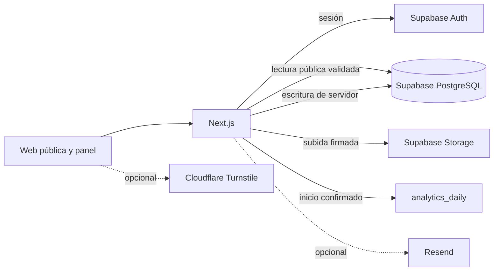

# Referencia funcional y técnica del backend

Fecha de revisión: 13 de octubre de 2026. Esta referencia describe la arquitectura y el estado verificado del backend. La guía de configuración está en [BACKEND_SETUP.md](./BACKEND_SETUP.md).

## 1. Estado de esta versión

- El reproductor y la analítica se integraron mediante el PR #15 y se desplegaron primero en Production con 605314d. La corrección de duplicados del catálogo se integró mediante el PR #16 y se desplegó con be6bd94; Vercel confirmó Ready y www.curileta.com sirvió esa versión el 12 de octubre de 2026.
- Las migraciones 20261012020000_managed_editorial_content.sql y 20261012030000_seed_public_youtube_videos.sql se aplicaron y verificaron en Supabase Production el 12 de octubre de 2026. La segunda deja disponibles los dos vídeos que ya estaban publicados en el canal.
- La migración de vídeo es idempotente y no reemplaza fichas que ya se hayan editado desde el panel.
- La analítica de reproducción usa analytics_daily y no requiere una migración de métricas. La versión vigente incluye la deduplicación por youtubeId entre el CMS y las sobreescrituras de YouTube. Production muestra un capítulo y un Short, una sola vez cada uno; ambos modales también se comprobaron con el fallback de YouTube.
- El pack de 16 campañas se integró mediante el PR #18 (commit 0dc2fe1) y Vercel confirmó Ready el 12 de octubre de 2026. Supabase Production devolvió 16 eventos con arte; solo Halloween estaba habilitada y el modo de control global era automático.
- El 13 de octubre de 2026 se verificaron en Supabase Production los efectos de las 20 migraciones de `main`: esquema, funciones, permisos y RLS, almacenamiento y datos iniciales. Se registraron en el historial las 18 versiones que faltaban con `statements = NULL`; las otras dos ya constaban. Ahora aparecen las 20 versiones sin volver a ejecutar los scripts SQL ni cambiar contenido.
- `contact-submission-retention` está activa en `pg_cron` a las 03:00 UTC y sus tres ejecuciones recientes terminaron correctamente. La limpieza de consultas cerradas funciona; los avisos y borrado programados de oportunidades y la limpieza multimedia de Vercel siguen bloqueados porque `CRON_SECRET` no aparece en Production.
- No se describe ningún dato, permiso, secreto o servicio como activo si no se comprobó en su entorno.

## 2. Arquitectura y responsabilidades

La aplicación web se ejecuta con Next.js. Supabase aporta autenticación, PostgreSQL y almacenamiento de imágenes. Las rutas de servidor separan la lectura pública de las operaciones protegidas. Resend y Turnstile son integraciones opcionales para formularios.

El contenido editorial gestionado por la aplicación tiene a Supabase como fuente de escritura y lectura de servidor. Sanity Studio y sus herramientas quedan fuera del runtime editorial descrito aquí. Cualquier importación histórica es una operación de migración; no es necesaria para mantener el panel operativo.

## 3. Identidad, autenticación y autorización

- Supabase Auth valida la sesión del navegador y la mantiene en cookies.
- apps/web/src/lib/supabase/admin.ts obtiene la identidad autenticada y consulta su perfil en admin_profiles.
- apps/web/src/lib/supabase/server.ts crea el cliente de sesión y el cliente privado de servidor. La credencial privada queda aislada con server-only.
- Las rutas administrativas usan requireAdmin con una lista de roles permitidos. No basta con ocultar una sección en la interfaz.
- Los roles reconocidos son owner, admin, editor y analyst.
- owner gestiona las cuentas del equipo. La cuenta destino debe existir en Supabase Auth antes de añadirla desde la sección Equipo.
- editor administra contenido en las rutas que lo admiten. analyst accede a estadísticas. Cada ruta mantiene su propia comprobación de rol.
- La función SQL set_admin_profile_role limita la gestión de perfiles a owner, valida los roles y conserva al menos una persona propietaria.
- Las tablas managed_content_entries y admin_audit_log tienen RLS activa; los permisos SQL directos están reservados al rol de servidor. La aplicación autoriza cada operación antes de usar ese cliente privado.

## 4. Contenido editorial administrado

### Modelo

supabase/migrations/20261012020000_managed_editorial_content.sql crea managed_content_entries y admin_audit_log e incorpora el conjunto editorial inicial. La migración aditiva supabase/migrations/20261012030000_seed_public_youtube_videos.sql conserva el capítulo y el Short publicados en el canal al cambiar a Supabase; inserta solo los identificadores que falten. Estas fichas ya se verificaron en Production y se pueden editar desde Contenidos en /admin. El registro administrado contiene:

- content_type y content_id como tipo e identificador estable;
- slug opcional para la ruta pública;
- payload JSON con los campos propios del tipo;
- sort_order, is_published e is_deleted;
- created_by, updated_by y fechas de creación y actualización.

La base valida el tipo, la forma JSON, la longitud de identificadores y rutas, y la unicidad de una ruta activa dentro de su tipo. El borrado administrativo usa una marca recuperable. El trigger de auditoría registra creación, edición, publicación, retirada y recuperación en admin_audit_log.

Tipos admitidos por el esquema: character, book, adventure, video, song, location, trailWaypoint, narrativeMilestone, mentionedCuriosity, wallpaper, seasonalEvent, letter, universeRoadmapItem, collaboration y siteSettings. La interfaz puede aplicar límites adicionales por sección; por ejemplo, algunos tipos solo admiten edición y no altas desde la vista general.

### Flujo de edición

1. La persona inicia sesión y la ruta verifica perfil y rol en servidor.
2. /api/admin/content valida tipo, identificador, ruta y payload.
3. La capa de persistencia escribe con el cliente privado de Supabase y guarda el actor.
4. La base registra la acción administrativa.
5. El servidor invalida las etiquetas y páginas afectadas para refrescar la web pública.
6. Las lecturas públicas filtran registros publicados y no retirados.

Un conflicto de ruta devuelve un error de validación. La API usa códigos HTTP explícitos para entradas inválidas, conflictos, contenido ausente y fallos de almacenamiento, en lugar de indicar éxito si no pudo guardar.

### Archivos principales

- apps/web/src/lib/supabase/admin.ts: identidad y autorización del panel.
- apps/web/src/lib/supabase/server.ts: clientes de Supabase aislados en servidor.
- apps/web/src/app/api/admin/content/route.ts: listado, creación, edición, retirada y recuperación.
- apps/web/src/features/home/YouTubeScene.tsx: interfaz del reproductor y presentación modal.
- supabase/migrations/20261012020000_managed_editorial_content.sql: esquema, permisos, auditoría y contenido inicial.
- supabase/migrations/20261012030000_seed_public_youtube_videos.sql: fichas públicas iniciales de vídeo, con inserción segura si todavía no existen.

Las secciones operativas que usan modelos propios pueden conservar tablas o rutas especializadas. Consulta la migración correspondiente antes de cambiarles el formato; no presupongas que todos esos ajustes viven en managed_content_entries.

## 5. Carga de imágenes

apps/web/src/app/api/admin/media/upload/route.ts autoriza owner, admin y editor, valida el tipo y tamaño, limita las ubicaciones permitidas y emite una URL firmada de subida al bucket público curileta-site-media. Los formatos aceptados son WebP y JPEG, con máximo de 8 MB.

El navegador intenta convertir el archivo a WebP y ofrece JPEG como alternativa. La interfaz debe mostrar el resultado real de la carga y no guardar una ficha con una URL vacía o inválida. Los objetos de este bucket son públicos: no subas documentos privados ni información personal.

## 6. Analítica de vídeo y estadísticas

### Inicio interno

apps/web/src/components/YouTubeTrackedPlayer.tsx usa la API oficial IFrame Player de YouTube. Solo registra video_play cuando el reproductor comunica el estado PLAYING; no cuenta la apertura de un modal ni un clic que no haya iniciado la reproducción.

El evento lleva el identificador y slug del vídeo. apps/web/src/app/api/admin/analytics/route.ts valida tipo y contenido, normaliza la ruta contra el contenido publicado y escribe el evento por la función de analítica existente. packages/analytics/src/index.ts declara el evento y su tipo de contenido. /admin/estadisticas agrupa los eventos por slug y muestra inicios por vídeo.

### Respaldo

Si la inserción no puede reproducir, el reproductor muestra la miniatura configurada y prueba miniaturas de YouTube alternativas. Ofrece un enlace directo al mismo vídeo en YouTube. La escena se presenta en una capa modal con bloqueo de desplazamiento del documento para evitar que la página se desplace por encima del vídeo.

### Límites de medición

video_play es analítica propia de Curileta y cuenta un inicio confirmado por el reproductor. No equivale a una visualización oficial de YouTube ni permite modificar sus estadísticas. YouTube determina si una reproducción reúne sus criterios de visualización. Restricciones del vídeo, del navegador o del sitio de origen pueden impedir la inserción; el enlace externo conserva un camino para reproducirlo directamente.

## 7. Datos y tablas

### Eventos, temas y control del header

`/admin/eventos` administra temporadas y el tema base con las rutas `/api/admin/events`, `/api/admin/events/control` y `/api/admin/events/base-theme`. El control global permite programación automática, fijar una campaña o volver al tema base. El tema base guarda nombre y paleta clara/oscura; al aplicarlo el aviso de temporada desaparece. `SeasonalThemeProvider` vive en el layout localizado público (`/[locale]`), así que cubre portada, listados, detalles, páginas legales, eventos y chrome compartido. Actualiza atributos y variables CSS en la raíz del documento para que la escena decorativa cubra el viewport y el tema alcance los componentes de todas las páginas. `globals.css` remapea las clases Tailwind históricas de superficies, textos, bordes, acentos y botones a la paleta estacional, incluida la paleta base y ambos modos de color. El PR #31 se integró en `main` con `0f13595150917a02683994f9d7917f000bfb238f` y su preview de Vercel quedó Ready, pero Production todavía aparecía en el commit `540d1b3212da9c72ea013660a2ffbabd60a2780c` al auditar el panel. La revisión visual encontró que los fondos fijos claros de algunas páginas no seguían el modo oscuro; `globals.css` ya se corrigió en `codex/seasonal-theme-dark-surfaces`, pendiente de CI y Production. `/admin` usa otro layout: no monta el proveedor y, al salir del área pública, la limpieza del efecto retira los atributos y variables estacionales del documento.

El pack inicial contiene 16 campañas bilingües, inactivas salvo Halloween durante su ventana actual, con paleta, ilustración original, calendario de referencia y decoraciones preconfiguradas. Las ventanas pueden solaparse; el servidor elige la mayor prioridad y luego la fecha de inicio. Halloween enlaza el MP4 local `apps/web/public/videos/hero/events/halloween/curileta-halloween.mp4`. Las demás campañas usan SVG originales locales; se pueden sustituir desde el editor con una imagen WebP/JPEG optimizada. Los vídeos y sonidos se cargan por las rutas multimedia existentes. Las campañas seed tienen estado y fechas preservados en conflictos; la migración solo completa recursos o textos vacíos.

`campaign_content` en `site_events` guarda el título y la presentación bilingües de la sección bajo el hero, además de hasta seis actividades por campaña. Cada actividad es un reto con respuesta desplegable o un recurso PDF descargable. `/admin/eventos` edita esos campos y archivos en el mismo registro. La API valida el par URL/ruta contra el bucket y verifica referencias de `campaign_content` antes de retirar un archivo; no permite borrar un PDF todavía asociado a otro evento. La sección pública usa el mismo componente administrado para Halloween y las demás temporadas; el componente anterior de Halloween con capítulo ficticio y actividades “en preparación” se retiró.

La migración `20261013010000_event_campaign_content.sql` agrega la columna y completa de forma idempotente la narrativa y los retos de las 16 campañas sin reemplazar personalizaciones existentes. Añade motivos decorativos especializados a las configuraciones seed. Se aplicó en Supabase Production el 13 de octubre de 2026 y se verificó: columna presente, 16 campañas con 32 actividades, 24 elementos decorativos por campaña y MIME PDF permitido. Halloween continúa habilitado con control programado; Navidad está desactivada. El PR #30 se integró con el commit `540d1b3212da9c72ea013660a2ffbabd60a2780c`; Vercel confirmó Production Ready. La landing pública mostró el título e historia bilingües de Halloween y dos actividades; el reto desplegó su respuesta y el PDF se sirvió con HTTP 200. `/admin/eventos` mostró los 16 temas y el formulario de edición de Halloween con textos, actividades, PDF, vídeo, paleta y decoración. CI aprobó lint, typecheck, pruebas y builds.

Las actividades descargables usan `EventMediaUploadField`, `POST/DELETE /api/admin/events/media` y el bucket público `curileta-site-media`. Se admite `application/pdf`, máximo de 12 MB por archivo, en `events/materials/{uuid}.pdf`; requiere los roles `owner`, `admin` o `editor`. Se conservan imágenes WebP/JPEG (8 MB), vídeo MP4/WebM (100 MB) y audio MP3/M4A/OGG/WebM (25 MB). Los archivos del bucket son públicos: sube únicamente materiales preparados para publicación. No se añaden variables de entorno.

El cuadernillo `apps/web/public/files/events/halloween/curileta-halloween-printables.pdf` tiene tres páginas A4 bilingües: máscaras imprimibles de Curileta y Pompón y una lámina para colorear. ReportLab lo generó; se verificaron tres páginas y sus renderizados. Production responde HTTP 200 con `application/pdf`.

`20261012040000_event_theme_pack_and_artwork.sql` añade artwork a `site_events`, permite el identificador local autorizado del vídeo Halloween y crea el pack idempotente. Se ejecutó en Supabase Production el 12 de octubre de 2026; el 13 de octubre se verificaron 16 campañas, solo Halloween habilitada, el control global automático y sus recursos multimedia. El PR #18 quedó integrado en `main` con 0dc2fe1 y Vercel confirmó Ready. La versión figura en el historial con `statements = NULL`. El 13 de octubre también se verificaron y reconciliaron las 20 versiones de `main`, sin volver a ejecutar migraciones. La carga de arte usa los roles `owner`, `admin` o `editor`, el bucket `curileta-site-media`, la ruta `events/artwork/`, WebP/JPEG de hasta 8 MB y comprobación de referencias antes del borrado. No añade variables de entorno.

| Tabla o servicio | Uso |
|---|---|
| admin_profiles | Relación entre cuentas Auth, nombre mostrado y rol interno. |
| managed_content_entries | Contenido editorial y configuración admitidos por el modelo central. |
| admin_audit_log | Historial de acciones sobre contenido gestionado. |
| analytics_daily | Contadores agregados del sitio, incluidos inicios internos de reproducción. |
| Tablas de módulos | Formularios, consultas, configuración de visualización y otros módulos específicos, según sus migraciones. |
| Supabase Storage | Imágenes públicas gestionadas desde el panel. |
| Supabase Auth | Identidad y sesiones de las personas del equipo. |

El modelo central no sustituye automáticamente a las tablas especializadas. La política RLS y la autorización deben revisarse en cada nueva tabla y función SQL.

## 8. Variables de configuración

La aplicación de servidor admite los nombres siguientes. Esta documentación describe nombres, no valores:

- SUPABASE_URL
- SUPABASE_PUBLISHABLE_KEY
- SUPABASE_SECRET_KEY
- SUPABASE_SERVICE_ROLE_KEY como compatibilidad privada heredada
- NEXT_PUBLIC_SUPABASE_URL y NEXT_PUBLIC_SUPABASE_PUBLISHABLE_KEY como alias heredados
- NEXT_PUBLIC_SITE_URL
- NEXT_PUBLIC_GOOGLE_ANALYTICS_ENABLED: solo el valor true junto a un identificador habilita Google Analytics; no existe consentimiento predeterminado.
- NEXT_PUBLIC_GA_MEASUREMENT_ID
- YOUTUBE_API_KEY, opcional para importar metadatos
- RESEND_API_KEY, CONTACT_FROM_EMAIL y CONTACT_TO_EMAIL
- CRON_SECRET
- NEXT_PUBLIC_TURNSTILE_SITE_KEY y TURNSTILE_SECRET_KEY
- SUPABASE_JWKS_URL está declarada para compatibilidad, pero no interviene en la validación actual de sesión de Supabase Auth

Google Analytics permanece desactivado en Production. Para habilitarlo se requieren ambos nombres de variable, aceptación de cookies y una declaración de persona adulta o progenitor/tutor autorizado. El aviso usa lenguaje sencillo de cookies; la política explica el proveedor y la finalidad. La confirmación se guarda en el navegador como consentimiento v2; el formato anterior deja de ser válido y se limpian cookies accesibles sin consentimiento válido. La declaración no verifica edad ni autoridad parental y no constituye consentimiento parental verificable para COPPA. Por el público mixto mundial, mantener Analytics desactivado hasta revisar las normas y medidas necesarias por país. DNT/GPC bloquean la carga.

Las claves privadas se usan solo en servidor. No añadas valores al repositorio, a la referencia técnica, al HTML ni a variables de entorno públicas.

## 9. Operación de esquema y publicación

- Mantén los cambios de esquema en supabase/migrations.
- Antes de aplicar una migración, compara el esquema y el historial remoto con los archivos locales. Las aplicaciones manuales pueden no estar registradas en el historial.
- No ejecutes una sincronización general de migraciones hasta reconciliar el historial y revisar qué SQL se aplicará.
- En Production, el 13 de octubre de 2026 quedaron registradas las 20 versiones de `main` después de comprobar sus efectos en el esquema. No se reejecutaron los scripts al reparar el historial. Para futuras migraciones, compara el plan y el esquema remoto antes de aplicar SQL y verifica tablas, funciones, RLS y permisos.
- Configura variables por entorno en el proveedor de despliegue.
- Integra el código después de verificar CI para el commit actual; comprueba una vista previa y luego las rutas públicas y /admin en Production.
- Documenta por separado el resultado del despliegue web y el resultado de migración de datos.
- `.gitignore` excluye `._*` y `**/._*` de Git; `.vercelignore` aplica las mismas reglas a las cargas directas a Vercel. Los archivos AppleDouble son metadatos de macOS, no recursos de la aplicación.

El PR #29 integró en `main` las reglas `.gitignore` y `.vercelignore` contra los archivos `._*` en el commit `43c05dd899de396e65929a34147ebf5a7ae64bb0`. Vercel confirmó Production Ready para `www.curileta.com` en el despliegue `7YQvMk77hahQ5rc39WRPBYsreV6m`. No había archivos `._*` versionados; se limpiaron los encontrados en el árbol local y en metadatos Git. Las exclusiones ya están activas en el código integrado y en Vercel.

Las migraciones de contenido administrado y de conservación de los dos vídeos se aplicaron y verificaron en Supabase Production el 12 de octubre de 2026. Las tablas site_events, site_theme_settings y site_theme_control, además del bucket público curileta-site-media con su límite de 100 MB y formatos multimedia permitidos, también se verificaron en Production. El reproductor y la analítica del PR #15 siguen en la versión de Production y la deduplicación del PR #16 está desplegada desde main en be6bd94. El 12 de octubre de 2026 se comprobó www.curileta.com/es/videos: el catálogo muestra 2 piezas en total, un capítulo y un Short; al abrir cada una, YouTube bloquea la reproducción insertada y el modal ofrece el enlace directo correcto (watch para el capítulo y shorts para el Short). La medición propia solo registra el inicio cuando la API comunica PLAYING; no altera la métrica oficial de YouTube. No hizo falta una migración de datos para deduplicar. La documentación no reemplaza una comprobación del estado remoto.

## 10. Cookies, privacidad y métricas

El aviso de cookies y la política de privacidad se sirven en /[locale]/cookies y /[locale]/privacidad; el resumen por capas del formulario está en /[locale]/contacto. Sus textos siguen en el código y su actualización es un cambio editorial revisado y desplegado, no un ajuste de /admin.

La elección de Google Analytics solo puede activarse con `NEXT_PUBLIC_GOOGLE_ANALYTICS_ENABLED=true` y `NEXT_PUBLIC_GA_MEASUREMENT_ID`; el valor predeterminado es desactivado. Cuando la función no está habilitada o el navegador indica DNT/GPC, el cliente limpia la elección antigua y las cookies _ga accesibles, y las rutas públicas omiten los eventos estadísticos agregados. La API también rechaza la escritura agregada ante las cabeceras DNT o Sec-GPC. Un voto de vídeo elegido por el visitante sigue registrándose porque es la acción funcional solicitada, no una métrica pasiva.

Turnstile de contacto solo carga al empezar a usar el formulario; Turnstile de votos solo carga al elegir votar. Cloudflare declara actuar como encargado en la comprobación de bots y como responsable independiente al reutilizar las señales para mejorar Turnstile. La API y el reproductor de YouTube cargan al abrir un vídeo. Las miniaturas del catálogo se sirven por el optimizador de imágenes de Next/Vercel a partir de i.ytimg.com. Los enlaces sociales y Amazon solo navegan a terceros al elegirlos. La versión del resumen de privacidad del formulario es contact-form-privacy-v2 y se fija en código junto al texto; se ignora la variable de entorno obsoleta PRIVACY_NOTICE_VERSION.

La analítica diaria no tiene retención automática configurada. El titular confirmó que las regiones de tratamiento seleccionadas de Vercel, Supabase, Cloudflare y Resend están en la UE y que revisó sus acuerdos y salvaguardas aplicables; esta referencia registra la declaración recibida, no una inspección independiente de los contratos. El identificador aleatorio de favoritos se guarda en localStorage y su hash permanece en `character_favorites`; no hay vencimiento automático. El responsable debe decidir y documentar un plazo de conservación adecuado y comprobar las opciones de eliminación. El formulario de contacto declara una edad adulta, pero una casilla no verifica edad ni consentimiento parental. Google Analytics debe seguir desactivado mientras no se complete la revisión del público infantil y de las obligaciones aplicables.

La política enumera Vercel, Supabase, Cloudflare Turnstile y Resend. Según confirma el titular, las regiones de servicio seleccionadas están en la UE y los acuerdos aplicables se revisaron, incluidas las salvaguardas pertinentes para transferencias; la plataforma no ha inspeccionado los documentos contractuales. Cloudflare puede operar redes globales y como responsable independiente para mejorar Turnstile. El titular aún debe documentar la evaluación de interés legítimo para consultas generales y valorar esa finalidad independiente. El correo de Resend no incluye el contenido de la consulta según la ruta actual.

El PR #19 quedó integrado como e3d7831 y Vercel confirmó Production Ready el 12 de octubre de 2026. El PR #20 quedó integrado como 3d7d8b5; el despliegue Cfn3JcQtJJriLox8gsLJD9DidEof alcanzó Production Ready en www.curileta.com. El PR #21 sincronizó la referencia. El PR #22 corrigió la descripción pública de retención; el despliegue 66rGkx1pZbiwKQ4PSXTi6jAGVRni alcanzó Production Ready y se comprobó el texto actualizado en español e inglés. Se verificaron visualmente `/es/cookies`, `/es/privacidad`, `/es/contacto` y `/en/privacidad`; no se envió el formulario ni se inspeccionó Network. La lista de variables de Vercel Production muestra el ID de Google Analytics, pero no la bandera de habilitación: por ello Analytics queda desactivado por código. El aviso del formulario se fija ahora en código como `contact-form-privacy-v2`, ignorando la variable obsoleta `PRIVACY_NOTICE_VERSION`. Estos cambios no alteran tablas ni funciones SQL y no requieren migración. La tarea de `pg_cron` `contact-submission-retention` está activa a las 03:00 UTC y terminó correctamente los días 11, 12 y 13 de octubre. El proceso elimina consultas cerradas sin oportunidad tras 30 días y marca oportunidades sin actividad al cumplir 12 meses. No había avisos pendientes, eliminaciones de oportunidades programadas ni consultas cerradas atrasadas en la consulta agregada del 13 de octubre. La ruta Vercel que envía avisos y programa la eliminación posterior de oportunidades, y la ruta de limpieza multimedia, exigen `CRON_SECRET`, que falta en Production; por eso esos dos procesos siguen sin ejecutarse. La política pública explica que las consultas cerradas se limpian automáticamente y que las oportunidades deben revisarse manualmente hasta activar sus avisos. La [auditoría de privacidad](./PRIVACY_COMPLIANCE_AUDIT.md) enumera el alcance, las medidas técnicas, los hallazgos y las decisiones del titular que faltan.

## 11. Verificación y diagnóstico

Comandos habituales para la aplicación web:

    npm run lint --workspace=web
    npm run typecheck --workspace=web
    npm run build --workspace=web

En CI confirma que todos corresponden al mismo commit. Para una vista previa comprueba:

- Lectura pública de contenido publicado en los idiomas disponibles.
- Acceso denegado a cuentas sin perfil o con rol insuficiente.
- Creación, edición, publicación, retirada y recuperación según las acciones ofrecidas por cada sección.
- Subida WebP y JPEG, errores de tamaño, extensión y permisos.
- Cambio visible en la web después de invalidar caché.
- Reproducción, evento PLAYING, conteo por vídeo y estado de respaldo si el iframe falla.
- Registro de estadísticas sin exponer identificadores de sesión o datos personales.

Un HTTP 503 en administración suele indicar variables privadas ausentes, tabla o migración no aplicada, o fallo de Supabase. Revisa logs del servidor sin copiar secretos ni datos personales a incidencias públicas.

## 12. Límites y cobertura pendiente

- El panel central administra los tipos listados en esta referencia; algunos tipos tienen restricciones de alta o edición por diseño del formulario.
- Las secciones especializadas pueden depender de sus propias tablas y permisos.
- La presencia de una página administrativa no significa que toda la aplicación sea editable: textos de interfaz, traducciones, contenido legal y valores predeterminados pueden seguir dentro del código. La cobertura debe auditarse módulo por módulo antes de prometer administración completa.
- No guardes identificadores de proyectos, URLs privadas, detalles de DNS o despliegues, credenciales, datos personales ni trazas con datos de visitantes en esta referencia.

## 13. Mantenimiento documental

Cuando cambie un flujo, API, rol, tabla, permiso, almacenamiento, entorno, política de datos o despliegue, actualiza esta referencia y BACKEND_SETUP.md en el mismo cambio. Distingue el código existente de las migraciones aplicadas y los despliegues verificados. El README enlaza a ambas guías en Docs.

## 14. Despliegue verificado del consentimiento de cookies

El PR #26 se integró en `main` con el commit `9657b975b18ab0ce47a063ba1d393deca8a63c5b`. Vercel Production identificó el despliegue `DnXBw8GxVZgi1edCEFykxvLTAgtz` como Ready el 12 de octubre de 2026 y asignó `www.curileta.com`. Se verificaron visualmente `/es/cookies`, `/en/cookies` y `/es/privacidad`. La interfaz habla de cookies opcionales; para aceptarlas requiere una autodeclaración adulta o de tutor autorizado. La autodeclaración no es verificación de edad ni consentimiento parental verificable.

La bandera `NEXT_PUBLIC_GOOGLE_ANALYTICS_ENABLED` no está configurada como habilitada en Production. Por tanto, Analytics sigue apagado y no se presenta el diálogo de elección en la landing mientras la función esté desactivada. Antes de habilitarlo para el público mixto mundial sigue pendiente la revisión legal y de controles para menores. Los chequeos de CI y vista previa del PR pasaron; TypeScript pasó para los paquetes de analítica y web. ESLint presentó dos avisos preexistentes en el editor de eventos y el reproductor de YouTube. No hubo cambio de esquema ni migración SQL.
