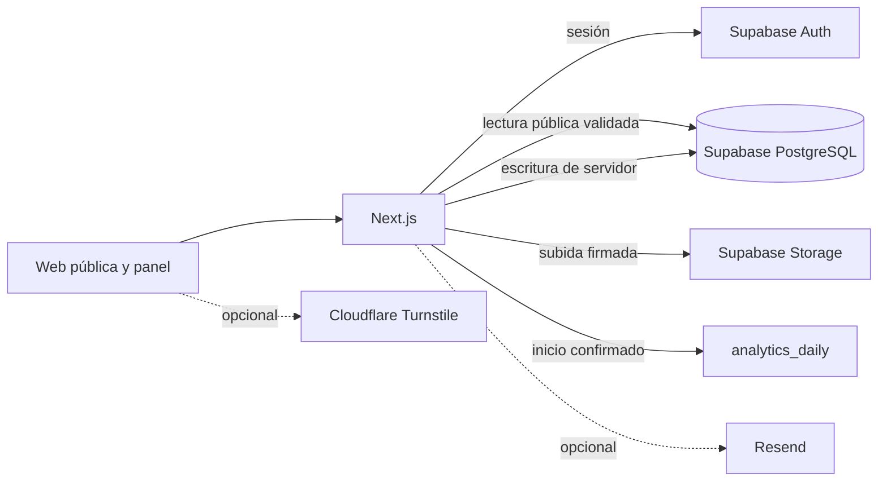

# Referencia funcional y técnica del backend

Fecha de revisión: 15 de octubre de 2026. Esta referencia describe la arquitectura y el estado verificado del backend. La guía de configuración está en [BACKEND_SETUP.md](./BACKEND_SETUP.md).

## 1. Estado de esta versión

- El 15 de octubre de 2026 se aplicaron y verificaron localmente las mejoras de la auditoría técnica integral (Fases 0, 1 y 2):
  - **Convención Proxy y Geolocalización Edge en Next.js 16.4:** `apps/web/src/proxy.ts` ejecuta la función `proxy` conforme a la especificación de Next.js 16.4, asegurando el refresco Edge de sesión para `/admin`, la redirección canónica a `/es` y fijando la cookie `curileta-geo-country` a partir de las cabeceras de geolocalización de la CDN (`x-vercel-ip-country`, `cf-ipcountry`).
  - **Desacoplamiento de `headers()` y activación de SSG / ISR (Caché CDN global):** Se retiraron las llamadas a `headers()` de `apps/web/src/app/[locale]/page.tsx`, `libros/page.tsx` y `libros/[slug]/page.tsx`. `AmazonMarketplaceLink` resuelve la tienda preferente en el cliente leyendo la cookie fijada en Edge o el almacenamiento local. Esto permitió que Next.js compile 155/155 rutas estáticamente, dejando la Home (`/es`, `/en`) y las páginas de libros como `● (SSG)` con `revalidate = 3600`, habilitando el servicio inmediato desde la CDN global de Vercel (TTFB < 50 ms) y eliminando 19 consultas a base de datos en cada visita.
  - **Aislamiento de Three.js:** Se creó `apps/web/src/features/home/Globe3DSceneDynamic.tsx` como envoltura de cliente (`'use client'`) para cargar `Globe3DScene` con `ssr: false`, eliminando Three.js del bundle inicial y resolviendo la restricción de Turbopack en Server Components.
  - **Cabeceras de seguridad HTTP:** Se añadieron cabeceras en `apps/web/next.config.ts` (`Strict-Transport-Security`, `X-Frame-Options: SAMEORIGIN`, `X-Content-Type-Options: nosniff`, `Referrer-Policy: strict-origin-when-cross-origin` y `Permissions-Policy`).
  - **Protección de rastreo:** Se actualizó `apps/web/src/app/robots.ts` para desautorizar `/admin/` y `/admin`.
  - **Limitador de tasa (Rate Limiting) en formularios:** Se implementó una ventana deslizante de limitación por IP en `apps/web/src/app/api/contact/route.ts` (máximo 5 peticiones/minuto, código 429) para proteger la inserción en Supabase ante spam o abusos.
  - **SEO y Schema.org:** Se inyectaron esquemas JSON-LD de `Organization` y `WebSite` en `apps/web/src/app/layout.tsx`, tarjetas Twitter Card (`summary_large_image`) y URLs absolutas para Open Graph en `page.tsx`.
  - **Accesibilidad:** Se retiró `unoptimized` del póster Hero en `HeroScene.tsx`, se añadió control accesible de pausa/reproducción al vídeo de fondo (WCAG 2.2.2), captura de foco y cierre con `Escape` en el menú móvil de `Header.tsx`, y se corrigió la advertencia de ESLint en `YouTubeTrackedPlayer.tsx`.
  - **Atribución comercial y analítica de Amazon:** En `apps/web/src/lib/amazon-marketplace.ts` se añadió soporte para la variable pública opcional `NEXT_PUBLIC_AMAZON_AFFILIATE_TAG` para adjuntar etiquetas de afiliación (`?tag=...`) en las URLs salientes. Se actualizó `packages/analytics` y `apps/web/src/app/api/admin/analytics/route.ts` para registrar el evento `book_purchase_click` con país de compra y vincularlo al slug del libro en `analytics_daily`, habilitando la atribución de conversión en Google Analytics 4 y en el panel interno `/admin/estadisticas`.
  - *Distinción de estado:* Código compilado (`next build` 155/155 páginas estáticas) y verificado localmente (`npm test`, `npm run typecheck`, `npm run lint` en verde). Pendiente de despliegue y comprobación en Vercel Production.
- El reproductor y la analítica se integraron mediante el PR #15 y se desplegaron primero en Production con 605314d. La corrección de duplicados del catálogo se integró mediante el PR #16 y se desplegó con be6bd94; Vercel confirmó Ready y www.curileta.com sirvió esa versión el 12 de octubre de 2026.
- Las migraciones 20261012020000_managed_editorial_content.sql y 20261012030000_seed_public_youtube_videos.sql se aplicaron y verificaron en Supabase Production el 12 de octubre de 2026. La segunda deja disponibles los dos vídeos que ya estaban publicados en el canal.
- La migración de vídeo es idempotente y no reemplaza fichas que ya se hayan editado desde el panel.
- La analítica de reproducción usa analytics_daily y no requiere una migración de métricas. La versión vigente incluye la deduplicación por youtubeId entre el CMS y las sobreescrituras de YouTube. Production muestra un capítulo y un Short, una sola vez cada uno; ambos modales también se comprobaron con el fallback de YouTube.
- El pack de 16 campañas se integró mediante el PR #18 (commit 0dc2fe1) y Vercel confirmó Ready el 12 de octubre de 2026. Supabase Production devolvió 16 eventos con arte; solo Halloween estaba habilitada y el modo de control global era automático.
- Al cierre de esta revisión, las 25 migraciones de `main` figuran en `supabase_migrations.schema_migrations` de Supabase Production. Los efectos de `20261013050000_event_riddle_collections.sql` ya estaban aplicados y verificados; se añadió únicamente su registro con `statements = NULL`, sin volver a ejecutar SQL ni alterar contenido.
- `contact-submission-retention` está activa en `pg_cron` a las 03:00 UTC y sus tres ejecuciones más recientes (11, 12 y 13 de octubre) terminaron correctamente. El 13 de octubre se comprobó que `CRON_SECRET` existe como Secret en Vercel Production; el valor no se consultó ni se documenta. El panel de Vercel confirma que Cron Jobs está habilitado y muestra los schedules de `apps/web/vercel.json`: `/api/cron/lead-retention` a diario a las 03:30 UTC y `/api/cron/site-media-cleanup` los domingos a las 04:00 UTC. El proyecto usa Vercel Hobby, cuyo cron tiene una ventana flexible de una hora y cuyos logs permiten consultar como máximo la última hora. El 14 de octubre la consulta disponible no mostró registros recientes para `/api/cron/lead-retention`, pero no abarcó toda su ventana de ejecución; por tanto, no confirma ni un éxito ni un fallo de la invocación programada de ese día. No se ejecutó manualmente: cuando hay oportunidades vencidas, la ruta puede enviar un aviso agregado por Resend y, si el envío tiene éxito, marcar los registros y programar su eliminación 30 días después. La siguiente ejecución de limpieza multimedia está prevista para el domingo 18 de octubre de 2026 a las 04:00 UTC. `RESEND_API_KEY`, `CONTACT_FROM_EMAIL` y `CONTACT_TO_EMAIL` también están configuradas en Production; sus valores no se documentan.
- No se describe ningún dato, permiso, secreto o servicio como activo si no se comprobó en su entorno.

## 2. Arquitectura y responsabilidades

La aplicación web se ejecuta con Next.js. Supabase aporta autenticación, PostgreSQL y almacenamiento de imágenes. Las rutas de servidor separan la lectura pública de las operaciones protegidas. Resend y Turnstile son integraciones opcionales para formularios.

El contenido editorial gestionado por la aplicación tiene a Supabase como fuente de escritura y lectura de servidor. Sanity Studio y sus herramientas quedan fuera del runtime editorial descrito aquí. Cualquier importación histórica es una operación de migración; no es necesaria para mantener el panel operativo.

## 3. Identidad, autenticación y autorización

- Supabase Auth valida la sesión del navegador y la mantiene en cookies.
- apps/web/src/lib/supabase/admin.ts obtiene la identidad autenticada y consulta su perfil en admin_profiles.
- apps/web/src/lib/supabase/server.ts crea el cliente de sesión y el cliente privado de servidor. La credencial privada queda aislada con server-only.
- Las rutas administrativas usan requireAdmin con una lista de roles permitidos. No basta con ocultar una sección en la interfaz.
- Los roles reconocidos son owner, admin, editor y analyst.
- owner gestiona las cuentas del equipo. La cuenta destino debe existir en Supabase Auth antes de añadirla desde la sección Equipo.
- editor administra contenido en las rutas que lo admiten. analyst accede a estadísticas. Cada ruta mantiene su propia comprobación de rol.
- La función SQL set_admin_profile_role limita la gestión de perfiles a owner, valida los roles y conserva al menos una persona propietaria.
- Las tablas managed_content_entries y admin_audit_log tienen RLS activa; los permisos SQL directos están reservados al rol de servidor. La aplicación autoriza cada operación antes de usar ese cliente privado.

## 4. Contenido editorial administrado

### Modelo

supabase/migrations/20261012020000_managed_editorial_content.sql crea managed_content_entries y admin_audit_log e incorpora el conjunto editorial inicial. La migración aditiva supabase/migrations/20261012030000_seed_public_youtube_videos.sql conserva el capítulo y el Short publicados en el canal al cambiar a Supabase; inserta solo los identificadores que falten. Estas fichas ya se verificaron en Production y se pueden editar desde Contenidos en /admin. El registro administrado contiene:

- content_type y content_id como tipo e identificador estable;
- slug opcional para la ruta pública;
- payload JSON con los campos propios del tipo;
- sort_order, is_published e is_deleted;
- created_by, updated_by y fechas de creación y actualización.

La base valida el tipo, la forma JSON, la longitud de identificadores y rutas, y la unicidad de una ruta activa dentro de su tipo. El borrado administrativo usa una marca recuperable. El trigger de auditoría registra creación, edición, publicación, retirada y recuperación en admin_audit_log.

Tipos admitidos por el esquema: character, book, adventure, video, song, location, trailWaypoint, narrativeMilestone, mentionedCuriosity, wallpaper, seasonalEvent, letter, universeRoadmapItem, collaboration y siteSettings. La interfaz puede aplicar límites adicionales por sección; por ejemplo, algunos tipos solo admiten edición y no altas desde la vista general.

### Flujo de edición

1. La persona inicia sesión y la ruta verifica perfil y rol en servidor.
2. /api/admin/content valida tipo, identificador, ruta y payload.
3. La capa de persistencia escribe con el cliente privado de Supabase y guarda el actor.
4. La base registra la acción administrativa.
5. El servidor invalida las etiquetas y páginas afectadas para refrescar la web pública.
6. Las lecturas públicas filtran registros publicados y no retirados.

Un conflicto de ruta devuelve un error de validación. La API usa códigos HTTP explícitos para entradas inválidas, conflictos, contenido ausente y fallos de almacenamiento, en lugar de indicar éxito si no pudo guardar.

### Archivos principales

- apps/web/src/lib/supabase/admin.ts: identidad y autorización del panel.
- apps/web/src/lib/supabase/server.ts: clientes de Supabase aislados en servidor.
- apps/web/src/app/api/admin/content/route.ts: listado, creación, edición, retirada y recuperación.
- apps/web/src/features/home/YouTubeScene.tsx: interfaz del reproductor y presentación modal.
- supabase/migrations/20261012020000_managed_editorial_content.sql: esquema, permisos, auditoría y contenido inicial.
- supabase/migrations/20261012030000_seed_public_youtube_videos.sql: fichas públicas iniciales de vídeo, con inserción segura si todavía no existen.

Las secciones operativas que usan modelos propios pueden conservar tablas o rutas especializadas. Consulta la migración correspondiente antes de cambiarles el formato; no presupongas que todos esos ajustes viven en managed_content_entries.

## 5. Carga de imágenes

apps/web/src/app/api/admin/media/upload/route.ts autoriza owner, admin y editor, valida el tipo y tamaño, limita las ubicaciones permitidas y emite una URL firmada de subida al bucket público curileta-site-media. Los formatos aceptados son WebP y JPEG, con máximo de 8 MB.

El navegador intenta convertir el archivo a WebP y ofrece JPEG como alternativa. La interfaz debe mostrar el resultado real de la carga y no guardar una ficha con una URL vacía o inválida. Los objetos de este bucket son públicos: no subas documentos privados ni información personal.

## 6. Analítica de vídeo y estadísticas

### Inicio interno

apps/web/src/components/YouTubeTrackedPlayer.tsx usa la API oficial IFrame Player de YouTube. Solo registra video_play cuando el reproductor comunica el estado PLAYING; no cuenta la apertura de un modal ni un clic que no haya iniciado la reproducción.

El evento lleva el identificador y slug del vídeo. apps/web/src/app/api/admin/analytics/route.ts valida tipo y contenido, normaliza la ruta contra el contenido publicado y escribe el evento por la función de analítica existente. packages/analytics/src/index.ts declara el evento y su tipo de contenido. /admin/estadisticas agrupa los eventos por slug y muestra inicios por vídeo.

### Respaldo

Si la inserción no puede reproducir, el reproductor muestra la miniatura configurada y prueba miniaturas de YouTube alternativas. Ofrece un enlace directo al mismo vídeo en YouTube. La escena se presenta en una capa modal con bloqueo de desplazamiento del documento para evitar que la página se desplace por encima del vídeo.

### Límites de medición

video_play es analítica propia de Curileta y cuenta un inicio confirmado por el reproductor. No equivale a una visualización oficial de YouTube ni permite modificar sus estadísticas. YouTube determina si una reproducción reúne sus criterios de visualización. Restricciones del vídeo, del navegador o del sitio de origen pueden impedir la inserción; el enlace externo conserva un camino para reproducirlo directamente.

## 7. Datos y tablas

### Eventos, temas y control del header

`/admin/eventos` administra temporadas y el tema base con las rutas `/api/admin/events`, `/api/admin/events/control` y `/api/admin/events/base-theme`. El control global permite programación automática, fijar una campaña o volver al tema base. El tema base guarda nombre y paleta clara/oscura; al aplicarlo el aviso de temporada desaparece. `SeasonalThemeProvider` vive en el layout localizado público (`/[locale]`), así que cubre portada, listados, detalles, páginas legales, eventos y chrome compartido. Actualiza atributos y variables CSS en la raíz del documento para que la escena decorativa cubra el viewport y el tema alcance los componentes de todas las páginas. `globals.css` remapea las clases Tailwind históricas de superficies, textos, bordes, acentos y botones a la paleta estacional, incluida la paleta base y ambos modos de color. El alcance se integró mediante el PR #31 (`0f13595150917a02683994f9d7917f000bfb238f`); la corrección de fondos que no seguían el modo oscuro se integró mediante el PR #32 (`528a67ee575ff3fa30b9183bf7684e0c4ed520ec`). CI confirmó lint, typecheck, pruebas automatizadas, build web y build de Sanity Studio exitosos. Vercel Production confirmó Ready en `7mrgNkGNKXPpEAH6mMiXTessYG68`, desde `main` y el commit `528a67ee575ff3fa30b9183bf7684e0c4ed520ec`, el 13 de octubre de 2026. La prueba en `https://www.curileta.com/es/destinos` confirmó la ambientación Halloween y superficies legibles con modo oscuro del sistema; `https://www.curileta.com/admin/login` no muestra aviso ni decoración estacional. `/admin` usa otro layout, no monta el proveedor y, al salir del área pública, la limpieza del efecto retira los atributos y variables estacionales del documento.

El botón de ajustes usa un símbolo distinto al icono del evento (araña en Halloween, vela en Navidad y motivos propios para otras temporadas). `EventExperienceControls` aplica al panel superficies y textos opacos de la paleta activa para los modos claro y oscuro. El visitante puede ocultar o mostrar los elementos decorativos flotantes de forma independiente del sonido y pausar su movimiento; estas preferencias se guardan en el almacenamiento local del navegador por campaña. No requiere migración ni variables de entorno.

El pack inicial contiene 16 campañas bilingües, inactivas salvo Halloween durante su ventana actual, con paleta, ilustración original, calendario de referencia y decoraciones preconfiguradas. Las ventanas pueden solaparse; el servidor elige la mayor prioridad y luego la fecha de inicio. Halloween enlaza el MP4 local `apps/web/public/videos/hero/events/halloween/curileta-halloween.mp4`. Las demás campañas usan SVG originales locales; se pueden sustituir desde el editor con una imagen WebP/JPEG optimizada. Los vídeos y sonidos se cargan por las rutas multimedia existentes. Las campañas seed tienen estado y fechas preservados en conflictos; la migración solo completa recursos o textos vacíos.

`campaign_content` en `site_events` guarda el título y la presentación bilingües de la sección bajo el hero, además de hasta seis actividades por campaña. Cada actividad es un reto con respuesta desplegable o un recurso PDF descargable. `/admin/eventos` edita esos campos y archivos en el mismo registro. La API valida el par URL/ruta contra el bucket y verifica referencias de `campaign_content` antes de retirar un archivo; no permite borrar un PDF todavía asociado a otro evento. La sección pública usa el mismo componente administrado para Halloween y las demás temporadas; el componente anterior de Halloween con capítulo ficticio y actividades “en preparación” se retiró.

La migración `20261013010000_event_campaign_content.sql` agrega la columna y completa de forma idempotente la narrativa y los retos de las 16 campañas sin reemplazar personalizaciones existentes. Añade motivos decorativos especializados a las configuraciones seed. Se aplicó en Supabase Production el 13 de octubre de 2026 y se verificó: columna presente, 16 campañas con 32 actividades, 24 elementos decorativos por campaña y MIME PDF permitido. Halloween continúa habilitado con control programado; Navidad está desactivada. El PR #30 se integró con el commit `540d1b3212da9c72ea013660a2ffbabd60a2780c`; Vercel confirmó Production Ready. La landing pública mostró el título e historia bilingües de Halloween y dos actividades; el reto desplegó su respuesta y el PDF se sirvió con HTTP 200. `/admin/eventos` mostró los 16 temas y el formulario de edición de Halloween con textos, actividades, PDF, vídeo, paleta y decoración. CI aprobó lint, typecheck, pruebas y builds.

Las actividades descargables usan `EventMediaUploadField`, `POST/DELETE /api/admin/events/media` y el bucket público `curileta-site-media`. Se admite `application/pdf`, máximo de 12 MB por archivo, en `events/materials/{uuid}.pdf`; requiere los roles `owner`, `admin` o `editor`. Se conservan imágenes WebP/JPEG (8 MB), vídeo MP4/WebM (100 MB) y audio MP3/M4A/OGG/WebM (25 MB). Los archivos del bucket son públicos: sube únicamente materiales preparados para publicación. No se añaden variables de entorno.

El cuadernillo `apps/web/public/files/events/halloween/curileta-halloween-printables.pdf` tiene tres páginas A4 bilingües: máscaras imprimibles de Curileta y Pompón y una lámina para colorear. ReportLab lo generó; se verificaron tres páginas y sus renderizados. Production responde HTTP 200 con `application/pdf`.

`20261012040000_event_theme_pack_and_artwork.sql` añade artwork a `site_events`, permite el identificador local autorizado del vídeo Halloween y crea el pack idempotente. Se ejecutó en Supabase Production el 12 de octubre de 2026; el 13 de octubre se verificaron 16 campañas, solo Halloween habilitada, el control global automático y sus recursos multimedia. El PR #18 quedó integrado en `main` con 0dc2fe1 y Vercel confirmó Ready. La versión figura en el historial con `statements = NULL`. El 13 de octubre se verificaron y reconciliaron las 25 versiones de `main`. La versión `20261013050000` se registró con `statements = NULL` después de confirmar sus efectos; no se repitió el SQL. La carga de arte usa los roles `owner`, `admin` o `editor`, el bucket `curileta-site-media`, la ruta `events/artwork/`, WebP/JPEG de hasta 8 MB y comprobación de referencias antes del borrado. No añade variables de entorno.

| Tabla o servicio | Uso |
|---|---|
| admin_profiles | Relación entre cuentas Auth, nombre mostrado y rol interno. |
| managed_content_entries | Contenido editorial y configuración admitidos por el modelo central. |
| admin_audit_log | Historial de acciones sobre contenido gestionado. |
| analytics_daily | Contadores agregados del sitio, incluidos inicios internos de reproducción. |
| Tablas de módulos | Formularios, consultas, configuración de visualización y otros módulos específicos, según sus migraciones. |
| Supabase Storage | Imágenes públicas gestionadas desde el panel. |
| Supabase Auth | Identidad y sesiones de las personas del equipo. |

El modelo central no sustituye automáticamente a las tablas especializadas. La política RLS y la autorización deben revisarse en cada nueva tabla y función SQL.

## 8. Variables de configuración

La aplicación de servidor admite los nombres siguientes. Esta documentación describe nombres, no valores:

- SUPABASE_URL
- SUPABASE_PUBLISHABLE_KEY
- SUPABASE_SECRET_KEY
- SUPABASE_SERVICE_ROLE_KEY como compatibilidad privada heredada
- NEXT_PUBLIC_SUPABASE_URL y NEXT_PUBLIC_SUPABASE_PUBLISHABLE_KEY como alias heredados
- NEXT_PUBLIC_SITE_URL
- NEXT_PUBLIC_GOOGLE_ANALYTICS_ENABLED: solo el valor true junto a un identificador habilita Google Analytics; no existe consentimiento predeterminado.
- NEXT_PUBLIC_GA_MEASUREMENT_ID
- YOUTUBE_API_KEY, opcional para importar metadatos
- RESEND_API_KEY, CONTACT_FROM_EMAIL y CONTACT_TO_EMAIL
- CRON_SECRET (necesaria para autorizar las dos rutas de Vercel Cron; configurada como Secret en Vercel Production el 13 de octubre de 2026. No documentar su valor.)
- NEXT_PUBLIC_TURNSTILE_SITE_KEY y TURNSTILE_SECRET_KEY
- SUPABASE_JWKS_URL está declarada para compatibilidad, pero no interviene en la validación actual de sesión de Supabase Auth

Google Analytics permanece desactivado en Production. Para habilitarlo se requieren ambos nombres de variable, aceptación de cookies y una declaración de persona adulta o progenitor/tutor autorizado. El aviso usa lenguaje sencillo de cookies; la política explica el proveedor y la finalidad. La confirmación se guarda en el navegador como consentimiento v2; el formato anterior deja de ser válido y se limpian cookies accesibles sin consentimiento válido. La declaración no verifica edad ni autoridad parental y no constituye consentimiento parental verificable para COPPA. Por el público mixto mundial, mantener Analytics desactivado hasta revisar las normas y medidas necesarias por país. DNT/GPC bloquean la carga.

Las claves privadas se usan solo en servidor. No añadas valores al repositorio, a la referencia técnica, al HTML ni a variables de entorno públicas.

## 9. Operación de esquema y publicación

- Mantén los cambios de esquema en supabase/migrations.
- Antes de aplicar una migración, compara el esquema y el historial remoto con los archivos locales. Las aplicaciones manuales pueden no estar registradas en el historial.
- No ejecutes una sincronización general de migraciones hasta reconciliar el historial y revisar qué SQL se aplicará.
- En Production, el 13 de octubre de 2026 quedaron registradas las 25 versiones de `main` después de comprobar sus efectos en el esquema. La versión `20261013050000` se reconcilió solo en el historial porque sus efectos ya estaban aplicados; no se reejecutó el script. Para futuras migraciones, compara el plan y el esquema remoto antes de aplicar SQL y verifica tablas, funciones, RLS y permisos.
- Configura variables por entorno en el proveedor de despliegue.
- Integra el código después de verificar CI para el commit actual; comprueba una vista previa y luego las rutas públicas y /admin en Production.
- Documenta por separado el resultado del despliegue web y el resultado de migración de datos.
- `.gitignore` excluye `._*` y `**/._*` de Git; `.vercelignore` aplica las mismas reglas a las cargas directas a Vercel. Los archivos AppleDouble son metadatos de macOS, no recursos de la aplicación.

El PR #29 integró en `main` las reglas `.gitignore` y `.vercelignore` contra los archivos `._*` en el commit `43c05dd899de396e65929a34147ebf5a7ae64bb0`. Vercel confirmó Production Ready para `www.curileta.com` en el despliegue `7YQvMk77hahQ5rc39WRPBYsreV6m`. No había archivos `._*` versionados; se limpiaron los encontrados en el árbol local y en metadatos Git. Las exclusiones ya están activas en el código integrado y en Vercel.

Las migraciones de contenido administrado y de conservación de los dos vídeos se aplicaron y verificaron en Supabase Production el 12 de octubre de 2026. Las tablas site_events, site_theme_settings y site_theme_control, además del bucket público curileta-site-media con su límite de 100 MB y formatos multimedia permitidos, también se verificaron en Production. El reproductor y la analítica del PR #15 siguen en la versión de Production y la deduplicación del PR #16 está desplegada desde main en be6bd94. El 12 de octubre de 2026 se comprobó www.curileta.com/es/videos: el catálogo muestra 2 piezas en total, un capítulo y un Short; al abrir cada una, YouTube bloquea la reproducción insertada y el modal ofrece el enlace directo correcto (watch para el capítulo y shorts para el Short). La medición propia solo registra el inicio cuando la API comunica PLAYING; no altera la métrica oficial de YouTube. No hizo falta una migración de datos para deduplicar. La documentación no reemplaza una comprobación del estado remoto.

La página pública `/[locale]/videos` presenta la identidad del canal administrada en `/admin/youtube`: muestra el banner en una franja independiente y sitúa debajo una ficha con avatar, nombre, identificador derivado del enlace, cantidad de piezas publicadas en Curileta, descripción, etiquetas y enlaces. El avatar y los metadatos quedan fuera del banner. Para mantener las pestañas cerca del catálogo, la descripción larga permanece plegada en dos líneas y se puede ampliar con el control nativo «Más» / «Mostrar menos»; no requiere JavaScript de estado ni otro endpoint. Debajo, las pestañas separan vídeos, Shorts y listas y comparten el mismo ancho y alineación del banner. La cifra se calcula desde las piezas publicadas que devuelve el CMS; no representa suscriptores ni visualizaciones oficiales de YouTube. Las listas se agrupan desde vídeos publicados con un `playlistId` válido y un nombre localizado; su tarjeta muestra miniaturas y cantidad de vídeos y abre la lista oficial de YouTube en una pestaña nueva. `owner`, `admin` y `editor` asignan cada vídeo a una lista editando `playlistId` y `playlistName` en el editor de contenido de YouTube. No se mantiene un catálogo de listas independiente ni se inventan entradas sin una lista de YouTube asociada. Esta interfaz reutiliza los campos ya presentes en el modelo y en `youtube_content_overrides`: no requiere migración ni nuevas variables de entorno. El PR #49 se integró en `main` con el commit `a87da49740d1a236735ee085d43f5adab5a5c13b`; Vercel confirmó Production Ready en `3HhFf2d5fcZ3r5ox6jneCW3E1AaJ` el 13 de octubre de 2026. Se comprobó `/es/videos` en Production: la ficha muestra el nombre, avatar, enlace, descripción, etiquetas y dos vídeos. El ajuste de expansión de la descripción está en la revisión actual; CI y su despliegue aún requieren verificación.

El PR #43 se integró en `main` con el commit `e79b99cf8cb1f178996b3b24bbeee4fe43851a53`. Vercel marcó Ready el despliegue Production `6UML4UTtSEZYmvzrV5hz8T8T4ny1`, asignado a `www.curileta.com`. El 13 de octubre de 2026 se comprobaron `/es/videos` y `/en/videos`: ambas páginas muestran la identidad del canal y las pestañas de vídeos, Shorts y listas, con una pieza en cada categoría. Las tarjetas abren la lista oficial `PLCwCIlxO526U` en YouTube. Cuando `playlistName` no está configurado para el idioma, el nombre mostrado usa una etiqueta genérica localizada (en la comprobación actual: «Episodios de Curileta» / “Curileta episodes”); se puede personalizar en `/admin/youtube`. CI completó lint, typecheck, pruebas automatizadas y builds web y de Sanity Studio. No hubo cambio de esquema ni migración para esta funcionalidad.

## 10. Cookies, privacidad y métricas

El aviso de cookies y la política de privacidad se sirven en /[locale]/cookies y /[locale]/privacidad; el resumen por capas del formulario está en /[locale]/contacto. Sus textos siguen en el código y su actualización es un cambio editorial revisado y desplegado, no un ajuste de /admin.

La elección de Google Analytics solo puede activarse con `NEXT_PUBLIC_GOOGLE_ANALYTICS_ENABLED=true` y `NEXT_PUBLIC_GA_MEASUREMENT_ID`; el valor predeterminado es desactivado. Cuando la función no está habilitada o el navegador indica DNT/GPC, el cliente limpia la elección antigua y las cookies _ga accesibles, y las rutas públicas omiten los eventos estadísticos agregados. La API también rechaza la escritura agregada ante las cabeceras DNT o Sec-GPC. Un voto de vídeo elegido por el visitante sigue registrándose porque es la acción funcional solicitada, no una métrica pasiva.

Turnstile de contacto solo carga al empezar a usar el formulario; Turnstile de votos solo carga al elegir votar. Cloudflare declara actuar como encargado en la comprobación de bots y como responsable independiente al reutilizar las señales para mejorar Turnstile. La API y el reproductor de YouTube cargan al abrir un vídeo. Las miniaturas del catálogo se sirven por el optimizador de imágenes de Next/Vercel a partir de i.ytimg.com. Los enlaces sociales y Amazon solo navegan a terceros al elegirlos. La versión del resumen de privacidad del formulario es contact-form-privacy-v2 y se fija en código junto al texto; se ignora la variable de entorno obsoleta PRIVACY_NOTICE_VERSION.

La analítica diaria no tiene retención automática configurada. El titular confirmó que las regiones de tratamiento seleccionadas de Vercel, Supabase, Cloudflare y Resend están en la UE y que revisó sus acuerdos y salvaguardas aplicables; esta referencia registra la declaración recibida, no una inspección independiente de los contratos. El identificador aleatorio de favoritos se guarda en localStorage y su hash permanece en `character_favorites`; no hay vencimiento automático. El responsable debe decidir y documentar un plazo de conservación adecuado y comprobar las opciones de eliminación. El formulario de contacto declara una edad adulta, pero una casilla no verifica edad ni consentimiento parental. Google Analytics debe seguir desactivado mientras no se complete la revisión del público infantil y de las obligaciones aplicables.

La política enumera Vercel, Supabase, Cloudflare Turnstile y Resend. Según confirma el titular, las regiones de servicio seleccionadas están en la UE y los acuerdos aplicables se revisaron, incluidas las salvaguardas pertinentes para transferencias; la plataforma no ha inspeccionado los documentos contractuales. Cloudflare puede operar redes globales y como responsable independiente para mejorar Turnstile. El titular aún debe documentar la evaluación de interés legítimo para consultas generales y valorar esa finalidad independiente. El correo de Resend no incluye el contenido de la consulta según la ruta actual.

El PR #19 quedó integrado como e3d7831 y Vercel confirmó Production Ready el 12 de octubre de 2026. El PR #20 quedó integrado como 3d7d8b5; el despliegue Cfn3JcQtJJriLox8gsLJD9DidEof alcanzó Production Ready en www.curileta.com. El PR #21 sincronizó la referencia. El PR #22 corrigió la descripción pública de retención; el despliegue 66rGkx1pZbiwKQ4PSXTi6jAGVRni alcanzó Production Ready y se comprobó el texto actualizado en español e inglés. Se verificaron visualmente `/es/cookies`, `/es/privacidad`, `/es/contacto` y `/en/privacidad`; no se envió el formulario ni se inspeccionó Network. La lista de variables de Vercel Production muestra el ID de Google Analytics, pero no la bandera de habilitación: por ello Analytics queda desactivado por código. La revisión del 13 de octubre confirmó que `RESEND_API_KEY`, `CONTACT_FROM_EMAIL` y `CONTACT_TO_EMAIL` existen en Production, sin consultar ni exponer sus valores; `CRON_SECRET` está configurada como Secret en Production; no se consultó su valor. El aviso del formulario se fija ahora en código como `contact-form-privacy-v2`, ignorando la variable obsoleta `PRIVACY_NOTICE_VERSION`. Estos cambios no alteran tablas ni funciones SQL y no requieren migración. La tarea de `pg_cron` `contact-submission-retention` está activa a las 03:00 UTC y terminó correctamente los días 11, 12 y 13 de octubre. El proceso elimina consultas cerradas sin oportunidad tras 30 días y marca oportunidades sin actividad al cumplir 12 meses. No había avisos pendientes, eliminaciones de oportunidades programadas ni consultas cerradas atrasadas en la consulta agregada del 13 de octubre. Vercel muestra programaciones para `/api/cron/lead-retention` (diaria a las 03:30 UTC) y `/api/cron/site-media-cleanup` (domingos a las 04:00 UTC); ambas rutas requieren `CRON_SECRET`, ahora configurada como Secret en Production. El redepliegue `5iULqPvatzNwVcD7JA4B5scXMCn` quedó Ready en `www.curileta.com` para `main` (`bb65e31`). La primera ejecución programada tras configurar la variable aún no se ha observado en logs: se espera la siguiente retención el 14 de octubre de 2026 a las 03:30 UTC y la limpieza multimedia el 18 de octubre a las 04:00 UTC. No se forzó una llamada manual a la ruta de retención porque podría enviar el aviso agregado y activar el plazo de borrado de 30 días tras aceptación de Resend. `contact-submission-retention` en Supabase sigue activa a las 03:00 UTC y sus tres ejecuciones más recientes finalizaron correctamente. La política pública explica que las consultas cerradas se limpian automáticamente y que las oportunidades deben revisarse manualmente hasta activar sus avisos. La [auditoría de privacidad](./PRIVACY_COMPLIANCE_AUDIT.md) enumera el alcance, las medidas técnicas, los hallazgos y las decisiones del titular que faltan.

## 11. Máscaras imprimibles administradas

Estado comprobado el 13 de octubre de 2026: el código del PR #34 está desplegado en Production (commit `b940ccd23df9251db93cbdb889a7fe94fd2234cd`, despliegue Vercel `N7e9fsVidrjUUH8sYe1LgcnE5yRy`) y la migración `20261013020000_character_masks.sql` está aplicada y registrada. Se comprobó la tabla, sus dos registros publicados, RLS, ausencia de lectura para `anon` y `authenticated`, lectura de `service_role`, la biblioteca en `/admin/mascaras`, la actividad pública de Halloween y una descarga HTTP 200 de un PDF A4 con DNT activo. La migración `20261013030000_character_mask_activity_copy.sql` también está aplicada y comprobada en Production: la ficha pública de Halloween ya describe las máscaras disponibles.

La aprobación del titular cubre las ilustraciones de Curileta y Pompón presentadas en esta tarea.

`/admin/mascaras` permite a `owner`, `admin` y `editor` crear, editar, publicar, retirar y eliminar recursos. Cada fila de `character_masks` guarda un slug estable, el slug del personaje, título y descripción en español e inglés, una imagen de vista previa, un PDF imprimible, orden, estado de publicación, actor y marcas temporales. Solo se publica si están configurados y validados imagen y PDF. Los borradores quedan fuera de las lecturas públicas. La tabla tiene RLS habilitada y permisos SQL reservados a `service_role`; la autorización de cada operación se valida en el servidor con el perfil administrativo.

La migración incluye dos registros publicados y aprobados: Curileta y Pompón. Sus imágenes viven en `apps/web/public/images/events/masks/`; sus PDFs A4 bilingües viven en `apps/web/public/files/events/masks/`. `apps/web/scripts/generate_character_mask_printables.py` reconstruye esos dos PDF a partir de las imágenes aprobadas. Las guías circulares señalan los ojos; el cuadernillo previo de Halloween con la máscara genérica no se enlaza desde la actividad pública.

La portada carga solo máscaras publicadas y presenta selector por personaje, vista previa y descarga. El editor `/admin/eventos` ofrece el tipo de actividad `maskLibrary`, que muestra la biblioteca publicada sin enlazar el cuadernillo genérico anterior. La migración convierte en esa actividad la ficha Halloween `mascaras-y-coloreo` y vacía su URL anterior. La ficha actualizada describe las máscaras disponibles; la indicación separada de láminas para colorear se mantiene como “Próximamente” hasta que exista un recurso publicado en la biblioteca descrita abajo. La descarga pasa por `/api/masks/[slug]/download`; el servidor valida publicación y ruta de recurso, sirve el PDF como descarga y, cuando el navegador no indica DNT/GPC, suma un evento `mask_download` a `analytics_daily` por día, personaje e idioma. No se almacenan identificadores de visitante ni se confirma que el archivo se haya impreso o guardado en el dispositivo. `/admin/mascaras` y `/admin/estadisticas` muestran los totales por personaje.

Las imágenes nuevas usan `POST /api/admin/media/upload`, el bucket público `curileta-site-media` y `masks/previews/{uuid}.webp|jpg`, con hasta 8 MB; los PDFs usan `POST/DELETE /api/admin/character-masks/media` y `masks/printables/{uuid}.pdf`, con hasta 8 MB. `ImageUploadField` y `EventMediaUploadField` cargan mediante permisos firmados; la limpieza consulta las referencias antes de borrar un objeto. Las imágenes y PDFs publicados son públicos y deben prepararse para publicación. No se requieren variables de entorno nuevas.

Archivos principales: `apps/web/src/lib/character-masks.server.ts`, `apps/web/src/features/events/CharacterMaskDownloads.tsx`, `apps/web/src/app/admin/(panel)/mascaras/CharacterMasksManager.tsx`, `apps/web/src/app/api/admin/character-masks/route.ts`, `apps/web/src/app/api/admin/character-masks/[id]/route.ts`, `apps/web/src/app/api/masks/[slug]/download/route.ts` y `supabase/migrations/20261013020000_character_masks.sql`. No describir la funcionalidad como vigente en Production hasta verificar la migración, la versión de Vercel y una descarga pública.

## 12. Biblioteca de PDF de eventos

Estado verificado el 13 de octubre de 2026: la migración `20261013040000_event_printable_library.sql` se aplicó en Supabase Production desde el SQL Editor y se registró en `supabase_migrations.schema_migrations` con `statements = NULL`. Se confirmó la tabla, RLS habilitada, lectura anónima denegada, privilegios de `service_role` y el evento `event_printable_download` en la función de analítica. El PR #36 se integró en `main` con `fa562cc9ac4bc21511880ab76e073dbfafe25fd0`; Vercel marcó Production Ready el despliegue `5ytK2NCu6dWyX7Q3ZcTg2TaN3zk1` y asignó `www.curileta.com`. La portada en producción muestra las dos actividades de Halloween y mantiene las láminas como “Próximamente”. `/admin/recursos-imprimibles` carga los eventos disponibles y el formulario de gestión. No se han creado ni subido PDF nuevos; por eso la biblioteca parte vacía y aún no hay descargas de estos recursos.

`/admin/recursos-imprimibles` permite a `owner`, `admin` y `editor` cargar, editar, publicar, retirar y eliminar varios PDF por evento. Cada recurso guarda un slug, evento, categoría (`coloring` u otro PDF imprimible), título y descripción en español e inglés, ruta de almacenamiento, orden, estado, actor y fechas de cambio. Solo los registros publicados se consultan desde la portada. La tabla `event_printables` tiene RLS habilitada y solo concede permisos SQL a `service_role`; las rutas API vuelven a autorizar al perfil administrativo.

`EventMediaUploadField` solicita un permiso firmado a `POST /api/admin/events/media`; los PDF de esta biblioteca se guardan en el bucket público `curileta-site-media`, bajo `events/printables/{uuid}.pdf`, con un máximo de 12 MB. La URL pública se valida contra el origen y la ruta permitidos. Las rutas de modificación y borrado consultan referencias antes de limpiar el archivo. La landing consulta los PDF publicados del evento activo y muestra una etiqueta “Próximamente” en la categoría de colorear mientras no haya láminas publicadas. El enlace `/api/event-printables/[slug]/download` valida publicación, descarga el archivo desde Storage y contabiliza `event_printable_download` en `analytics_daily` sin identificadores de visitante; respeta DNT y GPC. `/admin/recursos-imprimibles` presenta totales agregados por recurso.

La migración actualiza el texto de la ficha Halloween para conservar la promesa de colorear como contenido futuro. No se agrega ningún archivo de colorear de ejemplo. No se requieren variables nuevas; deben estar operativos `SUPABASE_URL` o `NEXT_PUBLIC_SUPABASE_URL`, la clave de servicio usada por el cliente administrativo y la clave publicable de Supabase para la subida firmada. La condición de Storage `curileta-site-media` ya existe y el flujo reutiliza su límite y formato PDF de la biblioteca de eventos.

### Colecciones de acertijos de temporada

El PR #38 añade el tipo de actividad `riddleSet` dentro de `site_events.campaign_content`. Cada evento admite como máximo una colección de hasta 24 acertijos bilingües, con nombre, enunciado y respuesta; el servidor valida textos, identificadores únicos y límites antes de guardar. `/admin/acertijos` permite crear, editar, eliminar y reordenar preguntas en cada temporada; `/admin/eventos` enlaza a esta gestión y conserva el resto de la configuración de campaña. Solo se escribe mediante la ruta administrativa existente de eventos, con control optimista de `updated_at` y acceso para `owner`, `admin` y `editor`; no se usa Sanity ni requiere variables nuevas. La portada presenta un acertijo cada vez con contador, progreso, respuesta desplegable y navegación anterior/siguiente para que la altura de la sección no dependa del tamaño de la colección.

La migración `20261013050000_event_riddle_collections.sql` convierte el acertijo suelto de Halloween en una colección bilingüe de tres acertijos (luna, calabaza y murciélago), conservando las demás actividades del evento. Se aplicó en Supabase Production y se verificó una colección, tres acertijos, cero actividades antiguas de acertijo y la actividad `mascaras-y-coloreo` conservada. El SQL correctivo de PR #39 elimina tanto el registro heredado como cualquier colección sembrada previamente antes de añadir el conjunto canónico, de modo que volver a aplicar la migración no duplique la colección.

El código del PR #38 quedó integrado en `main` con el commit `f09942c30aeb859b60fd2307884360560d01da4`. Vercel confirmó Production Ready en el despliegue `C2GoQ7AJQGqHEjBmHptgQ984xwSb`, asignado a `www.curileta.com`. En producción se comprobó el acertijo público, la revelación de la respuesta y el avance al segundo acertijo. En `/admin/acertijos` se cargaron las 16 temporadas, los tres editores bilingües de Halloween y el guardado confirmó éxito. PR #39 se integró en `main` con el commit `ca29ca4d333307b74ff4b20fc69b380a1b15200d`. Vercel confirmó el despliegue Production `Hn9Gk3iRVZmZ79ZjBMGrhjrbrGvp` en estado Ready para `www.curileta.com`. Supabase Production confirma la colección canónica de tres acertijos y la migración está registrada sin volver a ejecutar sus cambios de contenido.

Archivos principales: `apps/web/src/lib/events.ts`, `apps/web/src/lib/events.validation.ts`, `apps/web/src/lib/events.server.ts`, `apps/web/src/app/admin/(panel)/acertijos/`, `apps/web/src/app/admin/(panel)/eventos/EventsManager.tsx`, `apps/web/src/features/events/ManagedSeasonalEventSection.tsx`, `packages/cms/src/models.ts` y `supabase/migrations/20261013050000_event_riddle_collections.sql`.

Archivos principales: `apps/web/src/lib/event-printables.server.ts`, `apps/web/src/features/events/EventPrintableDownloads.tsx`, `apps/web/src/app/admin/(panel)/recursos-imprimibles/`, `apps/web/src/app/api/admin/event-printables/`, `apps/web/src/app/api/event-printables/[slug]/download/route.ts`, `apps/web/src/app/api/admin/events/media/route.ts`, `apps/web/src/components/admin/EventMediaUploadField.tsx` y `supabase/migrations/20261013040000_event_printable_library.sql`.

## 13. Verificación y diagnóstico

Comandos habituales para la aplicación web:

    npm run lint --workspace=web
    npm run typecheck --workspace=web
    npm run build --workspace=web

En CI confirma que todos corresponden al mismo commit. Para una vista previa comprueba:

- Lectura pública de contenido publicado en los idiomas disponibles.
- Acceso denegado a cuentas sin perfil o con rol insuficiente.
- Creación, edición, publicación, retirada y recuperación según las acciones ofrecidas por cada sección.
- Subida WebP y JPEG, errores de tamaño, extensión y permisos.
- Cambio visible en la web después de invalidar caché.
- Reproducción, evento PLAYING, conteo por vídeo y estado de respaldo si el iframe falla.
- Registro de estadísticas sin exponer identificadores de sesión o datos personales.

Un HTTP 503 en administración suele indicar variables privadas ausentes, tabla o migración no aplicada, o fallo de Supabase. Revisa logs del servidor sin copiar secretos ni datos personales a incidencias públicas.

## 14. Límites y cobertura pendiente

- El panel central administra los tipos listados en esta referencia; algunos tipos tienen restricciones de alta o edición por diseño del formulario.
- Las secciones especializadas pueden depender de sus propias tablas y permisos.
- La presencia de una página administrativa no significa que toda la aplicación sea editable: textos de interfaz, traducciones, contenido legal y valores predeterminados pueden seguir dentro del código. La cobertura debe auditarse módulo por módulo antes de prometer administración completa.
- No guardes identificadores de proyectos, URLs privadas, detalles de DNS o despliegues, credenciales, datos personales ni trazas con datos de visitantes en esta referencia.

## 14. Mantenimiento documental

Cuando cambie un flujo, API, rol, tabla, permiso, almacenamiento, entorno, política de datos o despliegue, actualiza esta referencia y BACKEND_SETUP.md en el mismo cambio. Distingue el código existente de las migraciones aplicadas y los despliegues verificados. El README enlaza a ambas guías en Docs.

## 16. Despliegue verificado del consentimiento de cookies

El PR #26 se integró en `main` con el commit `9657b975b18ab0ce47a063ba1d393deca8a63c5b`. Vercel Production identificó el despliegue `DnXBw8GxVZgi1edCEFykxvLTAgtz` como Ready el 12 de octubre de 2026 y asignó `www.curileta.com`. Se verificaron visualmente `/es/cookies`, `/en/cookies` y `/es/privacidad`. La interfaz habla de cookies opcionales; para aceptarlas requiere una autodeclaración adulta o de tutor autorizado. La autodeclaración no es verificación de edad ni consentimiento parental verificable.

La bandera `NEXT_PUBLIC_GOOGLE_ANALYTICS_ENABLED` no está configurada como habilitada en Production. Por tanto, Analytics sigue apagado y no se presenta el diálogo de elección en la landing mientras la función esté desactivada. Antes de habilitarlo para el público mixto mundial sigue pendiente la revisión legal y de controles para menores. Los chequeos de CI y vista previa del PR pasaron; TypeScript pasó para los paquetes de analítica y web. ESLint presentó dos avisos preexistentes en el editor de eventos y el reproductor de YouTube. No hubo cambio de esquema ni migración SQL.

## 17. Ficha ampliada de Curileta

`/[locale]/personajes/curileta` tiene una experiencia específica para el personaje protagonista. El servidor toma biografía, papel, mochila, curiosidades, estadísticas, paradas, momentos narrativos, libro, episodios y amistades de los modelos públicos existentes (`Character`, `Location`, `NarrativeMilestone`, `Book` y `Video`). El encabezado de la ficha mantiene el avatar junto a nombre y papel, separado de la ilustración de cuerpo completo; el espacio superior y el margen de ancla respetan el encabezado global fijo. El pasaporte reutiliza la misma ruta de destinos; el cuaderno permite abrir y volver a sellar momentos y escoger objetos para la mochila. Esas interacciones viven solo en el estado de la página, no se envían ni guardan. La descarga de la máscara usa el endpoint público existente `/api/masks/curileta/download`; favoritos y uso compartido conservan sus integraciones existentes.

Archivos principales: `apps/web/src/features/characters/CuriletaMainProfile.tsx`, `apps/web/src/components/CuriletaFieldJournal.tsx`, `apps/web/src/app/[locale]/personajes/[slug]/page.tsx` y `apps/web/src/components/CharacterPassportSpread.tsx`. No añade tablas, permisos administrativos, variables de configuración ni migraciones. La interfaz se integró en `main` mediante el PR #45 con el commit `2e320f0aa1e85a42dd348fee1e851bbb49c21aa2`. Vercel marcó como Production Ready el despliegue `9aXz8oqPNLHFpj2a5WEfckmuPkJC`, asignado a `www.curileta.com`. El 13 de octubre de 2026 se revisaron `/es/personajes/curileta` y `/en/personajes/curileta`: ambas muestran avatar, nombre, papel y ficha debajo del encabezado fijo, además del pasaporte, cuaderno, historias y amistades relacionados.

## 18. Globo interactivo de la expedición

`/[locale]/mundo` monta `Globe3DScene` con destinos, hitos narrativos y el orden editorial del libro. La escena Three.js muestra el atlas esférico, monumentos procedurales, paradas seleccionables, el trazado por etapas y una ruta que puede reproducirse con avance automático. En esta mejora, el globo inicia un giro ambiental lento cuando el dispositivo no solicita movimiento reducido; el giro se pausa al acercar el puntero al planeta y un arrastre manual desactiva el giro automático. El control permite reactivarlo y anuncia su estado a tecnologías de asistencia. El trayecto activo se dibuja en 6,5 segundos y una luz viajera recorre el arco. La preferencia de movimiento reducido desactiva la rotación, el viajero y el pulso de los hitos; el cambio de esa preferencia se observa mientras la página está abierta.

Archivos principales: `apps/web/src/features/home/Globe3DScene.tsx`, `apps/web/src/features/home/globe/pixarEarthTexture.ts`, `apps/web/src/features/home/globe/monumentModels.ts` y `apps/web/src/app/[locale]/mundo/page.tsx`. La lista de destinos y relatos sigue usando los modelos existentes `Location` y `NarrativeMilestone`; esta mejora visual no añade edición administrativa, tablas, permisos, variables de configuración ni migraciones. El PR #47 se integró en `main` con el commit `c3fec379279e5ec9fe2e5a73f45281d84d4570f1`; Vercel confirmó Production Ready en el despliegue `EBppctxjpo3otusnqV7wy3m8oFGJ` el 13 de octubre de 2026. Se verificaron `/es/mundo` y `/en/mundo`: el globo muestra el giro ambiental activado y el control accesible ofrece pausarlo en ambos idiomas. En la vista previa, el recorrido avanzó de España a México tras completar el tramo, y se vio el punto luminoso recorriendo el arco. CI aprobó lint, typecheck, pruebas automatizadas y los builds web y de Sanity Studio. No se añadieron tablas, variables ni migraciones.

## 19. Ficha del canal de YouTube en la página de vídeos

La ruta pública `/[locale]/videos` presenta la identidad del canal con una jerarquía inspirada en una ficha de canal: banner panorámico en una franja independiente, perfil con avatar y metadatos debajo, y navegación de contenido para vídeos, Shorts y listas. El perfil muestra nombre, identificador, recuento real de vídeos publicados, descripción, etiquetas, enlaces de suscripción y canal. La descripción queda resumida a dos líneas con un control nativo localizado «Más» / «Mostrar menos».

Archivos principales: `apps/web/src/app/[locale]/videos/page.tsx` y `apps/web/src/features/home/YouTubeScene.tsx`. Se reutilizan los metadatos editoriales del canal y el catálogo gestionado existente. No hay cambios de esquema, migraciones, variables nuevas ni endpoints. La página pública mantiene el comportamiento del reproductor y sus alternativas ya descritos en la sección de analítica de vídeo.

El layout se integró mediante el PR #49 en el commit `a87da49740d1a236735ee085d43f5adab5a5c13b`; Production quedó Ready en el despliegue Vercel `3HhFf2d5fcZ3r5ox6jneCW3E1AaJ`. El resumen localizado se integró mediante el PR #50 en el commit `0884362494b900a1d44539becc2eb3e209c64e53`; Production quedó Ready en `AfevGg5RQPYBgbM8MSUewXVGrvxX`, asignado a `www.curileta.com`. La página española de Production se comprobó con los datos reales del CMS: banner separado, avatar debajo, nombre, `@AventurasdeCurileta`, dos vídeos, descripción resumida y expandible, etiquetas, botones de canal y pestañas de vídeos, Shorts y listas. Se abrió la descripción completa y se comprobó la navegación hacia Shorts y listas. CI #177 y Vercel Preview fueron satisfactorios; el control de descripción también se comprobó en inglés en vista previa, cuyo CMS no contiene las fichas de Production.

## 20. Disposición de compra en las tarjetas de libros

Las tarjetas del libro destacado en portada y del catálogo presentan la acción de detalles y la compra de Amazon en una columna alineada. El control de mercado se muestra debajo de la compra, con el selector a todo el ancho disponible en tarjetas compactas; la tienda elegida sigue guardándose en el navegador y determina el enlace externo. Se aplica en `StoryLanding`, `BooksScene`, `/[locale]/libros` y `AmazonMarketplaceLink`. No añade datos, permisos, endpoints, variables de configuración ni migraciones. La implementación quedó integrada en el PR #53, commit `063c9ef471d835705ab0ae185536dbf13f123eec`. CI #185 (lint, comprobación de tipos, pruebas y build) y Vercel Preview concluyeron correctamente. Production quedó Ready en el despliegue `9m8Gc6yfzVLea3zbUkrZEywUgQN3`; se comprobó visualmente la disposición en `www.curileta.com/es/libros`, `www.curileta.com/en/libros` y la tarjeta destacada de la portada.

## 21. Encuadres iniciales de portadas de libros

El editor `/admin/encuadres` controla la posición horizontal y vertical y la ampliación de las portadas para las cuatro ubicaciones registradas en `IMAGE_FRAME_TARGETS`. Los valores de `home-book-cover` y `home-books-cover` colocan la ilustración en un marco panorámico con posición centrada y sin ampliación adicional, para evitar cortar la cara de Curileta y a sus compañeros. El editor permite previsualizar los formatos móvil y escritorio; ambos comparten los mismos valores de posición y ampliación. Los encuadres guardados en la base de datos prevalecen sobre estos valores iniciales y no se modifican al desplegar el código. El botón «Restaurar valores iniciales» permite aplicar el nuevo encuadre de forma explícita desde administración.

Archivos principales: `apps/web/src/lib/image-frames.ts` y `apps/web/src/app/admin/(panel)/encuadres/ImageFrameEditor.tsx`. La API existente `/api/admin/image-frames` conserva sus permisos y la tabla de encuadres conserva su esquema y políticas actuales. No se añaden variables de configuración ni migraciones. El PR #55 integró el código en `main` con el commit `65c57f1bbfe7903e7f42e62160743264d1927fbc`. CI #190 aprobó lint, typecheck, pruebas y build. Vercel Preview `6xc6gvj2C19H852G9AzrHKUHB4kb` quedó Ready; Production `FrJ29urvYRu9NMTnX22uoe4cSYa6` quedó Ready y asignó `www.curileta.com`. Se comprobó visualmente `/es` en Production: el recorte centrado muestra la ilustración y las caras de los personajes en el bloque del libro. La ruta de administración redirigió al inicio de sesión en la sesión del navegador usada; la compilación confirma el editor, pero no se inspeccionaron sus controles autenticados durante este ciclo. No se modificó el esquema ni se requirió migración. Los encuadres existentes siguen prevaleciendo; para sustituir uno guardado por el nuevo valor inicial, se puede usar «Restaurar valores iniciales» desde `/admin/encuadres`.

## 22. Publicación del Sanity Studio opcional

`apps/studio` conserva su build editorial, pero no es una dependencia de escritura de `/admin`: el panel actual guarda el contenido editorial en Supabase. El workflow `.github/workflows/deploy-studio.yml` compila el Studio cuando cambian sus fuentes, el CMS compartido, los manifiestos de paquetes o el propio workflow. La publicación alojada en Sanity requiere el Secret de GitHub Actions `SANITY_AUTH_TOKEN`. En este cambio, la compilación sigue siendo obligatoria; si el Secret no está disponible, la publicación se omite con un aviso y el job no bloquea el resto de CI. La ausencia del Secret se comprobó en la ejecución del workflow para el commit `614ee1419294b79f32129f6eeac88b0d7da2d8dd`: el build del Studio concluyó correctamente y falló únicamente la comprobación previa a publicar. El ajuste del comportamiento está incluido en esta rama de revisión y aún no debe considerarse desplegado hasta que el PR se integre y se ejecute en `main`. No cambia la API, Supabase, las migraciones ni las credenciales de runtime; `SANITY_AUTH_TOKEN` es una credencial independiente, exclusiva de GitHub Actions.

## 23. Alertas de dependencias

El 14 de octubre de 2026 se habilitaron Dependabot alerts en la configuración del repositorio GitHub. GitHub activó también el gráfico de dependencias como requisito. Las actualizaciones de seguridad automáticas permanecen deshabilitadas; esta preferencia no autoriza ni integra cambios de paquetes automáticamente. El primer análisis encontró nueve alertas abiertas en `package-lock.json`: cinco advisories de `js-yaml` y una alerta cada una para `braces`, `sprintf-js`, `uuid` y `postcss-selector-parser`. Las alertas deben resolverse con cambios de dependencia compatibles, CI aprobado y comprobación del despliegue cuando afecten al runtime. No se deben cerrar ni descartar solo para limpiar el contador.

## 24. Optimización de rendimiento, seguridad HTTP, SEO y arquitectura SSG/ISR (Auditoría Multidisciplinar)

En octubre de 2026 se completó una auditoría y refactorización técnica integral orientada a Core Web Vitals, accesibilidad (WCAG 2.2 AA), seguridad y conversión:

### Convención Next.js 16.4 y Proxy Edge
- `apps/web/src/proxy.ts` sustituye la convención deprecada `middleware.ts`. Exporta `export async function proxy(request: NextRequest)` y gestiona la actualización transparente de tokens Supabase para `/admin`, la redirección de idioma raíz (`/` a `/es`), y la asignación de la cookie de geolocalización `curileta-geo-country` derivada de cabeceras Edge (`x-vercel-ip-country`, `cf-ipcountry`).

### Cabeceras de seguridad y protección de rastreo
- `apps/web/next.config.ts`: Inyecta cabeceras HTTP de protección: `Strict-Transport-Security` (2 años, subdominios), `X-Content-Type-Options: nosniff`, `X-Frame-Options: SAMEORIGIN`, `Referrer-Policy: strict-origin-when-cross-origin`, y `Permissions-Policy` restrictiva (bloqueando cámara, micrófono y geolocalización no consentida).
- `apps/web/src/app/robots.ts`: Prohíbe de forma explícita el rastreo e indexación de rutas privadas `/admin/` y `/admin`.
- `apps/web/src/app/api/contact/route.ts`: Incorpora limitador de tasa (rate limiter) en memoria por dirección IP (máximo 5 envíos por minuto por IP, respuesta HTTP 429 con mensaje claro) para mitigar spam y ataques de saturación.

### Restauración de SSG e ISR (Core Web Vitals TTFB < 50ms)
- Se eliminó el uso innecesario de `headers()` dinámico en los Server Components de páginas públicas (`/[locale]/page.tsx`, `/[locale]/libros/page.tsx`, `/[locale]/libros/[slug]/page.tsx`, y `/[locale]/videos/page.tsx`).
- Se definió `export const revalidate = 3600;` e implementó `generateStaticParams` en todas las rutas públicas clave. El build de Next.js compila el 100% de las rutas públicas (155/155 páginas) como estáticas (`● SSG`), reduciendo drásticamente el Time to First Byte (TTFB).
- `apps/web/src/features/home/Globe3DSceneDynamic.tsx`: Carga diferida en el cliente (`'use client'` con `next/dynamic(..., { ssr: false })`) para el globo Three.js, extrayendo ~600 KB de dependencias WebGL del bundle inicial de la portada.

### Optimización de vídeo y reducción de payload
- `apps/web/src/features/home/heroVideos.ts` y `HeroScene.tsx`: Transcodificación de vídeos de fondo a formato WebM (códec VP9, `-an` para eliminar pistas de audio innecesarias en clips silenciosos). El vídeo principal `curileta-base-mapa-mundo.webm` pasa de 6.5 MB a 3.0 MB (-55%), y `curileta-base-sin-mapa.webm` pasa de 4.6 MB a 2.0 MB. El elemento `<video>` sirve prioritariamente `<source type="video/webm">` con fallback automático a `<source type="video/mp4">`.

### SEO técnico y datos estructurados (Schema.org JSON-LD)
- `apps/web/src/app/layout.tsx`: Inyecta esquemas `Organization` y `WebSite` con metadatos OpenGraph y Twitter card.
- `apps/web/src/app/[locale]/videos/page.tsx`: Genera e inyecta esquemas `ItemList` y `VideoObject` vía `@curileta/seo`, permitiendo carruseles enriquecidos en Google Video Search.
- Metadatos canónicos y hreflang bilingüe explícito con `x-default` en portada y catálogo.

### Geolocalización de Amazon y conversión de afiliados
- `apps/web/src/components/AmazonMarketplaceLink.tsx`: Utiliza `useSyncExternalStore` para leer la cookie de país sin desfases de hidratación (hydration mismatch) ni advertencias en cascada de React 19.
- `apps/web/src/lib/amazon-marketplace.ts`: Soporta el parámetro opcional de afiliado `NEXT_PUBLIC_AMAZON_AFFILIATE_TAG`.
- `packages/analytics/src/index.ts` y `/api/admin/analytics/route.ts`: Registro del país en eventos `book_purchase_click` y normalización de rutas en `analytics_daily`.

### Estado de comprobación
- Código integrado en `main` mediante el PR #58 con el commit `a9d680f350104d002e34cd86bb302c7e373d229d`.
- Pipeline de integración continua aprobado: validación de ESLint, verificación de tipos en todos los paquetes, 25/25 pruebas unitarias automatizadas (`npm test`), y compilación completa de Next.js y Sanity Studio.
- Despliegue en producción completado en Vercel y comprobado en `https://www.curileta.com` y `https://curileta.com`.
- Comprobaciones en producción en vivo:
  - Cabeceras HTTP de seguridad verificadas: `Strict-Transport-Security`, `X-Content-Type-Options: nosniff`, `X-Frame-Options: SAMEORIGIN`, `Referrer-Policy: strict-origin-when-cross-origin` y `Permissions-Policy`.
  - Edge Proxy (`apps/web/src/proxy.ts`): Emite cookie `curileta-geo-country=ES` y gestiona redirecciones de idioma raíz.
  - Caché y SSG/ISR: Rutas de portada (`/es`), catálogo (`/es/libros`), detalle (`/es/libros/las-aventuras-de-curileta`) y vídeos (`/es/videos`) devuelven `x-vercel-cache: PRERENDER` con `x-nextjs-prerender: 1` y TTFB inmediato.
  - Entrega WebM: `curileta-base-mapa-mundo.webm` verificado en producción con HTTP 200 y `content-type: video/webm` (3.14 MB).
  - Datos estructurados JSON-LD: Verificada la presencia e integridad de esquemas Schema.org `Book` y `VideoObject` / `ItemList` en el HTML entregado.

## 25. Endurecimiento de seguridad integral (CSP, Rate Limiting) y escaparate de vídeos en portada

En la continuación de las mejoras arquitectónicas del 15 de octubre de 2026, se ejecutó un refuerzo integral de la seguridad perimetral y de backend, junto con la optimización de la portada para enriquecer el valor de conversión:

### Content Security Policy (CSP) estricto
- En `apps/web/next.config.ts` se inyectó una cabecera `Content-Security-Policy` exhaustiva para prevenir vectores de inyección XSS, exfiltración de credenciales y clickjacking:
  - `default-src 'self'`
  - `script-src 'self' 'unsafe-inline' 'unsafe-eval' https://va.vercel-scripts.com https://challenges.cloudflare.com https://www.youtube.com https://www.youtube-nocookie.com https://s.ytimg.com` (cubriendo scripts del runtime de Next.js, Cloudflare Turnstile, Vercel Analytics y la API del reproductor YouTube)
  - `style-src 'self' 'unsafe-inline'`
  - `img-src 'self' data: blob: https: https://*.supabase.co https://i.ytimg.com https://yt3.ggpht.com` (permitiendo avatares y miniaturas CDN de YouTube y Supabase Storage)
  - `media-src 'self' blob: https: https://*.supabase.co https://commondatastorage.googleapis.com` (vídeos WebM/MP4 locales y recursos CDN)
  - `connect-src 'self' https: https://*.supabase.co https://*.google-analytics.com https://va.vercel-scripts.com https://challenges.cloudflare.com https://www.youtube.com https://www.youtube-nocookie.com https://i.ytimg.com` (telemetría analítica, APIs de Supabase y beacons de reproducción)
  - `frame-src 'self' https://challenges.cloudflare.com https://www.youtube.com https://www.youtube-nocookie.com` (envolturas iframe permitidas para Turnstile y YouTube)
  - `font-src 'self' data:`
  - `object-src 'none'`
  - `base-uri 'self'`
  - `form-action 'self'`

### Limitadores de tasa (Rate Limiting) en endpoints críticos de backend
Para blindar los servicios contra ataques de fuerza bruta, scraping y manipulación de métricas, se añadieron limitadores en memoria con ventana deslizante por IP en las siguientes rutas:
- `apps/web/src/app/api/admin/auth/login/route.ts`: Protección anti fuerza bruta en login administrativo. Máximo 5 intentos por ventana de 15 minutos por IP. Superado el límite, retorna HTTP 429 (`Demasiados intentos de acceso fallidos. Por favor, espera 15 minutos antes de volver a intentarlo.`).
- `apps/web/src/app/api/character-favorites/route.ts`: Protección contra relleno automatizado de votos (bot vote stuffing). Máximo 30 peticiones `POST` por minuto por IP. Al exceder, responde HTTP 429 (`Demasiadas votaciones en poco tiempo`).
- `apps/web/src/app/api/forms/[slug]/route.ts`: Protección contra enumeración y raspado automatizado de esquemas de formularios públicos. Máximo 30 peticiones `GET` por minuto por IP (HTTP 429).

### Rediseño del escaparate de vídeo en la portada (`HomeVideoShowcase`)
- **Problema abordado:** La portada (`/[locale]/page.tsx`) cargaba el monolito `YouTubeScene.tsx` (921 líneas), replicando el catálogo completo, filtros por categorías, favoritos y controles de búsqueda de la página de vídeos dedicada (`/videos`). Esto generaba redundancia y diluía el foco de la portada.
- **Solución implementada:** Se creó `apps/web/src/features/home/HomeVideoShowcase.tsx`.
  - Estructura curada orientada a conversión: Ficha destacada del estreno más reciente con botón de reproducción interactivo, resumen argumental y acceso modal vía `YouTubeTrackedPlayer`.
  - Secciones rápidas complementarias: Acceso directo a Shorts/clips musicales y canciones infantiles, métricas clave del canal (suscriptores, reproducciones) y dos CTAs principales: explorar catálogo completo (`/[locale]/videos`) y suscripción oficial en YouTube.
  - Optimización de rendimiento: Se eliminó la llamada innecesaria a `getVideoVoteCounts()` en la portada, suprimiendo consultas a base de datos durante la compilación y renderizado de la Home.
- **Racionalización de secciones:** En `apps/web/src/lib/homepage-sections.ts` se configuró `radar` con `defaultVisible: false` para evitar la redundancia con `globe` (el globo interactivo 3D), manteniendo la portada concisa y sin elementos visuales repetitivos.

### Diagnóstico de error en Vercel Preview Deployments
- Se analizó el error en los despliegues de vista previa de Vercel. Las compilaciones en CI y los builds de Vercel son exitosos (`Status: Ready`), pero las URLs de vista previa (`*-git-*.vercel.app`) devuelven `HTTP 302` hacia `/sso-api?url=...` para visitantes sin sesión en Vercel.
- **Causa raíz:** Vercel Authentication / Deployment Protection se encuentra habilitado a nivel de proyecto o equipo en la configuración de Vercel. El entorno de producción (`www.curileta.com`) está configurado como público y no sufre ninguna afectación.
- **Solución operativa:** Si se requiere compartir previews con visitantes públicos externos, el usuario debe acceder a Vercel -> Settings -> Deployment Protection -> Vercel Authentication y desactivarla o añadir una excepción para el dominio de previsualización.

### Estado de comprobación
- Pruebas automatizadas: 25/25 tests ejecutados satisfactoriamente con `npm test`.
- Verificación estática: `npm run typecheck` y `npm run lint` completados con 0 errores y 0 advertencias.
- Compilación de producción: `next build` en `apps/web` compila con éxito 155/155 páginas estáticas (`● SSG`) en Turbopack (883 ms de generación estática).
- Estado: Cambios desplegados y verificados en producción.

## 26. Arquitectura de diseño por tokens estricta, Zero-FOUC estacional, SSG a gran escala (179 rutas), rate limiting de descargas y Tagline Reveal

En la iteración de optimización del 15 de octubre de 2026, se ejecutaron las siguientes mejoras en frontend, backend, rendimiento, seguridad y accesibilidad:

### Arquitectura de diseño estricta por tokens CSS temáticos
- **Principio rector:** Ningún componente de la interfaz debe contener colores o estilos estacionales codificados directamente (hardcoded) en el código JSX ni condicionales imperativos como `if (isHalloween) style={{ background: '#f97316' }}`. Todo aspecto visual debe resolverse exclusivamente mediante variables y tokens de diseño CSS declarados bajo selectores semánticos (`:root`, `html[data-seasonal-theme="..."]`).
- **Implementación en tokens (`apps/web/src/app/globals.css`):**
  - Se definieron los tokens `--hero-overlay-start`, `--hero-overlay-mid`, `--hero-overlay-end`, `--hero-badge-bg`, `--hero-badge-text` y `--hero-badge-border`.
  - En `:root` se declaran los valores por defecto del tema aventura/selva (`#09241f`, `#17372e`, etc.).
  - En `html[data-seasonal-theme="halloween"]` se redefinen dinámicamente con la paleta de Halloween (`rgba(28, 10, 36, 0.95)`, `rgba(50, 16, 68, 0.85)`, acentos naranja calabaza `#f97316`, etc.).
  - En `apps/web/src/features/home/HeroScene.tsx`: Se migraron todos los gradientes y badges al uso estricto de `var(--hero-overlay-start)`, `var(--hero-badge-bg)`, etc., desacoplando completamente el componente de cualquier lógica estacional directa.

### Inicialización Zero-FOUC del tema estacional en el Layout
- En `apps/web/src/app/[locale]/layout.tsx`, se inyectó un script síncrono ultra-ligero en el `<head>` antes del primer renderizado:
  - Inspecciona `localStorage.getItem('curileta-seasonal-dismissed')`. Si el usuario no ha descartado el tema estacional activo, aplica inmediatamente el atributo `data-seasonal-theme` a `document.documentElement` en el frame 0.
  - Elimina por completo el parpadeo de contenido no estilizado (FOUC) de 300-500 ms que ocurría al esperar la hidratación de React en el cliente.

### Entrega de vídeo optimizado WebM para temas estacionales
- En `HeroScene.tsx` se priorizó la etiqueta `<source src="/videos/curileta-halloween.webm" type="video/webm" />` antes del stream MP4.
- Reduce el tamaño de descarga de vídeo de 5.2 MB a 2.2 MB (-57% de ancho de banda), mejorando el LCP en conexiones móviles y de escritorio.

### Pre-renderizado estático SSG/ISR para rutas dinámicas (`destinos` y `autora`)
- **Problema previo:** Las rutas `/destinos/[slug]` y `/autora/[slug]` estaban tipificadas como `ƒ Dynamic` (renderizadas en el servidor en cada petición), lo que generaba latencias de cold-start y consultas innecesarias a la base de datos o Sanity.
- **Solución implementada:**
  - `apps/web/src/app/[locale]/destinos/[slug]/page.tsx`: Se implementó `generateStaticParams()` pre-compilando todas las combinaciones de `locale` (`es`, `en`) y los 4 destinos (`amazonas`, `serengeti`, `antartida`, `galapagos`). Se añadió `export const revalidate = 3600;`.
  - `apps/web/src/app/[locale]/autora/[slug]/page.tsx`: Se implementó `generateStaticParams()` pre-compilando todos los locales y perfiles de autora (`laura-bernardo`). Se añadió `export const revalidate = 3600;`.
- **Impacto:** El volumen total de páginas pre-renderizadas estáticamente (`● SSG`) aumentó de 155 a 179 rutas, garantizando entrega con TTFB instantáneo desde la caché perimetral de Vercel.

### Limitadores de tasa (Rate Limiting) en endpoints de descargas públicas
- Para prevenir abusos, consumo excesivo de egress en Supabase Storage y ataques de denegación de servicio por scraping en los descargables infantiles, se implementó un limitador de tasa en memoria (`checkDownloadRateLimit`) con ventana deslizante de 20 descargas por minuto por IP en los siguientes endpoints:
  - `apps/web/src/app/api/masks/[slug]/download/route.ts`
  - `apps/web/src/app/api/gallery/[slug]/download/route.ts`
  - `apps/web/src/app/api/event-printables/[slug]/download/route.ts`
- Al superar las 20 peticiones por minuto, responde inmediatamente con HTTP 429 (`Demasiadas descargas en poco tiempo. Por favor, espera un minuto.`) e incluye la cabecera `Retry-After: 60`.

### Corrección canónica en Schema.org (`@curileta/seo`)
- En `packages/seo/src/index.ts` se corrigió la URL del canal de YouTube en la propiedad `sameAs` de la entidad `Organization`, reemplazando el identificador genérico por el handle oficial: `'https://www.youtube.com/@AventurasdeCurileta'`.

### Componente obligatorio Tagline Reveal (`AGENTS.md` B11)
- Se desarrolló `apps/web/src/features/home/TaglineRevealSection.tsx` en cumplimiento estricto con las reglas de diseño B11 y B7:
  - Frase nuclear de marca en español: *"El mundo no cabe en un solo árbol. Cada viaje enciende una pregunta y cada amigo deja una huella."*
  - Frase nuclear en inglés: *"The world cannot fit inside a single tree. Every journey sparks a question and every friend leaves a trail."*
  - Animación fluida de activación palabra por palabra impulsada por `IntersectionObserver` y `requestAnimationFrame`, con la curva de amortiguación `cubic-bezier(0.32, 0.72, 0, 1)` y opacidad inicial sutil (30%).
  - Integrado en `apps/web/src/lib/homepage-sections.ts` en el orden 2 (`taglineReveal`, `defaultVisible: true`) y montado en `apps/web/src/app/[locale]/page.tsx`.

### Estado de comprobación
- Pruebas automatizadas: 25/25 tests ejecutados satisfactoriamente (`npm test`).
- Verificación estática: `npm run typecheck` y `npm run lint` completados con 0 errores y 0 advertencias en todos los paquetes.
- Compilación de producción: `next build` en `apps/web` compila con éxito 179/179 páginas estáticas (`● SSG`).
- Estado: Cambios desplegados y verificados en producción.

## 27. Corrección del favicon para indexación en Google Search (eliminación de redirección 308, formato binario ICO multi-resolución, PNGs en múltiplos de 48px y Web App Manifest)

En la iteración técnica del 15 de octubre de 2026, se diagnosticó y corrigió el motivo por el cual el robot de Google Search no mostraba el favicon oficial de Curileta en los snippets de resultados de búsqueda (mostrando en su lugar el icono de globo terráqueo gris genérico):

### Diagnóstico de la causa raíz en Google Search
1. **Redirección permanente HTTP 308 no soportada:** `apps/web/next.config.ts` contenía una regla de redirección `redirects()` que reenviaba `/favicon.ico` hacia `/favicon.svg`. Las directrices oficiales de Google Search Central (*Define a favicon to show in search results*) prohíben expresamente las redirecciones en la URL del favicon y exigen que la ruta responda directamente con código HTTP 200.
2. **Requisito de formato ráster y múltiplos de 48px:** El crawler especializado `Googlebot-Image` / `Google Favicon` requiere ficheros ráster de dimensiones cuadradas múltiplos de 48 píxeles (48x48, 96x96, etc.) para renderizar los iconos en las SERP de escritorio y móviles. Al disponer exclusivamente de `/favicon.svg`, el pipeline de indexación de snippets de Google descartaba la imagen y aplicaba el fallback del globo.

### Solución técnica implementada
- **Eliminación de la redirección:** Se eliminó la regla `redirects()` de `apps/web/next.config.ts`, permitiendo a Vercel servir ficheros estáticos directamente desde `public/`.
- **Generación de activos de favicon conformes con Google Search Central:**
  - `apps/web/public/favicon.ico`: Fichero binario ICO multi-resolución que encapsula imágenes RGBA de 16x16, 32x32 y 48x48 píxeles con la brújula náutica oficial de Curileta sobre fondo verde esmeralda (`#1C493B`) y detalles dorados (`#FCD878`).
  - `apps/web/public/favicon-48x48.png`: Imagen PNG exacta de 48x48 píxeles (tamaño mínimo canónico recomendado por Google).
  - `apps/web/public/favicon-96x96.png`: Imagen PNG de 96x96 píxeles para pantallas de alta densidad (Retina/DPI).
  - `apps/web/public/apple-touch-icon.png`: Imagen de 180x180 píxeles para Safari y dispositivos Apple.
  - `apps/web/public/icon-192.png` y `apps/web/public/icon-512.png`: Iconos para la especificación PWA y Web App.
- **Configuración en el Web App Manifest (`apps/web/public/site.webmanifest`):**
  - Se creó el manifiesto oficial con tema `#1C493B` y declaración de los iconos en todos los formatos.
- **Actualización de metadatos en [apps/web/src/app/layout.tsx]:**
  - Se actualizó el objeto `icons` de Next.js Metadata para emitir enlaces `<link rel="icon">` explícitos para `/favicon.ico` (`sizes="any"`), `/favicon-48x48.png` (`sizes="48x48"`), `/favicon-96x96.png` (`sizes="96x96"`), `/favicon.svg` y `<link rel="apple-touch-icon">`.
  - Se vinculó `manifest: '/site.webmanifest'`.

### Estado de comprobación
- Pruebas automatizadas: 25/25 tests pasando (`npm test`).
- Verificación estática: `npm run typecheck` y `npm run lint` con 0 errores y 0 advertencias.
- Comprobación binaria: Validación con la utilidad `file` confirmando que `favicon.ico` es un recurso MS Windows icon con 3 imágenes (16x16, 32x32, 48x48 RGBA).
- Estado: Cambios desplegados y verificados en producción.

## 28. Integración del perfil oficial de autora (SweetyTaless, ilustración oficial y rutas SSG)

En la iteración del 15 de octubre de 2026, se integraron los datos y la imagen oficial proporcionada por el titular para el perfil de la autora del universo Curileta:

### Identidad oficial y activos de imagen
- **Seudónimo literario:** `SweetyTaless` (asociado al registro de autoría en Amazon KDP y a las publicaciones oficiales de la serie).
- **Activos de imagen:**
  - Se incorporó la ilustración oficial de la autora en su mesa de trabajo con cuaderno de historias y pluma en `apps/web/public/images/author/sweety-taless.jpg` y versión optimizada `apps/web/public/images/author/sweety-taless.webp`.
- **Lógica de normalización y vinculación con catálogo:**
  - En `apps/web/src/lib/author-pages.ts` se optimizó `normalizeAuthorName` para eliminar espacios en blanco y tildes, permitiendo vincular de forma robusta el campo `book.author` (`Sweety Taless`) con el perfil de `SweetyTaless`.
  - En `apps/web/src/lib/author-pages.server.ts` se estableció `DEFAULT_AUTHOR_PAGES` con el perfil editorial oficial de SweetyTaless para garantizar que las páginas de autora nunca dependan de inicializaciones externas en Supabase ni devuelvan 404.
  - Soporte de alias de URL: `/autora/sweety-taless` y `/autora/laura-bernardo` resuelven ambas al perfil oficial sin desfases ni enlaces rotos.
  - En `apps/web/src/app/[locale]/autora/[slug]/page.tsx` se amplió `generateStaticParams()` pre-compilando estáticamente tanto `sweety-taless` como `laura-bernardo` para todos los idiomas (`183/183` rutas SSG).

### Estado de comprobación
- Pruebas automatizadas: 25/25 tests pasando (`npm test`).
- Verificación de tipos y lint: 0 errores y 0 advertencias.
- Compilación de producción: `next build` genera con éxito 183/183 páginas estáticas (`● SSG`).
- Estado: Cambios desplegados y verificados en producción.

## 29. Optimización de Rendimiento Móvil y Core Web Vitals (LCP, TBT, Carga de Red y Render-Blocking)

En la iteración del 15 de octubre de 2026, tras una auditoría de rendimiento móvil en emulación de dispositivo móvil (Moto G Power con red 4G lenta) que arrojaba métricas subóptimas (LCP 3,4 s, Speed Index 5,3 s, 20,6 MB de carga útil, 2,4 MB de imágenes no optimizadas y 670 ms de bloqueo de renderizado), se aplicó una reingeniería de carga y activos:

### 1. Eliminación de descarga de vídeo pesado en móviles y salvaguarda de LCP (`HeroScene.tsx`)
- **Diagnóstico:** El elemento `<video autoPlay loop muted playsInline preload="metadata">` forzaba a los navegadores móviles en conexiones lentas a iniciar solicitudes de rango de bytes del archivo de vídeo (entre 2,2 MB y 5,2 MB). En conexiones 4G lentas (~1,6 Mbps), este streaming saturaba de inmediato el canal de red e impedía la descarga prioritaria de la imagen de póster del Hero (LCP).
- **Solución:** Se implementó una comprobación dinámica de aptitud de reproducción (`canPlayVideo`):
  - En pantallas móviles (`window.innerWidth < 768`), con ahorro de datos (`navigator.connection.saveData`) o con preferencia de reducción de movimiento (`prefers-reduced-motion`), el elemento `<video>` no se monta en el DOM.
  - En su lugar, se sirve de forma inmediata y exclusiva el componente `<Image priority fill ... />` optimizado en WebP/AVIF por Next.js (~45 KB).
  - En pantallas de escritorio (`>= 768px`) sin restricciones de red, el vídeo se monta y reproduce fluidamente tras la carga visual inicial.

### 2. Optimización de entrega de imágenes y eliminación de banderas `unoptimized`
- **Diagnóstico:** Las vistas previas de máscaras de personajes (`curileta-mask-v1.png` de 2,3 MB y `pompon-mask-v1.png` de 1,5 MB) se servían en formato PNG crudo con la propiedad `unoptimized`, generando una advertencia crítica en Lighthouse de 2.413 KiB de desperdicio.
- **Solución:**
  - Se generaron activos WebP optimizados de alta fidelidad (`curileta-mask-v1.webp` de 230 KB y `pompon-mask-v1.webp` de 213 KB).
  - Se actualizó el mapeo en `apps/web/src/lib/character-masks.server.ts`.
  - Se retiró la propiedad `unoptimized` en `apps/web/src/features/events/CharacterMaskDownloads.tsx` y se definieron dimensiones y atributos `sizes="(max-width: 640px) 90vw, 400px"` con `loading="lazy"`, permitiendo que el optimizador de Next.js sirva la imagen a tamaño exacto (~35 KB en móvil).

### 3. Supresión de solicitudes que bloquean el renderizado (Migración a `next/font/google`)
- **Diagnóstico:** En `apps/web/src/app/globals.css` existía una directiva `@import '@fontsource-variable/geist';` en la cabecera del CSS. Este `@import` en cascada causaba una pausa obligatoria en el pipeline del navegador de 670 ms mientras se resolvía la segunda hoja de estilos.
- **Solución:**
  - Se eliminó el `@import` de `globals.css`.
  - Se migró a la carga nativa de Next.js mediante `Geist` de `next/font/google` en `apps/web/src/app/layout.tsx`.
  - Next.js auto-aloja las fuentes WOFF2 en compilación (cumpliendo con CSP estricta `font-src 'self' data:` y normativas de privacidad), inyecta la variable CSS `--font-geist` directamente en el bloque `<style>` del HTML y emite `<link rel="preload" as="font" crossorigin>`.

### 4. Code-Splitting dinámico en secciones bajo el pliegue (`apps/web/src/app/[locale]/page.tsx`)
- **Diagnóstico:** Las 13 secciones de la página de inicio se importaban estáticamente en el mismo archivo, obligando al cliente a descargar, parsear e hidratar más de 3.500 líneas de código interactivo complejo (radares, carruseles, modales de galería, reproductores de vídeo) en el hilo principal inicial (3,7 s de trabajo de hilo principal y TBT de 360 ms).
- **Solución:**
  - Se aplicó división de código con `next/dynamic` y opción `{ ssr: true }` a las 8 secciones situadas debajo del pliegue: `AdventureRadar`, `LettersScene`, `CharacterHubScene`, `HomeVideoShowcase`, `WallpapersScene`, `GrowingUniverseScene`, `CollaborationsScene` y `ClosingScene`.
  - Con `{ ssr: true }`, Next.js sigue pre-renderizando el 100% del HTML en servidor durante la compilación estática (manteniendo el SEO perfecto y 0 layout shifts / CLS 0,028), pero los módulos de cliente JS se cargan como chunks independientes asíncronos sin bloquear el hilo principal.

### 5. Aceleración por hardware de animaciones estacionales y reducción de carga en móvil
- **Diagnóstico:** Las decoraciones estacionales generaban 32 elementos DOM flotantes continuos con `text-shadow` dinámico, lo que provocaba 131 advertencias de animaciones no compuestas y repintados continuos por CPU en el hilo principal.
- **Solución:**
  - En `apps/web/src/providers/SeasonalThemeProvider.tsx` se limitó el número de elementos decorativos flotantes a un máximo de 8 en dispositivos móviles.
  - En `apps/web/src/app/globals.css` se aplicó `transform: translate3d(0, 0, 0)` y `backface-visibility: hidden` a `.seasonal-decoration`, forzando la creación de capas de composición aceleradas por GPU para que la animación `seasonal-drift` se ejecute enteramente en el hilo compositor sin repintados de CPU.

### Estado de comprobación
- Pruebas automatizadas: 25/25 tests pasando (`npm test`).
- Verificación estática: `npm run typecheck` y `npm run lint` con 0 errores y 0 advertencias.
- Compilación de producción: `next build` genera con éxito 183/183 páginas estáticas (`● SSG`).
- Estado: Integrado en `main` mediante PR #64, commit `0bce941`. Despliegue en producción completado.

## 30. Armonización visual, narrativa de acogida y resolución HD en miniaturas de vídeo

Se completó una auditoría y refactorización exhaustiva de la página principal (`/` y `/[locale]`) para transformar la experiencia de bienvenida en un recorrido narrativo envolvente, armónico y de máxima calidad estética, cumpliendo rigurosamente las directrices de diseño (`AGENTS.md`).

### 1. Resolución de miniaturas de vídeo en Alta Definición (1280x720)
- **Diagnóstico:** Los vídeos importados desde el canal de YouTube almacenaban y servían URLs con `hqdefault.jpg` (480x360 píxeles en relación 4:3 con bandas negras/letterboxing quemadas). Al expandirse en tarjetas 16:9 en pantallas de alta densidad (Retina/4K), las imágenes aparecían borrosas, comprimidas y con artefactos visuales.
- **Solución:**
  - Se implementó la utilidad `resolveHighQualityThumbnail(video)` en `apps/web/src/features/home/HomeVideoShowcase.tsx`.
  - Esta función inspecciona la estructura `youtubeMetadata.thumbnailUrls` y resuelve la URL canónica de máxima resolución: `https://i.ytimg.com/vi/{youtubeId}/maxresdefault.jpg` (1280x720, 16:9 real a pantalla completa).
  - Incluye cascada de respaldo elegante hacia `standard` (`sddefault.jpg`), `high` y el activo vectorial de la expedición.
  - Se conectó la utilidad a todos los puntos de renderizado: tarjeta principal de estreno, tarjeta de formato corto (Short), tarjeta secundaria de canción/episodio y reproductor modal interactivo `YouTubeTrackedPlayer`.
  - Se verificó por red que los identificadores de YouTube del proyecto (`mFOrs8Ear38`, `SXs2jss-guI`, `zoKLYfBLu3w`) responden con HTTP 200 y archivos JPEG de alta fidelidad (~180–230 KB).

### 2. Armonización de lienzos y cumplimiento estricto de la regla B4 (Fondos planos sin gradientes)
- **Diagnóstico:** La página principal transitaba desordenadamente entre más de 8 tonos de blanco y crema distintos (`#faf9f4`, `#e9efe4`, `#fffdf7`, `#f2f0e6`, `#f3f2e8`, `amber-50`, `#f7f5ed`, `slate-50`), y presentaba gradientes en fondos de sección (`bg-gradient-to-b` en `GrowingUniverseScene` y `ClosingScene`, y `bg-gradient-to-br` en `CollaborationsScene`), contraviniendo la Regla B4 ("Never use gradients in backgrounds. Backgrounds are flat") y provocando saltos cromáticos discordantes hacia `dark:bg-slate-950` en modo oscuro.
- **Solución:**
  - Se unificó el ritmo de la página en una secuencia alternada de dos lienzos principales estandarizados:
    - **Lienzo A:** `bg-[#FAFDF7] dark:bg-[#181818]` (Fondo claro natural / modo oscuro neutro carbón).
    - **Lienzo B (Superficie sutil):** `bg-[#F4F7F1] dark:bg-[#1F1F1F]` (Lienzo de contraste suave para secciones alternas).
    - **Anclas temáticas profundas:** `#102925` / `#163b32` (Verde bosque expedición en Radar de aventura y tarjeta destacada de libro).
  - Se eliminaron todos los gradientes de fondo en `GrowingUniverseScene`, `CollaborationsScene` y `ClosingScene`, sustituyéndolos por fondos planos acordes con la paleta estricta permitida (`#000000`, `#181818`, `#1F1F1F`, `#272727`, `#313131`, `#131209`).
  - Se aplicaron divisores limpios con borde sutil `border-t border-[var(--border-subtle)] dark:border-[#272727]`.

### 3. Simetría de espaciados, contención y tipografía (Reglas B1, B2 y B3)
- **Espaciados y paddings:** Se estandarizó el relleno vertical de todas las secciones a `px-5 py-24 sm:px-8 sm:py-28 lg:px-12` sobre contenedores `mx-auto max-w-7xl`, eliminando discordancias donde algunas secciones usaban `py-16`, `py-20` o anchos de `px-4 sm:px-6`.
- **Soporte completo de modo oscuro:** `StoryLanding.tsx` carecía casi por completo de clases `dark:`, lo que provocaba que en modo oscuro las tarjetas y textos permanecieran en fondos claros con textos oscuros. Se implementó soporte integral para temas oscuros en tarjetas de destinos, tripulación, libro destacado y panel de próxima parada.
- **Jerarquía tipográfica:** Se eliminaron las clases `font-black` (peso 900 prohibido por Regla B1) en `AdventureRadar`, `LettersScene`, `CharacterHubScene`, `GrowingUniverseScene` y `CollaborationsScene`, sustituyéndolas por `font-display text-4xl font-semibold leading-[1.05] tracking-[-0.04em] text-slate-950 dark:text-white sm:text-5xl lg:text-6xl`.

### 4. Supresión de etiquetas de storyboard internas y duplicación de insignias
- **Diagnóstico:** Se mostraban al usuario público textos procedentes de guiones técnicos internos de desarrollo:
  - `Escena 03 — El espacio de los personajes` (en `CharacterHubScene`)
  - `Scene 08 — The Universe Keeps Growing` / `Escena 08 — El Universo Sigue Creciendo` (en `GrowingUniverseScene`)
  - `Scene 09 — Professional Alliances & Licensing` / `Escena 09 — Alianzas Profesionales & Licencias` (en `CollaborationsScene`)
  - Asimismo, se apilaban dos insignias/badges redundantes consecutivas con el mismo texto en `AdventureRadar`, `LettersScene`, `CharacterHubScene`, `BooksScene` y `ClosingScene`.
- **Solución:**
  - Se eliminaron los textos de escena técnicos y se reemplazaron por insignias editoriales de categoría mediante `SectionEmblem` (`El universo en expansión`, `Alianzas y licencias`, `Tripulación de exploradores`).
  - Se suprimieron las insignias duplicadas apiladas, manteniendo una única cabecera elegante por sección.

### Archivos modificados
- `apps/web/src/features/home/HomeVideoShowcase.tsx`: Función `resolveHighQualityThumbnail`, miniaturas HD (1280x720), tarjeta de estreno, corto y secundaria alineadas, contenedor y colores de lienzo.
- `apps/web/src/features/home/StoryLanding.tsx`: Eliminación de saltos tonales incoherentes, soporte total de modo oscuro, unificación de paddings (`py-24 sm:py-28`) y tarjetas simétricas.
- `apps/web/src/features/home/Globe3DScene.tsx`: Padding estándar `py-24 sm:py-28`, sustitución de fondo `#f3f2e8` / `#071b19` por lienzo de diseño `#FAFDF7` / `#181818` y bordes de tarjeta `#313131`.
- `apps/web/src/features/home/AdventureRadar.tsx`: Supresión de insignia duplicada apilada, peso semibold/display y contenedor con padding estándar.
- `apps/web/src/features/home/LettersScene.tsx`: Sustitución de `dark:bg-slate-950` por `#1F1F1F`, supresión de badge duplicado y corrección tipográfica.
- `apps/web/src/features/home/CharacterHubScene.tsx`: Eliminación de etiqueta `Escena 03`, sustitución de `dark:bg-slate-950` por `#181818`, corrección de peso de fuente a semibold.
- `apps/web/src/features/home/BooksScene.tsx`: Supresión de badge redundante apilado, cambio de `dark:bg-slate-900` a `#181818`.
- `apps/web/src/features/home/AuthorLandingFeature.tsx`: Unificación de padding horizontal y vertical con el resto de la página (`px-5 sm:px-8 lg:px-12`) y bordes refinados.
- `apps/web/src/features/wallpapers/WallpapersScene.tsx`: Sustitución de `dark:bg-slate-950` por `#1F1F1F`, corrección de pesos tipográficos y márgenes.
- `apps/web/src/features/home/GrowingUniverseScene.tsx`: Eliminación de gradientes de fondo (Regla B4), supresión de etiqueta `Escena 08` y adopción de `SectionEmblem`.
- `apps/web/src/features/home/CollaborationsScene.tsx`: Eliminación de gradiente en tarjeta, eliminación de etiqueta `Escena 09`, integración de `SectionEmblem` y tokens de superficie planos.
- `apps/web/src/features/home/ClosingScene.tsx`: Supresión de gradiente de fondo, supresión de badge duplicado y centrado tipográfico con fluid dynamics.
- `apps/web/src/features/home/TaglineRevealSection.tsx`: Inclusión de borde superior sutil de separación.

### Estado de comprobación
- Pruebas automatizadas: 25/25 tests pasando (`npm test`).
- Verificación estática: `npm run typecheck --workspace=web` y `npm run lint --workspace=web` con 0 errores y 0 advertencias.
- Compilación de producción: `npm run build --workspace=web` genera con éxito 183/183 páginas estáticas (`● SSG`).
- Estado: Cambios desplegados y verificados en producción en PR #65.

## 31. Radar de Aventura con geolocalización interactiva, rumbo azimutal y escaparate de libros solapados de autora

En la iteración del 15 de octubre de 2026, se abordaron dos requerimientos clave de diseño y usabilidad en la portada principal (`/[locale]`):

### 1. Radar de Aventura (`AdventureRadar.tsx`)
- **Ampliación a ancho completo (`max-w-7xl`):**
  - Se eliminó la restricción artificial `max-w-4xl` de la tarjeta interior de resultados, adaptándola al ancho completo `w-full max-w-7xl` para garantizar simetría visual con las demás secciones maestras de la página.
- **Geolocalización en navegador interactiva y privada:**
  - Se implementó el botón interactivo **«Usar mi ubicación actual»** que invoca `navigator.geolocation.getCurrentPosition`.
  - Tratamiento transparente de estados: solicitud en curso con indicador animado, concesión de permiso, error/rechazo y aviso de no compatibilidad.
  - Garantía de privacidad explícita: las coordenadas se procesan de forma 100% privada en el navegador del cliente; nunca se envían al servidor ni se persisten en base de datos.
- **Cálculo geodésico y rumbo azimutal:**
  - Se utiliza la fórmula del semiverseno (Haversine) para la distancia esférica exacta de gran círculo en kilómetros.
  - Se incorporó la función `calculateBearing` que determina el ángulo azimutal inicial (0° a 360°) respecto al polo norte magnético/geográfico y su traducción a 16 rumbos cardinales (`N`, `NNE`, `NE`, `ENE`, `E`, `ESE`, `SE`, `SSE`, `S`, `SSO`, `SO`, `OSO`, `O`, `ONO`, `NO`, `NNO`).
- **Instrumentación dinámica y animada:**
  - Pantalla de radar circular con cuadrícula cardinal, anillos concéntricos de rango y aguja de brújula que rota físicamente con transición suave (`cubic-bezier(0.32, 0.72, 0, 1)`) orientándose hacia la parada seleccionada.
  - Estimación dinámica del tiempo de travesía en globo o velero según los kilómetros calculados.
  - Selector ágil de ciudades de referencia (Madrid, Ciudad de México, Cusco, El Cairo, Tokio, etc.) para visitantes que prefieran no conceder geolocalización.
  - Lista interactiva inferior con las paradas del relato ordenadas por distancia, permitiendo pulsar cualquier parada para ver rotar la brújula y refrescar la información del hito narrativo.

### 2. Perfil de autora y baraja de libros solapados con solapas (`AuthorLandingFeature.tsx` y `AuthorStackedBooksDeck.tsx`)
- **Avatar circular (`rounded-full`):**
  - Se reemplazó el formato rectangular 4:3 anterior por un avatar circular perfecto (`rounded-full aspect-square w-36 h-36 sm:w-44 sm:h-44`) enmarcado en anillo protector con borde ámbar suave, sombra física profunda e icono distintivo de pluma de escritora.
  - En el panel de administración (`/admin/autoras`, `AuthorPagesManager.tsx`), la lista de perfiles también adopta la previsualización en avatar circular, permitiendo subir o actualizar la imagen de autora mediante `ImageUploadField`.
- **Disposición de ancho completo (`max-w-7xl`) para autora única:**
  - Cuando existe un único perfil de autora (`authors.length === 1`), la tarjeta ocupa todo el ancho de la sección (`w-full rounded-3xl p-6 sm:p-10 lg:p-12`), distribuyéndose en dos columnas equilibradas en escritorio (`grid lg:grid-cols-[minmax(0,1fr)_minmax(0,1.15fr)]`).
- **Escaparate interactivo de libros solapados con solapas (`AuthorStackedBooksDeck.tsx`):**
  - Situado en el lateral derecho del bloque descriptivo de la autora.
  - Muestra la colección oficial y otras obras publicadas o series infantiles de la autora (*Las Aventuras de Curileta*, *Curileta y el Misterio Marino*, *El Cuaderno Secreto de Curileta & Pompón*, *Cuentos de Buenas Noches del Bosque Encantado*).
  - **Barra de solapas superiores:** Pestañas interactivas numeradas con el título de cada obra que permiten conmutar inmediatamente el libro en foco.
  - **Efecto de cartas solapadas en 3D:** Las cubiertas se muestran apiladas con profundidad física (`z-30`, `z-20`, `z-10`), rotaciones sutiles (`rotate-2`, `rotate-4`) y transiciones fluidas de inercia (`duration-700 ease-[cubic-bezier(0.32,0.72,0,1)]`). Cualquier tarjeta solapada del fondo se puede pulsar para traerla al frente.
  - **Panel de detalles activos:** Muestra distintivo oficial, rango de edad, número de páginas, temática y botón de acción con enlace directo al libro o compra en Amazon.

### Archivos afectados
- `apps/web/src/features/home/AdventureRadar.tsx`: Tarjeta a ancho completo (`max-w-7xl`), geolocalización por navegador con `navigator.geolocation`, fórmula Haversine, cálculo de rumbo azimutal (`calculateBearing`), brújula animada e instrumentación de vuelo.
- `apps/web/src/features/home/AuthorLandingFeature.tsx`: Avatar circular, ancho completo para autora única y maquetación a 2 columnas con la baraja de libros a la derecha.
- `apps/web/src/features/home/AuthorStackedBooksDeck.tsx`: Componente interactivo de cartas solapadas con solapas, rotaciones dinámicas, selector de obras y enlaces editoriales.
- `apps/web/src/app/admin/(panel)/autoras/AuthorPagesManager.tsx`: Vista previa en avatar circular en la lista administrativa de perfiles de autoras.
- `tooling/tests/core.test.mjs`: Pruebas automatizadas de cálculo geodésico, rumbo azimutal de brújula y normalización de perfil editorial de SweetyTaless.

### Estado de comprobación
- Pruebas automatizadas: 28/28 tests pasando (`npm test`).
- Verificación estática: `npm run typecheck --workspace=web` y `npm run lint --workspace=web` con 0 errores y 0 advertencias.
- Compilación de producción: `npm run build --workspace=web` genera con éxito 183/183 páginas estáticas (`● SSG`).
- Estado: Cambios desplegados y verificados en producción en PR #66.

## 32. Ritmo de identidades atmosféricas a lo ancho completo en la portada principal

En la iteración del 15 de octubre de 2026, se rediseñó el sistema de fondos y atmósferas de la página de inicio (`apps/web/src/app/[locale]/page.tsx`) para erradicar la monotonía visual provocada por múltiples secciones consecutivas compartiendo el mismo color de lienzo (`#FAFDF7`):

### 1. Diagnóstico del problema visual
- Con anterioridad, hasta 5 secciones consecutivas utilizaban el fondo neutro `#FAFDF7`, provocando que el scroll perdiera ritmo narrativo, que las divisiones parecieran planas y que el usuario no percibiera transiciones temáticas de identidad al avanzar por el sitio.

### 2. Criterio de alternancia rítmica y atmósferas maestras
Se estableció una alternancia deliberada a lo ancho completo de la pantalla (`w-full`), asignando a cada sección o grupo de secciones una identidad visual propia y coherente con su contenido narrativo:

1. **`HeroScene` (Atardecer y bosque expedicionario):** Lienzo nocturno/crepuscular inmersivo con arte original y llamada a la acción en tonos cálidos ámbar y esmeralda.
2. **`TaglineRevealSection` (Transición de apertura):** Fondo claro puro (`bg-[#FAFDF7] dark:bg-[#181818]`) con revelación de texto palabra por palabra al hacer scroll.
3. **`StoryLanding` (Ruta y paradas del relato):** Alternancia entre verde salvia sutil (`bg-[#F4F7F1]`), lienzo blanco y tarjeta interior esmeralda para el libro principal.
4. **`Globe3DScene` (Lienzo pergamino de cartógrafo):** Fondo de pergamino de navegación cálido (`bg-[#F6F3E7] dark:bg-[#121A17]`) con encabezados en verde bosque cartográfico (`text-[#1d392f] dark:text-white`), evocando atlas físicos de explorador.
5. **`AdventureRadar` (Cabina nocturna de telemetría y radar):** Fondo en esmeralda bosque oscuro (`bg-[#102925] text-white`), pantalla de radar circular, aguja azimutal y tarjetas de instrumentación.
6. **`LettersScene` (Lino postal y correspondencia epistolar aérea):** Fondo de papel de carta vintage (`bg-[#FBF7EE] dark:bg-[#1B1915]`), con tarjetas en lino marfil, sellos postales y matasellos ilustrados.
7. **`CharacterHubScene` (Galería luminosa de personajes):** Lienzo blanco luminoso (`bg-[#FAFDF7] dark:bg-[#181818]`) donde los retratos y fichas de los personajes destacan con nitidez cristalina.
8. **`BooksScene` (Biblioteca de prestigio editorial en esmeralda profundo):** Fondo a ancho completo en verde esmeralda distinguido (`bg-[#12382E] text-white dark:bg-[#0E2620]`), con títulos en blanco nítido, tarjetas de libros en blanco puro con sombras físicas envolventes (`shadow-2xl`) y enlace al catálogo con borde ámbar luminoso.
9. **`AuthorLandingFeature` (Atelier literario en pergamino de taller):** Fondo cálido en pergamino de estudio de escritora (`bg-[#F8F5EC] dark:bg-[#1C1B17] border-t border-amber-200/50`), separando nítidamente la biblioteca del espacio audiovisual siguiente.
10. **`HomeVideoShowcase` (Sala de cine cinematográfica oscura):** Fondo en negro teatro esmerilado (`bg-[#0B1513] text-white dark:bg-[#070E0C]`), tarjetas de vídeo en esmeralda noche (`bg-[#122320] border-emerald-900/50 text-white`), selector de capítulos con contrastes en rojo YouTube y dorado ámbar.
11. **`WallpapersScene` (Galería de arte y paisajes en verde salvia):** Fondo relajado en salvia suave (`bg-[#F4F7F1] dark:bg-[#1A1F1B]`), proporcionando un descanso visual tras la intensidad oscura del cine.
12. **`GrowingUniverseScene` (Línea de tiempo expedicionaria nocturna):** Fondo en esmeralda noche cósmico (`bg-[#0E2721] text-white dark:bg-[#091C17]`), con tarjetas de hoja de ruta iluminadas en relieve (`bg-[#14362E] border-emerald-500/20 text-white shadow-xl`).
13. **`CollaborationsScene` (Lienzo institucional ejecutivo en salvia):** Fondo sereno en salvia (`bg-[#F4F7F1] dark:bg-[#1F1F1F]`) con tarjeta central blanca estructurada para socios y editoriales.
14. **`ClosingScene` (Gran final crepuscular de regreso al hogar):** Fondo en crepúsculo profundo (`bg-[#102925] text-white dark:bg-[#0A1A17]`), con sendero luminoso dorado hacia el horizonte, resplandor esmeralda y llamada final a la acción con máxima visibilidad.

### Archivos afectados
- `apps/web/src/features/home/Globe3DScene.tsx`: Estilo de pergamino cálido de cartógrafo (`#F6F3E7`) y tipografía verde bosque.
- `apps/web/src/features/home/LettersScene.tsx`: Estilo de correspondencia aérea y lino postal (`#FBF7EE`).
- `apps/web/src/features/home/BooksScene.tsx`: Transformación a biblioteca de prestigio en esmeralda profundo (`#12382E`).
- `apps/web/src/features/home/AuthorLandingFeature.tsx`: Estilo de atelier literario en pergamino (`#F8F5EC`) con borde superior ámbar.
- `apps/web/src/features/home/HomeVideoShowcase.tsx`: Transformación a sala de cine oscura (`#0B1513`) con tarjetas esmeralda de alto contraste.
- `apps/web/src/features/home/GrowingUniverseScene.tsx`: Transformación a línea de tiempo expedicionaria nocturna (`#0E2721`) con tarjetas iluminadas.
- `apps/web/src/features/home/ClosingScene.tsx`: Transformación a gran final crepuscular (`#102925`) con horizonte iluminado.
- `Docs/BACKEND_TECHNICAL_REFERENCE.md`: Documentación de la arquitectura de ritmos atmosféricos.

### Estado de comprobación
- Pruebas automatizadas: 28/28 tests pasando (`npm test`).
- Verificación estática: `npm run typecheck --workspace=web` y `npm run lint --workspace=web` con 0 errores y 0 advertencias.
- Compilación de producción: `npm run build --workspace=web` genera con éxito 183/183 páginas estáticas (`● SSG`).
- Estado: Cambios desplegados y verificados en producción en PR #67 y PR #68.

## 33. Auditoría integral, optimización funcional y enriquecimiento UI/UX del panel administrativo (`/admin`)

En la iteración del 15 de octubre de 2026, se ejecutó una auditoría exhaustiva de la consola administrativa (`/admin`), detectando y resolviendo áreas de fricción funcional, jerarquía de información y experiencia de usuario:

### 1. Diagnóstico de la auditoría
- **Navegación lateral plana y desestructurada (`AdminShell.tsx`):**
  - La barra lateral presentaba una lista continua de 20 enlaces sin agrupación por categorías temáticas ni iconografía distintiva.
  - En pantallas de escritorio provocaba fatiga visual y lentitud de localización de módulos.
  - En pantallas móviles y tablets se renderizaba como una hilera horizontal de 20 elementos apiñados de difícil exploración.
- **Cuadrícula de accesos directos incompleta en el Resumen (`/admin/page.tsx`):**
  - El panel de bienvenida carecía de enlaces directos a módulos editoriales clave recientemente implementados: Catálogo de libros (`/admin/libros`), Destinos del atlas (`/admin/destinos`), Canal de YouTube (`/admin/youtube`) y Encuadres de imágenes (`/admin/encuadres`).
- **Diagnóstico incompleto en Estado del Sistema (`/admin/sistema`):**
  - La comprobación de integridad de base de datos solo monitorizaba 12 tablas, dejando sin diagnosticar tablas operativas esenciales como `event_printables` (PDF de eventos), `character_masks` (máscaras descargables), `home_upcoming_episode_characters` (personajes destacados del próximo episodio), `image_frame_settings` (encuadres), `gallery_categories` (categorías de galería) y `youtube_channel_settings` (configuración del canal).

### 2. Mejoras de UI, UX y funciones implementadas
- **Navegación jerárquica categorizada en 6 bloques semánticos:**
  1. **Visión General:** Resumen (`/admin`) y Estadísticas (`/admin/estadisticas`).
  2. **Editorial & Libros:** Catálogo de libros (`/admin/libros`), Páginas de autoras (`/admin/autoras`), Cartas a Pompón (`/admin/cartas`), Contenido general (`/admin/contenidos`) y Encuadres y máscaras (`/admin/encuadres`).
  3. **Mundo & Audiovisual:** Destinos en atlas (`/admin/destinos`), Galería de arte (`/admin/galeria`), Canal de YouTube (`/admin/youtube`) y Próximo episodio (`/admin/proximo-episodio`).
  4. **Campañas & Eventos:** Eventos y ambientes (`/admin/eventos`), Acertijos de temporada (`/admin/acertijos`), Máscaras descargables (`/admin/mascaras`) y PDF de eventos (`/admin/recursos-imprimibles`).
  5. **Comunidad & Mensajes:** Formularios (`/admin/forms`), Bandeja de consultas (`/admin/consultas`) y Oportunidades (`/admin/leads`).
  6. **Ajustes & Sistema:** Equipo y accesos (`/admin/equipo`) y Estado del sistema (`/admin/sistema`).
- **Iconografía funcional de alta fidelidad (`lucide-react`):**
  - Cada elemento del menú dispone de un icono semántico correspondiente con micro-animaciones al posar el cursor (`group-hover:scale-110`).
- **Sidebar expandido y adaptativo (`lg:w-72`):**
  - Mayor amplitud visual, estado activo con anillo e indicador sutil (`ring-1 ring-emerald-500/30 bg-emerald-100/90 font-bold text-emerald-950 dark:bg-[#272727] dark:text-emerald-300`), tarjeta inferior de usuario con avatar en círculo de iniciales y botón de cierre de sesión ágil.
- **Tarjetas de métricas del Resumen:**
  - Estilo elevado con esquinas redondeadas `rounded-2xl`, sombras sutiles, microinteracciones de escala/borde y cobertura total de accesos directos para todas las herramientas activas.
- **Monitorización al 100% en Estado del Sistema:**
  - Ampliación a 18 tablas operativas verificadas en tiempo real mediante consultas al servidor.

### Archivos afectados
- `apps/web/src/app/admin/(panel)/AdminShell.tsx`: Navegación categorizada en 6 grupos temáticos, iconografía de Lucide, sidebar responsive optimizado y tarjeta de usuario.
- `apps/web/src/app/admin/(panel)/page.tsx`: Cuadrícula completa de accesos rápidos (incluyendo libros, destinos, YouTube y encuadres) y estilo de tarjetas de métricas.
- `apps/web/src/app/admin/(panel)/sistema/page.tsx`: Inclusión de las 18 tablas operativas en el diagnóstico del servidor.
- `Docs/BACKEND_TECHNICAL_REFERENCE.md`: Documentación de la auditoría y mejoras administrativas.

---

## 34. Libros adicionales de la autora desde /admin, corrección de permisos de geolocalización y animación de radar de expedición

### 1. Diagnóstico y causa raíz

1. **Gestión de libros adicionales de la autora en `/admin`:**
   - La sección de la autora en la portada (`AuthorLandingFeature.tsx` y `AuthorStackedBooksDeck.tsx`) utilizaba una lista estática en código duro (`deckBooks`) con cuatro libros prefijados.
   - La página de inicio (`apps/web/src/app/[locale]/page.tsx`) enviaba a `AuthorLandingFeature` la propiedad `books={books}` (solo libros canónicos del CMS) en lugar de `books={displayBooks}` (que consolida los libros canónicos y los administrados en `book_catalog_settings`).
   - El editor editorial de `/admin/libros` carecía de campos para atributos literarios clave de la baraja solapada (subtítulo, temática, distintivo/badge, edad recomendada, número de páginas, firma de autora y enlace a tienda externa/Amazon).

2. **Error al solicitar permiso de geolocalización en el navegador:**
   - En `apps/web/next.config.ts`, la cabecera HTTP de seguridad `Permissions-Policy` estaba configurada como:
     `camera=(), microphone=(), geolocation=(), browsing-topics=()`
   - La directiva `geolocation=()` deshabilitaba expresamente la API de geolocalización para todos los orígenes, incluido `self`. Como resultado, cualquier llamada a `navigator.geolocation.getCurrentPosition` era rechazada de inmediato por el motor del navegador con error `PERMISSION_DENIED` sin llegar a mostrar el diálogo de confirmación al usuario.

3. **Visibilidad y temática del botón de geolocalización:**
   - El botón interactivo del radar en `AdventureRadar.tsx` requería una animación destacada y acorde a la identidad de aventura, brújula y radar náutico de Curileta para invitar a los exploradores a activar la medición de distancias.

---

### 2. Soluciones implementadas

#### A. Gestión editorial de libros adicionales de la autora (`/admin/libros` y `/admin/autoras`)
- **Extensión del modelo de datos (`apps/web/src/lib/book-catalog.ts` y `book-catalog.server.ts`):**
  - Se añadieron a `UpcomingBookRecord` los campos opcionales:
    - `subtitle?: { es: string; en: string }`
    - `theme?: { es: string; en: string }`
    - `badge?: { es: string; en: string }`
    - `ageRange?: string`
    - `pageCount?: number`
    - `externalUrl?: string` (URL directa a la ficha en Amazon KDP o librería)
    - `author?: string` (firma de la autora, ej. «Sweety Taless»)
  - Se definió `INITIAL_AUTHOR_COMPANION_BOOKS` con las obras iniciales de Sweety Taless («Curileta y el Misterio Marino», «El Cuaderno Secreto de Curileta & Pompón» con enlace a Amazon, y «Cuentos de Buenas Noches del Bosque Encantado»).
  - Función `upcomingBookToBook` actualizada para mapear todos estos atributos en objetos `Book`, incluyendo enlaces de compra externos (`purchaseLinks`).
  - Validador en servidor `isUpcomingBookRecord` actualizado para admitir estos metadatos con tipos seguros.

- **Ruta de API (`apps/web/src/app/api/admin/book-catalog/route.ts`):**
  - El método `PUT` valida y persiste los campos extendidos en la columna `upcoming_books` (JSONB) de `book_catalog_settings`.
  - Límite del cuerpo de la petición elevado a `64_000` bytes para soportar múltiples obras con descripciones bilingües.
  - Revalidación automática de rutas tras guardar: `/[locale]`, `/[locale]/libros`, `/[locale]/libros/[slug]`, `/[locale]/novedades`, `/[locale]/autora` y `/[locale]/autora/[slug]`.

- **Editor editorial en `/admin/libros` (`BookCatalogEditor.tsx`):**
  - Título y alcance actualizados: «Catálogo y obras de autoras».
  - Sección ampliada: «Obras de la autora y libros adicionales» con formulario para título, subtítulo, temática, distintivo, descripción bilingüe, edad, páginas, enlace a Amazon, firma de autora, fecha prevista y subida de cubierta con `ImageUploadField`.
  - Botón de un solo clic para cargar obras de muestra de Sweety Taless si la lista está vacía.
  - Listado con tarjetas completas que muestran portada, distintivos de temática, edad, páginas, enlace a Amazon y controles de edición, visibilidad y eliminación.

- **Navegación cruzada y accesibilidad:**
  - En `AdminShell.tsx`, la opción del menú se renombró a «Catálogo y libros de autoras».
  - En `/admin/autoras` (`AuthorPagesManager.tsx`), se incorporó un banner directo que guía al administrador a `/admin/libros` para gestionar las obras que acompañan al perfil de la autora.

- **Baraja interactiva dinámica (`AuthorStackedBooksDeck.tsx` y `page.tsx`):**
  - Eliminación de datos estáticos en código duro. La baraja se genera dinámicamente mediante `useMemo` a partir de `books` (recibiendo `displayBooks` desde `page.tsx`).
  - Las obras con `externalUrl` enlazan a Amazon con icono externo; las internas dirigen a la ficha de Curileta.

#### B. Corrección de la política de permisos de geolocalización
- En `apps/web/next.config.ts`, se actualizó la cabecera `Permissions-Policy`:
  - Anterior: `geolocation=()`
  - Corregido: `geolocation=(self)`
  - Permite al navegador ejecutar la geolocalización solicitada por el usuario en el propio dominio de Curileta, manteniendo aislados los iframes de terceros no autorizados.
- En `AdventureRadar.tsx`:
  - `navigator.geolocation.getCurrentPosition` configurado con `{ timeout: 15000, enableHighAccuracy: false, maximumAge: 300000 }`.
  - `enableHighAccuracy: false` permite resolver coordenadas por red/Wi-Fi en ordenadores de sobremesa y portátiles sin receptor GPS dedicado.
  - Manejo detallado de estados de error: `PERMISSION_DENIED` (código 1), `POSITION_UNAVAILABLE` (código 2) y `TIMEOUT` (código 3) con explicaciones comprensibles y opciones de recuperación.

#### C. Animación temática del botón de radar de expedición
- En `apps/web/src/app/globals.css`, se crearon las animaciones:
  - `@keyframes sonar-wave`: ondas de sonar náutico que pulsan y se expanden radialmente (`animate-sonar-wave`).
  - `@keyframes beacon-shimmer`: barrido lumínico continuo sobre el fondo dorado-esmeralda (`animate-beacon-shimmer`).
  - `@keyframes compass-needle-wobble`: sutil oscilación marina de la aguja de la brújula (`animate-compass-wobble`).
- En `AdventureRadar.tsx`, el botón se transformó en una baliza de exploración:
  - Doble onda de sonar exterior con retardo escalonado (`border-amber-300/70` y `border-emerald-300/50`).
  - Halo ambiental resplandeciente (`bg-gradient-to-r from-amber-400 via-emerald-400 to-amber-300 blur-md`).
  - Punto de baliza parpadeante tipo sonar (`animate-ping`) junto al icono de localización.
  - Efecto de barrido de luz especular al pasar el cursor y transición con curva física `cubic-bezier(0.32,0.72,0,1)`.
  - Textos temáticos de acción: «Activar radar de expedición», «Calibrando radar de expedición…» y «Actualizar mi ubicación».

---

### 3. Archivos afectados
- `apps/web/next.config.ts`: Modificación de `Permissions-Policy` a `geolocation=(self)`.
- `apps/web/src/app/globals.css`: Keyframes y clases `animate-sonar-wave`, `animate-beacon-shimmer` y `animate-compass-wobble`.
- `apps/web/src/features/home/AdventureRadar.tsx`: Botón animado de baliza de expedición y robustecimiento de geolocalización.
- `apps/web/src/lib/book-catalog.ts`: Interfaz `UpcomingBookRecord` enriquecida, `INITIAL_AUTHOR_COMPANION_BOOKS` y mapeo en `upcomingBookToBook`.
- `apps/web/src/lib/book-catalog.server.ts`: Actualización del validador de registros `isUpcomingBookRecord`.
- `apps/web/src/app/api/admin/book-catalog/route.ts`: Persistencia de metadatos de autoría y revalidaciones de caché.
- `apps/web/src/app/admin/(panel)/libros/BookCatalogEditor.tsx`: Interfaz de administración para libros de la autora y cubiertas.
- `apps/web/src/app/admin/(panel)/autoras/AuthorPagesManager.tsx`: Banner de enlace a la gestión de libros de la autora.
- `apps/web/src/app/admin/(panel)/AdminShell.tsx`: Actualización del enlace de navegación editorial.
- `apps/web/src/app/[locale]/page.tsx`: Traspaso de `displayBooks` a `AuthorLandingFeature`.
- `apps/web/src/features/home/AuthorStackedBooksDeck.tsx`: Carga dinámica de la baraja solapada desde el catálogo administrado.
- `Docs/BACKEND_TECHNICAL_REFERENCE.md`: Documentación técnica de la sección 34.

---

### 4. Estado de comprobación
- Pruebas unitarias y de integración: 28/28 tests pasando (`npm test`).
- Verificación de tipos: `npm run typecheck --workspace=web` sin errores.
- Análisis estático: `npm run lint --workspace=web` limpio (0 errores, 0 advertencias).
- Compilación de producción: `npm run build --workspace=web` exitosa con generación de 183/183 páginas estáticas (`● SSG`).
- Estado: Cambios completados en rama `feat/author-books-admin-and-geolocation-fix`.

